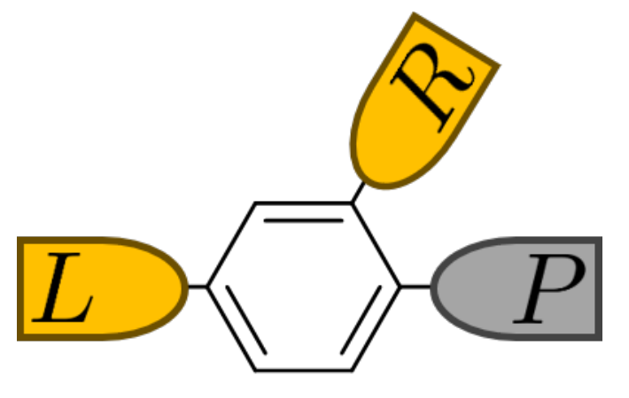

# Büttiker probe method

**Büttiker probe method**는 source와 drain에 연결된 소자에 가상의 전자 저장고를 더하고, 그 저장고의 순전류가 0이 되도록 재주입 분포를 정하는 방법이다. 저장고로 들어간 전자와 돌아오는 전자 사이의 위상 관계를 유지하지 않아 비결맞음 수송을 모사한다. 에너지마다 영전류를 요구하는 **dephasing probe**와, Fermi 분포를 가정하고 에너지 적분 전류만 0으로 만드는 **voltage probe**는 서로 다른 모형이다.[1,2]

[NEGF formalism](negf-formalism.md)의 nonequilibrium Green's function (NEGF) 규약을 사용한다. 정상 상태의 유효 단일입자 전자 수송과 직교 기저를 가정하며, 전자 전하는 $-e$, $e>0$이다. 단자 전류 $I_\alpha$는 **단위 시간당 단자에서 소자로 순주입되는 전자 수에 $+e$를 곱한 값**이다. 따라서 소자 안으로 들어오는 실제 음전하 전류와 부호가 반대이다. 모든 에너지는 공통 영점을 기준으로 재고 $\mu_L-\mu_R=eV$로 바이어스 $V$를 정의한다. 행렬 trace는 spin을 한 번만 세며, 아래 단일 준위 예제는 한 spin이다. 이 글은 전자 전하 수송에 집중한다.[2,3,4]

## 1. 세 단자 기준 모형

### (1) Source, drain과 가상 저장고

왼쪽 source $L$과 오른쪽 drain $R$은 외부에서 지정한 electrochemical potential $\mu_L,\mu_R$를 갖는다. 소자 $D$에 가상 저장고 $P$ 하나를 추가하면 세 단자 문제가 된다. $P$도 전자를 받아들이고 공급할 수 있지만, 세 번째 독립 전원으로 사용하지 않는다. 결합 세기는 입력으로 정하고 분포 또는 chemical potential은 **영전류 조건의 해**로 구한다. 물리 단자와 probe는 접속 유무보다 이 경계 조건에서 차이가 난다.[1,2]

그림 1은 이러한 접속을 분자 소자에서 보여 준다. 두 물리 전극과 하나의 probe가 같은 분자에 연결된다. 그림의 여러 궤도 구조를 유지해야 하는 실제 분자 계산은 아래에서 풀이하는 단일 전자 준위 모형과 구분한다. 단일 준위 예제는 접속과 영전류 조건을 해석하기 위한 최소 모형이다.[1,2,5]

<figure markdown="span">

<figcaption markdown="1">
그림 1. 두 물리 단자 $L,R$과 가상 단자 $P$의 접속 구조. 원도는 benzenedithiol 분자이며 한 준위를 그린 그림이 아니다. 원 논문은 voltage–temperature probe를 사용하지만, 여기서는 **접속 구조만** 가져왔으며 아래의 dephasing·voltage 조건은 별도로 정의한다. 출처: Justin P. Bergfield, “Quantum Interference Supernodes, Thermoelectric Enhancement, and the Role of Dephasing,” *Entropy* **27**, 1000 (2025), Figure 1 위쪽 inset, p. 7, [DOI](https://doi.org/10.3390/e27101000). [CC BY 4.0](https://creativecommons.org/licenses/by/4.0/). 원 PDF에서 inset만 발췌하고 PNG로 변환했으며, 주변 transmission 곡선과 축을 제외했다. 내부 기호·색·접속은 변경하지 않았다.[5]
</figcaption>
</figure>

Probe에 들어오는 흐름과 나가는 흐름은 각각 0일 필요가 없다. 두 흐름이 상쇄되어 **순전류**가 0일 뿐이다. 재주입된 전자의 위상은 들어간 전자의 위상과 상관되지 않으므로, probe를 방문하는 경로와 방문하지 않는 경로를 하나의 coherent 진폭처럼 더하지 않는다. 이 점에서 정적인 결함의 탄성 산란과도 다르다. 정적 결함은 반사를 일으켜도 그 자체로 위상 기억을 지우는 저장고가 아니다.[1,2]

### (2) 단일 전자 준위와 결합 폭

소자를 에너지 $\varepsilon_0$인 한 준위로 줄이고 각 저장고와의 결합 폭을 $\Gamma_L,\Gamma_R,\Gamma_P\geq0$로 나타내자. 세 폭은 에너지 단위이다. Wide-band limit (WBL)에서는 관심 에너지 구간에서 이 폭을 상수로 보고, 일정한 실수 self-energy 이동은 $\varepsilon_0$에 포함한다. 이때 retarded Green's function은 다음과 같다.[2,4,6]

$$
G^R(E)=\frac{1}{E-\varepsilon_0+i\Gamma_{\rm tot}/2},
\qquad
\Gamma_{\rm tot}=\Gamma_L+\Gamma_R+\Gamma_P.
$$

$G^R$의 단위는 에너지의 역수이다. $\Gamma_P$를 더하면 공명의 폭과 높이가 먼저 바뀐다. 그러므로 probe의 효과를 계산할 때는 probe가 없던 transmission을 그대로 두고 재주입 전류만 더해서는 안 된다. 같은 세 단자 $G^R$에서 직접 경로와 probe 경로를 모두 구해야 한다.[2,4,6]

$\Gamma_P=0$이면 [Coherent quantum transport](coherent-quantum-transport.md)의 두 단자 모형으로 돌아간다. 반대로 $\Gamma_P>0$만 정했다고 전류가 완성되지는 않는다. 저장고가 어떤 점유로 전자를 돌려주는지 지정해야 한다. 다음 절은 이 흡수와 재주입을 서로 다른 self-energy 성분으로 표현한다.[1,2,4]

## 2. Probe self-energy와 다단자 전류

### (1) 응답과 재주입의 분리

여러 궤도의 소자 Hamiltonian을 $H_D$, 항등행렬을 $\mathbf1$, 단자 $\alpha$의 retarded self-energy를 $\Sigma_\alpha^R(E)$라 하자. 모든 단자의 결합을 포함한 응답은 다음과 같다.[2,3,4]

$$
G^R(E)=\left[(E+i0^+)\mathbf1-H_D-
\sum_{\alpha\in\{L,R,P\}}\Sigma_\alpha^R(E)\right]^{-1},
\qquad G^A=(G^R)^\dagger.
$$

Probe의 broadening과 유입 self-energy는

$$
\Gamma_P=i(\Sigma_P^R-\Sigma_P^A),\qquad
\Sigma_P^<=if_P\Gamma_P,\qquad
\Sigma_P^{\rm in}=-i\Sigma_P^<=f_P\Gamma_P
$$

로 쓴다. $f_P(E)$는 $0\leq f_P\leq1$인 전자 점유율이고, $\Sigma_P^A=(\Sigma_P^R)^\dagger$이다. Retarded 성분은 전자가 소자에서 빠져나갈 경로와 스펙트럼 변화를 나타내며, lesser 성분은 저장고가 채워 주는 상태를 정한다. $G^n=-iG^<$로 정의하면 이 비상호작용 다단자 문제의 점유는 다음 식으로 계산한다.[2,3,4]

$$
G^n(E)=G^R(E)\left[\sum_\alpha f_\alpha(E)\Gamma_\alpha(E)\right]G^A(E).
$$

이하에서는 모든 관련 상태가 저장고에 연결되어 있고, 별도로 초기 점유를 지정할 bound state가 없는 정상 수송 문제를 다룬다.[3,4]

Probe self-energy는 수동적인 저장고에서 얻는 **인과적인 retarded 응답**이어야 하며 $\Gamma_P$는 양의 준정부호여야 한다. 이는 연결된 상태에서 음의 탈출 확률이 생기지 않게 하는 조건이다. 일반적인 에너지 의존 self-energy의 실수부와 허수부는 인과 관계로 연결되므로 임의로 따로 고를 수 없다. 양의 $\Gamma_P$만 확인했다고 모든 인과 조건까지 검증된 것은 아니다.[3,4]

정규화한 국소 궤도 $|n\rangle$에 붙이는 WBL probe는 가장 간단하게

$$
\Sigma_P^R=-\frac{i\gamma_P}{2}|n\rangle\langle n|,
\qquad \Gamma_P=\gamma_P|n\rangle\langle n|,
\qquad \gamma_P\geq0
$$

로 둔다. $\gamma_P$는 에너지 폭이고, 한 준위에서는 앞의 $\Gamma_P$와 같다. 음의 허수 퍼텐셜만 추가하고 $\Sigma_P^{\rm in}$을 빠뜨리면 빈 흡수원으로 작용한다. 그 계산에서는 일반적으로 $P$로 전자가 순유출된다. 영전류로 정한 재주입을 포함해야 가상 단자가 물리 두 단자의 전하를 빼앗지 않는다.[2,4,6]

### (2) 방향을 구별한 transmission

$T_{\beta\leftarrow\alpha}(E)$는 $\alpha$에서 입사하여 $\beta$로 나가는 총 transmission이다. 여러 채널의 합이므로 일반적으로 한 채널의 확률과 같은 상한 1을 갖는 양은 아니다. Caroli 식은 다음과 같다.[2,3]

$$
T_{\beta\leftarrow\alpha}(E)
=\operatorname{Tr}\!\left[\Gamma_\beta G^R\Gamma_\alpha G^A\right].
$$

행렬에는 명시한 spin 자유도를 포함하고, trace 뒤에 spin 배수를 다시 붙이지 않는다. 한 spin으로 계산한 결과를 서로 독립적이고 축퇴한 두 spin에 적용할 때에만 최종 전류를 두 배로 한다.[3,4,6]

$h$를 Planck 상수로 두고, 에너지별 전류 밀도를 $i_\alpha(E)$, 그 무차원 적분항을 $j_\alpha(E)=h i_\alpha(E)/e$로 정의하자. 방향을 생략하지 않은 전류식은

$$
j_\alpha(E)=\sum_{\beta\ne\alpha}
\left[T_{\beta\leftarrow\alpha}(E)f_\alpha(E)
-T_{\alpha\leftarrow\beta}(E)f_\beta(E)\right],
\qquad
I_\alpha=\frac{e}{h}\int dE\,j_\alpha(E)
$$

이다. 첫 항은 해당 단자가 보내는 전자, 둘째 항은 다른 단자에서 해당 단자로 도착하는 전자이다. $j_\alpha$와 $T$는 무차원이고 $dE/h$가 시간의 역수이므로 $I_\alpha$는 전하/시간 단위이다. 원문의 실제 음전하 유입 전류 규약을 사용하는 경우에는 전체 부호를 뒤집어 이 글의 정의와 비교해야 한다.[2,3,4]

모든 단자를 더하면 각 방향 transmission 항이 한 번씩 상쇄되어 $\sum_\alpha j_\alpha=0$이다. 한편 모든 $f_\alpha=f_0$인 평형에서 **각 단자** 전류가 0이 되려면, 물리적으로 일관된 산란 문제의 유입·유출 합 규칙도 만족해야 한다.[1,3]

$$
\sum_{\beta\ne\alpha}T_{\beta\leftarrow\alpha}
=\sum_{\beta\ne\alpha}T_{\alpha\leftarrow\beta}.
$$

이 합 규칙은 전체 산란행렬의 unitarity에서 나온다. 개별 쌍의 $T_{\beta\leftarrow\alpha}=T_{\alpha\leftarrow\beta}$를 요구하지는 않는다. 자기장 등이 있는 비상호적 문제에서도 방향을 유지해야 하며, 자화나 자기장 등 시간반전 홀수 변수를 모두 반전하는 reciprocity 관계와 같은 조건에서의 단순 대칭을 혼동하지 않는다. 아래 한 준위 모형은 reciprocal하므로 $T_{LP}=T_{PL}$ 같은 축약 표기를 사용할 수 있다.[1,3,6]

## 3. Dephasing probe

### (1) 에너지별 영전류와 비평형 분포

Dephasing probe는 **각 에너지에서** 들어오는 전자 수와 나가는 전자 수를 같게 둔다. 이 조건은 다음과 같다.[1,2,6]

$$
j_P(E)=0\qquad\text{모든 수송 에너지 }E.
$$

일반적인 방향성 transmission에서 probe가 하나이면

$$
f_P(E)=
\frac{T_{P\leftarrow L}f_L+T_{P\leftarrow R}f_R}
{T_{L\leftarrow P}+T_{R\leftarrow P}}
$$

이다. 분모가 양수인 에너지에서만 이 식으로 해를 정한다. 앞의 유입·유출 합 규칙을 사용하면 분모는 분자의 두 가중치 합과 같아진다. 따라서 물리적으로 일관된 수동 저장고 모형에서는 $f_P$가 $f_L,f_R$ 사이에 놓인다. 이 볼록 결합 성질은 점유 범위와 transmission 방향을 검사하는 데 유용하다. 모든 결합 transmission이 0이면 영전류는 자동으로 만족하지만 $f_P$는 미정이다.[1,2,3]

한 준위 WBL 모형에서는 $\alpha\ne\beta$에 대해

$$
T_{\beta\leftarrow\alpha}(E)
=\frac{\Gamma_\alpha\Gamma_\beta}
{(E-\varepsilon_0)^2+(\Gamma_{\rm tot}/2)^2}
$$

이므로 $\Gamma_P>0$, $\Gamma_L+\Gamma_R>0$에서

$$
f_P^{\rm d}(E)=\frac{\Gamma_Lf_L(E)+\Gamma_Rf_R(E)}{\Gamma_L+\Gamma_R}
$$

를 얻는다. 이는 위의 Caroli 식과 영전류 조건을 스칼라 모형에 대입한 결과이다. $\Gamma_P$가 약분된다고 probe의 전류 효과가 사라지는 것은 아니다. $G^R$에는 여전히 $\Gamma_P$가 들어간다.[2,4,6]

영온에서 $\mu_L>\mu_R$이면 $f_P^{\rm d}$는 $E<\mu_R$에서 1, $\mu_R<E<\mu_L$에서 $\Gamma_L/(\Gamma_L+\Gamma_R)$, $E>\mu_L$에서 0인 두 계단 분포이다. 이것은 하나의 floating chemical potential로 표현한 Fermi 함수가 아니다. 위상은 잃지만 다른 에너지 구간으로 전자 수를 옮겨서 영전류를 맞추지는 않는다는 것이 이 조건의 핵심이다.[1,2,6]

### (2) 직접 경로와 재주입 경로

Reciprocal한 세 단자 문제에서 $a=T_{PL}$, $b=T_{PR}$, $c=T_{LR}$라 놓자. $a+b>0$이면 앞의 해를 $j_L$에 넣어

$$
j_L(E)=\left[c(E)+\frac{a(E)b(E)}{a(E)+b(E)}\right]
[f_L(E)-f_R(E)]
$$

를 얻는다. 첫째 항은 $L\to R$로 직접 전달되는 부분이고, 둘째 항은 probe를 경유한 재주입의 기여이다. 서로 위상이 정해진 두 진폭의 합이 아니라 영전류 조건을 제거한 확률 흐름의 합이다. $a,b,c$는 모두 **probe가 포함된 같은 $G^R$**에서 구해야 한다.[1,2,4,6]

한 준위에 이를 적용하면 유효 transmission은

$$
T_{\rm eff}^{\rm d}(E)=
\frac{\Gamma_L\Gamma_R}{(E-\varepsilon_0)^2+(\Gamma_{\rm tot}/2)^2}
\frac{\Gamma_{\rm tot}}{\Gamma_L+\Gamma_R}
$$

이다. 이 식에서 공명 중심의 높이는 $4\Gamma_L\Gamma_R/[(\Gamma_L+\Gamma_R)\Gamma_{\rm tot}]$이므로 $\Gamma_P$가 증가할수록 낮아진다. 반면 공명 밖에서는 넓어진 꼬리가 영향을 줄 수 있다. 따라서 재주입항이 양수라는 사실만으로 주어진 바이어스 구간의 적분 전류가 항상 증가한다고 말할 수 없다. 이 높이 비교는 위 단일 준위 식의 직접적인 귀결이며, 다궤도 간섭 구조의 보편 법칙으로 확장하지 않는다.[2,4,6]

## 4. Voltage probe

### (1) Floating chemical potential

Voltage probe는 정해진 온도 $T_0$에서 내부 전자가 열평형에 도달한다고 가정한다. Boltzmann 상수를 $k_B$라 하면 분포는

$$
f_P^{\rm v}(E;\mu_P)=\left[1+\exp\left(\frac{E-\mu_P}{k_BT_0}\right)\right]^{-1}
$$

이고, 미지수 $\mu_P$를 다음 조건으로 정한다.[1,2]

$$
I_P(\mu_P)=\frac{e}{h}\int dE\,j_P(E;\mu_P)=0.
$$

여기서 floating은 전위를 임의로 지정한다는 뜻이 아니라 순충전이 없는 정상 상태의 값을 찾는다는 뜻이다. 온도까지 이 식 하나로 정할 수는 없다. 이 글에서는 모든 저장고의 온도를 같은 지정값 $T_0$로 유지하고 $\mu_P$만 푼다.[1,2,6]

한 준위에서는 식이

$$
\int dE\,\frac{\Gamma_P}
{(E-\varepsilon_0)^2+(\Gamma_{\rm tot}/2)^2}
\left[(\Gamma_L+\Gamma_R)f_P^{\rm v}
-\Gamma_Lf_L-\Gamma_Rf_R\right]=0
$$

으로 줄어든다. Dephasing 분포와 달리 각 에너지의 대괄호가 0일 필요가 없다. 낮은 에너지에서 내보낸 전자와 높은 에너지에서 받아들인 전자의 수가 적분 후 상쇄될 수 있다. 따라서 영전류는 전자 교환이 없거나 전자 에너지가 보존된다는 뜻이 아니다. Voltage probe는 위상 소실과 함께 에너지 재분배를 허용하지만, 어떤 포논 모드가 그 재분배를 일으켰는지는 지정하지 않는다.[1,2,4]

### (2) 해의 범위와 선형 응답

Transmission을 고정하고, 모든 저장고의 온도가 같고 $T_0>0$이며 $\mu_L>\mu_R$라고 하자. 위 전류식에서 $\mu_P=\mu_R$이면 $I_P\leq0$, $\mu_P=\mu_L$이면 $I_P\geq0$이다. 또한

$$
\frac{\partial I_P}{\partial\mu_P}
=\frac{e}{h}\int dE\,
[T_{L\leftarrow P}+T_{R\leftarrow P}]
\frac{f_P^{\rm v}(1-f_P^{\rm v})}{k_BT_0}
$$

이므로, 유한한 결합이 있는 구간에서는 단조 증가한다. 이 성질은 앞의 전류식과 Fermi 함수로부터 직접 얻으며, 연결된 한 probe의 해를 $[\mu_R,\mu_L]$에서 이분법으로 찾는 근거가 된다. 완전히 단절된 probe, 영온의 결합 없는 구간, 또는 $\mu_P$에 따라 Hamiltonian까지 바뀌는 문제에 이 유일성 결론을 그대로 적용하지 않는다.[1,2,6]

평형 $\mu_0,T_0$ 주변의 작은 바이어스에서 reciprocal transmission을 가정하면, $f_0(E)$를 평형 Fermi 함수로 두고

$$
g_{P\alpha}=\frac{e^2}{h}\int dE\,
\left(-\frac{\partial f_0}{\partial E}\right)T_{P\alpha}(E),
\qquad \delta\mu_\alpha=eV_\alpha
$$

를 정의한다. $g_{P\alpha}$는 conductance 단위이고, 영전류의 선형화는

$$
V_P=\frac{g_{PL}V_L+g_{PR}V_R}{g_{PL}+g_{PR}}
$$

를 준다. 이 가중치는 에너지를 적분한 conductance이다. 일반적인 에너지 의존 결합에서는 dephasing의 에너지별 가중 평균과 같은 연산이 아니다. 에너지별 probe 제거 후 적분과 적분 후 probe 제거는 보통 교환되지 않는다. 좁은 Fermi 구간에서 transmission을 거의 상수로 볼 수 있는 경우에는 두 결과가 가까워진다.[1,2,6]

## 5. 여러 probe의 해와 수치 조건

### (1) 선형계와 비선형계

Probe 집합을 $\mathcal P$라 하자. 모든 probe가 부착된 $G^R$로 transmission을 구한 뒤 dephasing 분포는 에너지마다 다음 선형계를 만족한다. 행렬 $A$와 벡터 $b$는 무차원이다.[2,3,6]

$$
\begin{aligned}
A_{pp}&=\sum_{\beta\ne p}T_{\beta\leftarrow p},\\
A_{pq}&=-T_{p\leftarrow q}\quad(p\ne q,\ p,q\in\mathcal P),\\
b_p&=\sum_{\alpha\in\{L,R\}}T_{p\leftarrow\alpha}f_\alpha,
\qquad A\mathbf f_{\mathcal P}=\mathbf b.
\end{aligned}
$$

대각항은 probe가 내보내는 transmission의 합이고, 비대각항은 다른 probe에서 들어오는 transmission이다. 이 방향을 섞으면 reciprocal 예제에서는 드러나지 않던 오류가 자기장 문제에서 나타날 수 있다. 수치 구현에서는 역행렬을 명시적으로 만들기보다 선형계를 푼다. Voltage probe에서는 각 $f_p$를 Fermi 함수로 제한하고 모든 $I_p(\{\mu_q\})=0$을 동시에 푸는 비선형 문제가 된다.[2,3,6]

Hamiltonian을 고정한 계산에서 retarded probe self-energy도 점유에 의존하지 않도록 정했다면 $G^R$와 transmission을 먼저 계산해 재사용할 수 있다. 그러나 전하가 전위를 바꾸는 자기일관 계산에서는 새 Hamiltonian의 transmission으로 probe 조건도 다시 풀어야 한다. 이전 전위에서 얻은 영전류 해가 새 전위에서도 영전류라는 보장은 없다. 이는 probe 조건과 NEGF 전하 계산을 함께 만족시켜야 한다는 구현상의 귀결이다.[2,3,4]

### (2) 연결성과 선형 응답의 probe 변수 소거

Reciprocal transmission에서 양의 단자 간 계수를 그래프의 연결로 해석하자. 각 probe 연결 성분이 전압을 지정한 물리 단자 중 적어도 하나와 이어져야 분포나 전압의 공통 미정값을 제거할 수 있다. Probe끼리만 연결된 성분에는 모든 점유 또는 선형 응답 전압에 같은 값을 더해도 영전류가 유지되는 nullspace가 있다. 이는 앞의 행렬식에서 직접 확인된다. 기준 전압 하나를 정했다는 이유만으로 모든 분리된 probe 성분이 해결되지는 않는다.[3,6]

선형 응답에서는 $I_\alpha=\sum_\beta K_{\alpha\beta}V_\beta$로 쓰고, reciprocal한 경우 $K_{\alpha\alpha}=\sum_{\beta\ne\alpha}g_{\alpha\beta}$, $K_{\alpha\beta}=-g_{\alpha\beta}$로 둔다. 물리 단자 집합을 $B=\{L,R\}$라 하면

$$
\begin{pmatrix}\mathbf I_B\\\mathbf0\end{pmatrix}
=
\begin{pmatrix}K_{BB}&K_{B\mathcal P}\\
K_{\mathcal PB}&K_{\mathcal P\mathcal P}\end{pmatrix}
\begin{pmatrix}\mathbf V_B\\\mathbf V_{\mathcal P}\end{pmatrix}.
$$

연결성을 확인한 가역 부분에서 probe 변수를 제거하면

$$
\begin{aligned}
\mathbf V_{\mathcal P}&=-K_{\mathcal P\mathcal P}^{-1}K_{\mathcal PB}\mathbf V_B,\\
K_{\rm eff}&=K_{BB}-K_{B\mathcal P}K_{\mathcal P\mathcal P}^{-1}K_{\mathcal PB}
\end{aligned}
$$

라는 Schur complement를 얻는다. 이 식은 위 블록 선형계의 대수적 소거이다. 단순히 probe 행과 열을 삭제하면 재주입 경로를 잃는다. 모든 전압에 같은 상수를 더해도 전류가 바뀌지 않는 성질과 전체 전류 합이 0인 성질도 소거 후 유지되는지 확인할 수 있다.[3,6]

매우 약하게 연결된 probe에서는 작은 전류 잔차가 정확한 probe 전압을 뜻하지 않을 수 있다. 전압을 크게 바꾸어도 작은 결합 때문에 전류가 거의 변하지 않기 때문이다. 이때는 선형계 조건수, 연결 강도와 물리 단자 전류의 민감도를 함께 확인한다. 완전히 단절된 probe에는 임의의 수를 채워 넣고 측정 가능한 국소 전압이라고 해석하지 않는다. Dephasing 분포가 $[0,1]$을 벗어나면 먼저 방향·연결·조건수를 확인하며, 단순 clipping으로 영전류 식을 깨뜨리지 않도록 한다. 이 점검은 앞의 nullspace와 볼록 결합 성질을 수치 해에 적용한 것이다.[2,3,6]

## 6. 단일 준위의 실행 예제

### (1) 같은 총전류와 다른 에너지별 흐름

다음 모형 입력은 실험값이 아니라 영전류 조건을 검증하기 위한 예시이다. $\varepsilon_0=0.05$ eV, $(\Gamma_L,\Gamma_R,\Gamma_P)=(0.06,0.04,0.03)$ eV, $\mu_L=0.10$ eV, $\mu_R=-0.10$ eV, $k_BT_0=0.025$ eV로 둔다. 모든 에너지에서 상수인 결합과 하나의 준위만 사용하므로 $T_{LP}/T_{RP}=\Gamma_L/\Gamma_R$이다.

이 특수한 비례 결합에서는 두 probe의 **적분 전류가 정확히 같을 수 있다**. 이를 확인하려고 $\Delta f_P=f_P^{\rm v}-f_P^{\rm d}$, $D(E)=(E-\varepsilon_0)^2+(\Gamma_{\rm tot}/2)^2$라 놓으면, 두 영전류 조건의 차이로부터

$$
0=\int dE\,\frac{\Gamma_P(\Gamma_L+\Gamma_R)}{D(E)}\Delta f_P(E)
$$

를 얻는다. 두 왼쪽 전류의 차이는

$$
I_L^{\rm v}-I_L^{\rm d}
=-\frac{e}{h}\int dE\,\frac{\Gamma_L\Gamma_P}{D(E)}\Delta f_P(E)=0
$$

이다. 마지막 등호는 두 적분의 가중치 비가 상수이기 때문에 성립한다. 위의 인용된 전류식과 probe 조건에서 직접 유도한 결과이며, 일반적인 다궤도 또는 에너지 의존 결합으로 확장할 수 없다. 같은 총전류만으로 두 분포가 같거나 두 모형이 물리적으로 동등하다고 판단해서는 안 된다.[1,2,6]

### (2) NumPy 계산과 잔차

아래 코드는 같은 transmission으로 두 조건을 풀고 $I_L+I_R+I_P$, $I_P$, $j_P(E)$를 따로 검사한다. eV로 적분하므로 SI 전류로 바꾸는 계수는 $e^2/h$이다. 하나의 $e$는 단위 시간당 순주입되는 전자 수를 전류로 변환하는 계수이고, 다른 하나는 eV에서 joule로의 변환이다. 배열의 $j$는 위에서 정의한 무차원 적분항이다. `GammaP=0` 검사에서는 미정인 probe 분포를 풀지 않고 물리 두 단자의 coherent 전류를 따로 계산한다.[2,3,4]

```python
import numpy as np


def solve(n=20001, cutoff=2.0):
    E = np.linspace(-cutoff, cutoff, n)  # eV
    eps, GL, GR, GP, kT = 0.05, 0.06, 0.04, 0.03, 0.025
    muL, muR = 0.10, -0.10
    f = lambda mu: 1 / (1 + np.exp(np.clip((E - mu) / kT, -700, 700)))
    integ = lambda x: np.trapz(x, E, axis=-1)
    D = (E - eps)**2 + ((GL + GR + GP) / 2)**2
    TLR, TLP, TRP = GL * GR / D, GL * GP / D, GR * GP / D
    fL, fR = f(muL), f(muR)

    def spectral(fp, fl=fL, fr=fR):
        jL = TLR * (fl - fr) + TLP * (fl - fp)
        jR = TLR * (fr - fl) + TRP * (fr - fp)
        jp = TLP * (fp - fl) + TRP * (fp - fr)
        return np.array([jL, jR, jp])

    fd = (GL * fL + GR * fR) / (GL + GR)
    jd = spectral(fd)
    lo, hi = muR, muL
    for _ in range(80):
        mid = (lo + hi) / 2
        if integ(spectral(f(mid))[2]) > 0:
            hi = mid
        else:
            lo = mid
    mup = (lo + hi) / 2
    jv = spectral(f(mup))
    e, h = 1.602176634e-19, 6.62607015e-34
    Id, Iv = e**2 / h * integ(jd), e**2 / h * integ(jv)

    assert np.max(np.abs(jd.sum(axis=0))) < 1e-14
    assert np.max(np.abs(jv.sum(axis=0))) < 1e-14
    assert np.max(np.abs(jd[2])) < 1e-14
    assert abs(Iv[2]) < 1e-18
    assert np.max(np.abs(Id - Iv)) < 1e-18  # proportional couplings only
    assert np.max(np.abs(spectral(f(0), f(0), f(0)))) == 0
    assert np.all((fd >= 0) & (fd <= 1))

    D0 = (E - eps)**2 + ((GL + GR) / 2)**2
    I0 = e**2 / h * integ(GL * GR / D0 * (fL - fR))
    gp_small = 1e-8
    Ds = (E - eps)**2 + ((GL + GR + gp_small) / 2)**2
    Teff = GL * GR / Ds * (GL + GR + gp_small) / (GL + GR)
    Is = e**2 / h * integ(Teff * (fL - fR))
    assert abs(Is - I0) / abs(I0) < 1e-6
    print(n, cutoff, 'muP(eV)=', mup)
    print('Id(A)=', Id, 'Iv(A)=', Iv, 'I0(A)=', I0)
    print('max|jp| d/v=', np.max(np.abs(jd[2])), np.max(np.abs(jv[2])))
    return Id[0], Iv[0]


coarse = np.array(solve())
fine = np.array(solve(40001))
wide = np.array(solve(80001, 4.0))
print('grid relative change=', np.max(np.abs(fine - coarse) / np.abs(fine)))
print('window relative change=', np.max(np.abs(wide - fine) / np.abs(wide)))
```

이 입력의 실행 결과는 $\mu_P=0.04003157148$ eV, 두 모형 모두 $I_L=3.12760052\times10^{-6}$ A, $I_R=-I_L$이다. $|I_P|$는 두 경우 모두 $3\times10^{-22}$ A보다 작다. 그러나 $\max_E|j_P^{\rm d}|\simeq1.1\times10^{-16}$인 데 비해 $\max_E|j_P^{\rm v}|\simeq0.14976$이다. Dephasing 조건은 에너지별로 만족하고, voltage 조건은 에너지 적분을 해야 만족한다. 숫자는 위 입력과 이산 적분의 결과이며 재료의 산란율 예측값이 아니다.

$[-2,2]$ eV에서 점 수를 20,001개에서 40,001개로 늘리고, 같은 간격으로 구간을 $[-4,4]$ eV까지 넓혀 전류를 다시 비교한다. 이 매끈한 WBL 예제에서는 상대 변화가 부동소수점 정밀도 수준이지만, 좁은 공명이나 transmission 영점이 있는 실제 문제에서는 동일한 격자가 충분하다고 가정할 수 없다. Probe 전류의 적분 잔차만 보지 말고 다음처럼 조건마다 검사를 구분한다.[2,3,6]

| 검사 | 확인할 양 | 해석 |
|---|---|---|
| 전체 보존 | $I_L+I_R+\sum_p I_p$ | 단자 누락·전류 방향·적분의 일관성 |
| Dephasing 조건 | 모든 에너지의 $j_p(E)$ | 에너지별 선형계의 해 정확도 |
| Voltage 조건 | 각 probe의 $I_p$ | chemical potential 해의 정확도 |
| 평형 | 공통 $\mu_0,T_0$에서 모든 단자 전류 | 분포·합 규칙·부호의 일관성 |
| Coherent 극한 | $\Gamma_P\to0$의 물리 전류 | 원래 두 단자 계산으로의 복귀 |
| 적분 수렴 | 격자 간격과 적분 구간을 각각 변경한 전류 | 공명 해상도와 누락된 꼬리의 영향 |

## 7. 미시적 산란 이론과 적용 한계

### (1) 입력과 물리적 가정

Probe는 환경을 실제로 이루는 원자 변위나 포논 모드를 계산하는 대신, 저장고 결합과 분포 조건으로 그 효과를 나타낸다. [Electron–phonon coupling](electron-phonon-coupling.md)의 electron–phonon coupling (EPC)은 모드별 에너지 $\hbar\omega_\lambda$, 전자–포논 결합 행렬 $M^\lambda$, 포논 점유를 입력으로 사용한다. 이 차이 때문에 임의의 $\Gamma_P$를 특정 모드의 EPC와 정확히 같은 양으로 해석할 수 없다.[1,4,7]

Self-consistent Born approximation (SCBA)에서는 선택한 산란 self-energy에 같은 dressed Green's function을 넣고 반복하여 일관된 해를 구한다. 예를 들어 한 모드의 lesser·greater 산란 성분은 $E\pm\hbar\omega_\lambda$에 있는 전자 점유와 빈 상태를 연결한다. Probe의 $f_P(E)\Gamma_P(E)$는 지정한 저장고 분포에 따른 유입이며, 이 모드별 흡수·방출 커널을 자동으로 재현하지 않는다. 자세한 에너지 이동과 보존식은 [Inelastic electron transport](inelastic-electron-transport.md)에 정리되어 있다.[4,7]

| 항목 | Dephasing probe | Voltage probe | 미시적 EPC와 SCBA |
|---|---|---|---|
| 환경 입력 | Probe 위치와 $\Gamma_p$ | Probe 위치, $\Gamma_p$, 지정 온도 | $M^\lambda$, $\omega_\lambda$, 포논 점유와 전자 모형 |
| 결정할 변수 | 각 에너지의 $f_p(E)$ | 각 probe의 $\mu_p$ | 산란 self-energy와 dressed $G$ |
| 전자 수 조건 | 에너지별 순교환 0 | 적분 순교환 0 | 일관된 충돌 적분의 전자 수 보존 |
| 에너지 처리 | 에너지 구간 사이 재분배 없음 | Fermi 재주입에 의한 재분배 허용 | 모드 에너지에 따른 흡수·방출 |
| 해석 범위 | 현상론적 위상 소실 | 현상론적 위상 소실·완화 | 선택한 미시적 Hamiltonian과 근사 범위 |

표의 비교는 각 방법의 정의에 따른 것이며, SCBA가 모든 결합 세기에서 정확하다는 뜻은 아니다. SCBA 역시 선택한 diagram과 상호작용 모형의 근사이다. 반대로 probe가 간단하다는 이유만으로 의미가 없는 것은 아니다. 환경이 간섭과 전자 전류에 미치는 민감도를 탐색하거나, 독립적인 관측량으로 정한 유효 산란 강도를 적용하는 데 쓸 수 있다. 다만 보정한 바이어스·온도·에너지 구간 밖에서도 같은 결합 폭이 유효한지는 별도로 검증해야 한다.[1,2,4,7]

### (2) 계산 비용과 해석의 경계

고정된 $H_D,\Sigma_p^R$의 probe 계산에서는 각 에너지의 전파 문제를 한 번 구한 뒤, dephasing 선형계 또는 voltage 영전류 반복을 푼다. SCBA는 산란 self-energy가 $G$에 의존하므로 전파와 점유를 반복 갱신하며, 이동 에너지의 배열과 모드별 행렬 곱도 필요하다. 따라서 probe에서는 이러한 미시적 에너지 결합의 계산을 저장고 경계 조건으로 대체한다. 이는 수식 구조에 따른 비용 차이이며 보편적인 몇 배의 속도 향상을 뜻하지 않는다. Probe 수가 많거나 전하–전위를 함께 반복하면 그 비용도 커진다.[2,4,6,7]

Probe 결합의 크기뿐 아니라 **어디에, 어떤 상태에** 결합했는지가 결과를 바꾼다. 국소 궤도의 probe는 그 상태로부터 전자를 받아 다른 위상으로 돌려주므로, 위상 소실만을 나타내는 하나의 보편적 길이로 모든 배치를 환산할 수 없다. 특정한 운동량 보존이나 산란 선택 규칙이 필요하면 결합 행렬과 재주입 모형이 그 조건을 구현하는지 확인해야 한다. 단순한 국소 probe를 붙인 결과에 미시적 선택 규칙을 사후에 부여하지 않는다.[1,2,4]

또한 probe 결합을 바꾸면 직접 transmission도 바뀐다. 앞의 단일 준위에서 보았듯 공명의 높이와 폭은 함께 변하고, 분자처럼 여러 경로가 있으면 간섭 변화도 더해진다. 따라서 전류가 증가했다는 사실은 dephasing이 언제나 전도를 돕는다는 증거가 아니며, 감소했다고 항상 특정 포논 산란율을 측정한 것도 아니다. 비교할 때는 동일한 전자 Hamiltonian, 물리 전극 결합, 바이어스와 probe 조건을 먼저 고정해야 한다.[1,2,6]

## 8. 요약

- Büttiker probe는 source·drain 소자에 가상 저장고를 더하고 흡수와 비결맞은 재주입을 함께 계산한다. 순전류 0은 전자 교환 자체가 없다는 뜻이 아니다.
- Retarded probe self-energy는 전파와 선폭을 바꾸고 lesser self-energy는 재주입 점유를 정한다. Imaginary potential만 넣는 흡수 계산은 영전류 probe와 다르다.
- Dephasing probe는 $j_P(E)=0$에서 일반적으로 비Fermi 분포를 구한다. Voltage probe는 지정 온도의 Fermi 분포를 가정하고 $I_P=0$에서 floating $\mu_P$를 구한다.
- 방향성 transmission, 단자 전체의 보존, probe별 제약, 분리된 연결 성분과 적분 수렴을 함께 확인해야 한다.
- 한 준위의 비례 결합에서는 두 모형의 총전류가 같아도 에너지별 흐름이 다르다. 총전류 일치만으로 물리적 동등성을 판단하지 않는다.
- Probe의 결합과 경계 조건은 미시적 EPC·SCBA를 자동으로 대체하는 물리 입력이 아니다. 사용한 환경 가정과 보정 범위 안에서 전자 수송 결과를 해석한다.

## 9. 참고문헌

1. H. Förster, P. Samuelsson, S. Pilgram, and M. Büttiker, “Voltage and dephasing probes in mesoscopic conductors: A study of full-counting statistics,” *Physical Review B* **75**, 035340 (2007). [DOI](https://doi.org/10.1103/PhysRevB.75.035340), [author manuscript](https://arxiv.org/abs/cond-mat/0609544). 원고 제목: “Voltage and dephasing probes: a full counting statistics discussion.” Sec. II: 저장고의 위상 소실, Fermi·비평형 분포와 영전류 조건.
2. M. Kilgour and D. Segal, “Inelastic effects in molecular transport junctions: The probe technique at high bias,” *The Journal of Chemical Physics* **144**, 124107 (2016). [DOI](https://doi.org/10.1063/1.4944470), [author manuscript](https://arxiv.org/abs/1601.00001). Sec. II, Eqs. (7)–(14): 결합 폭, 전류, 두 probe 조건과 비선형 해.
3. X. Waintal et al., “Computational quantum transport: a scattering approach perspective,” arXiv:2407.16257v3 (2026). [원문](https://arxiv.org/html/2407.16257v3). Secs. 5.3–5.4: self-energy와 $\Gamma$; Sec. 7.2.1: 다단자 전류와 합 규칙; Secs. 8.2–8.3: lesser 성분과 Caroli 식. 실제 음전하 유입 전류의 부호는 이 글의 순전자 주입 규약으로 변환한다.
4. S. Datta, “Electrical Resistance: An Atomistic View,” *Nanotechnology* **15**, S433–S451 (2004). [DOI](https://doi.org/10.1088/0957-4484/15/7/051), [author manuscript](https://arxiv.org/abs/cond-mat/0408319). Secs. 7.4–8, Eqs. (7.18)–(7.22): 가상 산란 단자, 유입·유출과 microscopic SCBA.
5. J. P. Bergfield, “Quantum Interference Supernodes, Thermoelectric Enhancement, and the Role of Dephasing,” *Entropy* **27**, 1000 (2025). [DOI](https://doi.org/10.3390/e27101000). Figure 1 위쪽 inset의 세 단자 접속 그림만 사용한다.
6. M. Kilgour and D. Segal, “Charge transport in molecular junctions: From tunneling to hopping with the probe technique,” *The Journal of Chemical Physics* **143**, 024111 (2015). [DOI](https://doi.org/10.1063/1.4926395), [author manuscript](https://arxiv.org/abs/1505.00645). Sec. II, Eqs. (7)–(16): probe 선형계와 선형 응답.
7. T. Frederiksen, M. Paulsson, M. Brandbyge, and A.-P. Jauho, “Inelastic transport theory from first principles: Methodology and application to nanoscale devices,” *Physical Review B* **75**, 205413 (2007). [DOI](https://doi.org/10.1103/PhysRevB.75.205413), [author manuscript](https://arxiv.org/abs/cond-mat/0611562). Sec. III.D, Eqs. (38)–(41), Appendix B: microscopic self-energy, 자기일관 해와 에너지 격자의 결합.
