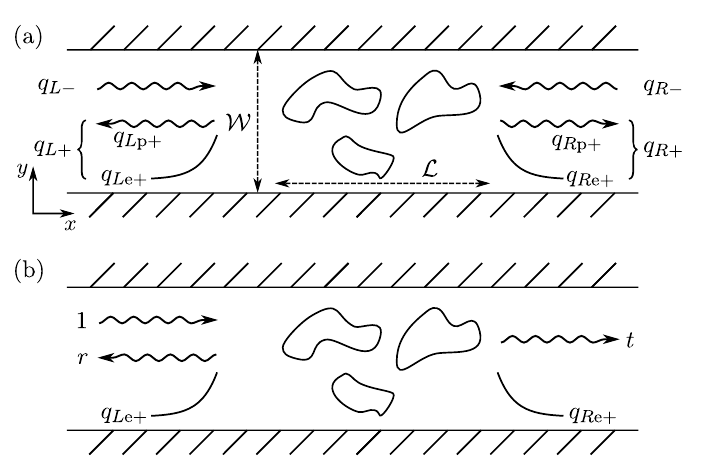

# Coherent quantum transport

Coherent quantum transport는 소자를 통과하는 전자 파동의 상대 위상을 유지하면서 입사·반사·투과를 계산하는 수송 모형이다. 전류를 계산하려면 전자 파동의 투과 확률뿐 아니라 각 전극이 에너지별로 얼마나 많은 전자를 주입하는지도 알아야 한다. 이 글은 정상 상태의 탄성 산란과 유효 단일입자 Hamiltonian을 가정하고, 두 reservoir의 점유 차이와 transmission을 결합하는 Landauer 관점을 설명한다.[1–3]

Density functional theory (DFT)의 고립계 고유값 문제와 달리 열린 소자의 수송 문제에서는, **주어진 에너지로 전극에서 입사한 전자 상태가 소자에서 어떻게 산란되고 어느 전극으로 나가는지**를 구해야 한다. 단일 준위와 일차원 사슬을 기준 모형으로 삼아 이 관점의 전환을 설명한다. Ballistic·diffusive 분류와 phase coherence의 차이는 [Electronic transport regimes](transport-regimes.md)를 따르며, 여기서는 길이 척도의 분류를 반복하지 않는다.[1–3]

## 1. 두 전극에 연결된 열린 계

### (1) Reservoir, lead와 산란 영역

Two-probe 모형은 왼쪽 reservoir, 왼쪽 lead, 유한한 산란 영역, 오른쪽 lead, 오른쪽 reservoir를 연결한다. **Reservoir**는 매우 많은 자유도를 가진 열평형 전자 공급원으로, 들어온 전자를 흡수하고 주어진 분포에 따라 새로운 입사 상태를 공급한다. **Lead**는 reservoir와 산란 영역을 연결하는 이상적인 전파 구간이다. 계산에서는 lead의 주기성을 이용해 입사·출사 mode를 정의하고, 멀리 있는 reservoir의 역할은 입사 mode의 점유로 반영한다.[1–3]

산란 영역에는 분자, 결함, 장벽, 계면과 필요한 전극 표면 원자가 들어갈 수 있다. 영역의 경계는 물질의 고유 경계라기보다 계산을 위한 분할이다. 경계 밖에서 lead의 반복 구조가 성립해야 하므로 접촉에 의한 국소 변화까지 모두 벌크 전극으로 취급하면 실제 계면의 특성을 반영할 수 없다. 동일한 전체 Hamiltonian을 표현하는 한, 중앙 영역에 이상적인 lead 셀을 더 포함하는 것은 새로운 물리적 저항을 추가하는 조작이 아니다.[1,2,4]

다음 그림에서는 일반적인 파동의 분해와 왼쪽에서 한 mode만 입사시키는 산란 문제를 비교한다. 중앙의 닫힌 곡선들은 산란 퍼텐셜을 상징하며 전자의 고전적 궤적이 아니다.[1]

<figure markdown="span">
  
  <figcaption markdown="1">
  그림 1. (a) 양쪽 lead의 일반적인 mode 분해와 (b) 왼쪽 단일 입사 상태의 산란. $W$는 폭, $\mathcal L$은 산란 영역 길이이다. 원그림의 $q_{L/R,-}$는 영역으로 들어오는 진폭, $q_{L/R,+}$는 나가는 성분이며 $p$와 $e$는 각각 propagating·evanescent 성분이다. 출처: X. Waintal et al., “Computational quantum transport: a scattering approach perspective,” arXiv:2407.16257v3, Fig. 1, p. 8, [CC BY 4.0](https://creativecommons.org/licenses/by/4.0/). PDF에서 그림 영역만 잘라 PNG로 변환했으며 레이블과 내용을 바꾸지 않았다.[1]
  </figcaption>
</figure>

그림 1(b)에 나타낸 파동은 특정 입사 상태 하나에 대해 계산한 산란 응답이다. 실제 전류에는 왼쪽에서 오는 모든 점유 상태와 오른쪽에서 오는 모든 점유 상태가 함께 기여한다. 서로 독립적인 reservoir에서 주입되는 전자 상태 사이에는 일정한 상대 위상이 정의되지 않는다. 따라서 양쪽 reservoir에서 들어오는 파동을 하나의 순수 상태로 간주하여 진폭을 먼저 더한 뒤 전류를 계산해서는 안 된다. 각 입사 상태 안에서의 간섭을 먼저 계산하고, 그 결과를 reservoir 점유로 가중한다.[1–3]

### (2) 전기화학 퍼텐셜과 전류 부호

전극 $\alpha=L,R$의 전기화학 퍼텐셜을 $\mu_\alpha$, 온도를 $\Theta_\alpha$, Boltzmann 상수를 $k_B$라 한다. 에너지 $E$는 두 전극에 공통인 기준에서 측정한다. Reservoir가 공급하는 Fermi–Dirac 분포는

$$
f_\alpha(E)=\frac{1}{\exp[(E-\mu_\alpha)/(k_B\Theta_\alpha)]+1}
$$

이다. $\mu_\alpha$에는 화학적 기여와 전기적 퍼텐셜에 따른 에너지 이동을 함께 포함한다. 따라서 식의 지수에 전기적 이동을 다시 더하지 않는다. 전기화학 퍼텐셜은 점유를 정하는 양이고, 공간에 따른 전기 퍼텐셜은 Hamiltonian의 장벽과 밴드 정렬에도 영향을 준다. 두 역할을 모두 다루어야 유한 바이어스 문제를 정의할 수 있다.[1–3]

이 글에서 $e>0$는 기본 전하의 크기이고, 전압 변수는 다음처럼 정의한다.

$$
\begin{aligned}
V&=\frac{\mu_L-\mu_R}{e},\\
\mu_L&=E_F+\frac{eV}{2},\\
\mu_R&=E_F-\frac{eV}{2}.
\end{aligned}
$$

$E_F$는 평형 전기화학 퍼텐셜이다. 위 식의 대칭 분할은 에너지 기준을 정하는 편리한 선택이며, 소자 내부 전기 퍼텐셜도 선형·대칭으로 분포한다는 가정은 아니다. $I_L$은 **왼쪽 reservoir가 소자로 단위 시간당 순주입하는 전자 수에 $e$를 곱한 값**으로 정의한다. $\mu_L>\mu_R$이면 보통 $I_L>0$이다. 전자의 실제 전하는 $-e$이므로, 같은 왼쪽→오른쪽 방향을 기준으로 한 전하 흐름의 부호와는 반대이다.[1–3]

이후 mode 합과 trace에는 spin 상태를 명시적으로 포함한다. 따라서 일반 전류식 앞에 추가적인 2를 붙이지 않는다. Spin이 섞이지 않고 두 spin이 완전히 축퇴한 경우에만 한 spin의 결과를 계산한 뒤 두 배 할 수 있다. 아래 기준 모형의 $\mathcal T(E)$는 **한 spin의 단일 channel** transmission이고, 전체 $T(E)$와 구분한다.[1,2]

## 2. 산란 상태와 flux 정규화

### (1) 입사파와 출사파

에너지 $E$에서 lead의 전파 가능한 해를 **propagating mode**라 한다. 횡방향 구속이 있는 lead에서는 같은 에너지에 여러 mode가 존재하며 각각 하나의 전류 channel이 된다. 영역으로 들어가는 해를 입사 mode, 멀어지는 해를 출사 mode로 구분한다. 공간적으로 감쇠하는 **evanescent mode**도 계면의 파동함수 연결에는 필요하지만, 무한히 먼 lead로 전류를 운반하는 독립 channel은 아니다.[1,5]

먼저 양쪽에 propagating mode가 하나씩 있는 경우를 생각하자. 수송 좌표 $x$는 왼쪽에서 오른쪽으로 증가하도록 잡는다. 왼쪽 입사 상태의 점근형은

$$
\psi_L(x)=e^{ik_Lx}+\widetilde r\,e^{-ik_Lx},\qquad
\psi_R(x)=\widetilde t\,e^{ik_Rx}
$$

이다. $k_L,k_R>0$는 오른쪽 진행파의 파수이고, $\widetilde r,\widetilde t$는 같은 밀도 정규화를 적용한 파동 진폭이다. 이 간단한 표현은 멀리 떨어진 lead에서의 형태이며, 경계 근처에서는 감쇠 성분과 횡방향 mode 함수를 함께 포함해야 한다. 산란 영역에서 Schrödinger 방정식을 풀고 경계를 연결하면 반사와 투과 진폭을 얻는다.[1,5]

확률 밀도와 확률 flux는 다르다. 포물선 분산의 유효질량 $m^*$에 대한 일차원 확률 flux는

$$
j=\frac{\hbar}{m^*}\operatorname{Im}(\psi^*\partial_x\psi),
\qquad j[Ae^{ikx}]=v|A|^2,\qquad v=\frac{\hbar k}{m^*}
$$

이다. $\hbar=h/(2\pi)$이고 $h$는 Planck 상수이다. 일반적인 밴드에서는 group velocity $v=\hbar^{-1}\partial E/\partial k$를 사용한다. 파동 진폭이 같더라도 group velocity가 큰 상태는 단위 시간에 더 많은 확률 flux를 운반한다. 따라서 양쪽 속도가 다르면 투과 확률을 진폭 제곱만으로 구할 수 없다.[1,5]

입사·투과 속도의 크기를 각각 $v_L,v_R$라 하면 위 식으로부터

$$
\mathcal T=\frac{j_{\mathrm{trans}}}{j_{\mathrm{in}}}
=\frac{v_R}{v_L}|\widetilde t|^2,\qquad
\mathcal R=|\widetilde r|^2
$$

를 얻는다. 이는 확률 flux 비의 정의를 앞 식에 대입한 결과이다. 한편 각 mode를 $1/\sqrt{|v|}$로 정규화하면, 새 투과 진폭 $t=\sqrt{v_R/v_L}\,\widetilde t$에 대해 $\mathcal T=|t|^2$가 된다. 이하의 산란 행렬은 이 **flux 정규화**를 사용한다.[1,5]

### (2) 산란 행렬과 channel 합

여러 mode의 입사 진폭을 벡터 $a_L,a_R$, 출사 진폭을 $b_L,b_R$로 묶으면 산란 행렬 $S_{\mathrm{sc}}$는

$$
\begin{pmatrix}b_L\\b_R\end{pmatrix}
=S_{\mathrm{sc}}\begin{pmatrix}a_L\\a_R\end{pmatrix},\qquad
S_{\mathrm{sc}}=\begin{pmatrix}r&t'\\t&r'\end{pmatrix}
$$

로 정의한다. $t$는 왼쪽 입사에서 오른쪽 출사로의 진폭, $t'$는 반대 방향의 진폭이다. $r,r'$는 각각 같은 전극으로 돌아가는 반사 진폭이다. 행렬 원소는 복소수이므로 여러 경로가 같은 출사 mode에 도달할 때 위상에 따른 간섭을 포함한다.[1,6]

흡수나 비탄성 과정이 없는 Hermitian 단일입자 문제에서 완전한 propagating channel 집합을 사용하면 flux 보존은

$$
S_{\mathrm{sc}}^\dagger S_{\mathrm{sc}}=1,\qquad
r^\dagger r+t^\dagger t=1_L
$$

을 준다. $\dagger$는 Hermitian conjugate이고 $1_L$은 왼쪽 입사 channel 공간의 항등행렬이다. 한 channel에서는 $\mathcal R+\mathcal T=1$이다. 정적 장벽 때문에 반사가 생겨도 위상은 보존될 수 있으므로, coherent라는 말이 완전 투과를 뜻하지 않는다.[1,6]

전체 transmission은

$$
T(E)=\operatorname{Tr}[t^\dagger(E)t(E)]
=\sum_{n\in L}\sum_{m\in R}|t_{mn}(E)|^2
=\sum_n\tau_n(E)
$$

이다. $n,m$은 spin을 포함한 입사·출사 channel이고, $\tau_n$은 $t^\dagger t$의 transmission eigenvalue이다. 각각은 $0\le\tau_n\le1$이지만 합인 $T$는 1보다 클 수 있다. 가능한 channel 수가 $N_L,N_R$라면 $T\le\min(N_L,N_R)$이다. 계산에서 이 상한과 flux 보존을 확인하면 spin 중복 계수나 잘못된 mode 정규화를 찾는 데 도움이 된다.[1,5,6]

## 3. Landauer 전류와 전도도

### (1) 에너지별 순주입

전류는 두 reservoir가 공급하는 flux의 차이다. 에너지 $E$에서 오른쪽으로 전달될 가능성이 커도 양쪽이 똑같이 점유되어 있으면 순전류는 없다. 반대로 점유 차이가 있어도 반대편으로 연결되는 channel이 없으면 전류가 흐르지 않는다. Landauer 식은 이 두 조건을 곱으로 결합한다.[1–3]

단일 spin의 한 진행 방향 branch에서, 단위 길이당 $k$ 상태 수는 $dk/(2\pi)$이다. 이를 단위 에너지당 상태 수 $\rho_+(E)$로 바꾸면

$$
\rho_+(E)=\frac{1}{2\pi}\left|\frac{dk}{dE}\right|
=\frac{1}{h|v(E)|},\qquad |v(E)|\rho_+(E)=\frac1h.
$$

이 관계는 전류식 앞에 붙는 계수의 기원을 보여 준다. 느린 mode는 같은 에너지 구간에 상태가 더 조밀하지만 각 상태가 운반하는 flux는 작아서 두 효과가 상쇄된다. 이 식의 $\rho_+$는 **lead의 단위 길이당 한 방향 상태 밀도**이며, 뒤에서 정의할 중앙 준위의 상태 밀도와 같지 않다.[1,2]

정상 상태의 두 단자 탄성 문제에서는 전체 양방향 transmission이 같으며, 이를 단위 에너지당 입사 flux에 곱하면

$$
I_L(V)=\frac{e}{h}\int_{-\infty}^{\infty}
T(E,V)[f_L(E)-f_R(E)]\,dE,\qquad I_R=-I_L
$$

을 얻는다. $I_R$도 오른쪽 reservoir에서 소자로의 순전자 주입에 $e$를 곱한 규약이다. 에너지를 joule로 적분하면 $e/h$와 함께 ampere를 얻는다. 에너지를 eV의 수치로 적분하는 코드에서는 eV→joule 변환이 필요하므로 계수가 수치상 $e^2/h$가 된다. Transmission에 spin을 이미 합했다면 여기서 다시 2를 곱하지 않는다.[1–3]

같은 온도에서 $\mu_L=\mu_R$이면 $f_L=f_R$이므로 $I_L=0$이다. 절대영도와 $\mu_L>\mu_R$에서는

$$
I_L=\frac{e}{h}\int_{\mu_R}^{\mu_L}T(E,V)\,dE
$$

로 줄어든다. 이 구간이 bias window이다. 유한 온도에서는 경계가 Fermi 분포에 의해 부드러워지므로 bias window의 안팎을 뚜렷이 나누는 그림은 근사이다. 또한 유한 바이어스에서 $T(E,V)$ 자체가 변할 수 있으므로, 평형 transmission의 적분 구간만 늘리는 것은 Hamiltonian과 접촉의 변화가 작은 경우에 한정된다.[1–3]

### (2) 선형 응답과 접촉 저항

양쪽 온도가 같은 $\Theta$이고 전압이 0에 가까울 때, 평형 분포를 $f_0$라 하면

$$
f_L-f_R\simeq eV\left(-\frac{\partial f_0}{\partial E}\right),\qquad
G_{\mathrm{lin}}=\left.\frac{dI_L}{dV}\right|_{V=0}
=\frac{e^2}{h}\int T(E,0)\left(-\frac{\partial f_0}{\partial E}\right)dE.
$$

$G_{\mathrm{lin}}$은 두 단자 선형 전도도이다. $-\partial f_0/\partial E$는 $E_F$ 부근의 정규화된 가중함수이므로, 유한 온도의 전도도는 Fermi 에너지 근처 transmission을 열적으로 평균한 값이다. 공명 폭이 열에너지보다 좁으면 $T(E_F)$ 한 점만으로 전도도를 정할 수 없다.[1–3]

절대영도에서는 그 가중함수가 delta function으로 수렴하여

$$
G_{\mathrm{lin}}=\frac{e^2}{h}T(E_F,0),\qquad
R_{\mathrm{2p}}=\frac{h}{Ne^2}\quad(T=N)
$$

이다. 오른쪽 식은 $N$개의 spin 포함 channel이 완전 투과할 때 $R_{\mathrm{2p}}=1/G_{\mathrm{lin}}$로부터 얻은 결과이다. 내부에서 이상적으로 전달되더라도 유한한 **두 단자** 저항이 남는다는 뜻이며, 이를 길이에 비례하는 벌크 저항률로 해석하면 안 된다. Reservoir에 의해 정해진 입사 mode 수가 유한하다는 경계조건이 전도도를 제한한다.[1–3]

!!! info "[Measurement]"
    두 전극의 온도를 고정하고 $V=0$ 주변에서 양·음 전압의 $I_L(V)$를 측정한다. 충분히 작은 $\Delta V$에서 $G_{\mathrm{lin}}\simeq[I_L(+\Delta V)-I_L(-\Delta V)]/(2\Delta V)$로 기울기를 추출한다. 전압 구간을 줄였을 때 값이 안정적인지 확인하고, 전류 부호와 spin 포함 여부를 계산값과 맞춘다. 이 값은 접촉을 포함한 전도도이며, 유한 바이어스의 $I/V$ 또는 비선형 미분 전도도와 반드시 같지는 않다.[1–3]

## 4. 단일 준위 공명과 DOS

### (1) 전극 결합에 의한 준위 폭

고립된 궤도 하나는 정해진 에너지를 가지지만, 전극에 연결하면 전자가 그 궤도에 머물다가 lead로 빠져나갈 수 있다. 그 결과 에너지 응답은 폭을 가진 공명으로 바뀐다. 여기서는 한 spin의 준위만 다루고, 전자 간 상호작용과 다른 준위의 간섭은 제외한다. 관심 에너지 구간에서 전극 결합의 변화가 작다는 **wide-band approximation**을 적용한다.[2,3]

고립 준위 에너지를 $\varepsilon_0$, 전극 $\alpha$에 의한 에너지 이동을 $\Delta_\alpha$, 결합 폭을 $\Gamma_\alpha\ge0$라 한다. 전극 self-energy와 총 폭을

$$
\Sigma_\alpha^r=\Delta_\alpha-\frac{i}{2}\Gamma_\alpha,\qquad
\varepsilon_d=\varepsilon_0+\Delta_L+\Delta_R,\qquad
\Gamma=\Gamma_L+\Gamma_R
$$

로 정의한다. $\varepsilon_d$와 $\Gamma_\alpha$의 단위는 에너지이다. 여기서는 상수 에너지 이동을 $\varepsilon_d$에 흡수한다. $\Gamma$가 크면 준위와 전극의 결합으로 생긴 공명이 넓어진다. 이 폭은 전극으로 빠져나가는 열린 경계의 효과이며, 그 자체가 중앙 영역에서의 비탄성 충돌을 뜻하지 않는다.[1,2]

Retarded Green's function $G^r(E)$는 에너지 $E$의 외란에 대한 준위의 응답이며, 출사 경계를 선택한 이 모형의 해는

$$
G^r(E)=\frac{1}{E-\varepsilon_d+i\Gamma/2},\qquad
\mathcal T(E)=\Gamma_L\Gamma_R|G^r(E)|^2
=\frac{\Gamma_L\Gamma_R}{(E-\varepsilon_d)^2+(\Gamma/2)^2}.
$$

분모는 공명에서 벗어난 정도와 총 결합 폭을 나타내고, 분자는 양쪽 전극이 모두 연결되어야 전자가 통과한다는 조건을 나타낸다. 이는 Breit–Wigner 공명이다. 여러 준위를 가진 실제 계에서 이 식을 쓸 때에는 인접 준위의 영향이 작고 전극 결합이 공명 부근에서 완만해야 한다. 문헌에 따라 $\Gamma_\alpha$를 절반 폭으로 정의하기도 하지만, 여기서는 self-energy의 허수부가 $-\Gamma_\alpha/2$인 규약을 고정한다.[2,3]

Full width at half maximum (FWHM)은 peak 높이의 절반에 해당하는 두 에너지 사이의 간격으로, 반치전폭을 뜻한다. 공명 중심에서의 값과 FWHM은

$$
\mathcal T(\varepsilon_d)=\frac{4\Gamma_L\Gamma_R}{(\Gamma_L+\Gamma_R)^2}\le1,
\qquad \mathrm{FWHM}=\Gamma
$$

이다. 대칭 결합이면 peak는 1에 도달하지만, 한쪽 결합이 약하면 공명 중심에서도 완전 투과하지 않는다. 단순히 준위가 bias window에 들어왔는지만 보는 것으로는 전류 크기를 설명할 수 없다.[2,3]

### (2) 상태 수와 전달 가능성

Density of states (DOS)는 단위 에너지당 존재하는 상태의 가중치이다. 이 단일 준위 모형에서 전자 상태의 에너지별 분포를 나타내는 spectral function $A(E)$와 density of states (DOS) $\rho_d(E)$는

$$
A(E)=-2\operatorname{Im}G^r(E)
=\frac{\Gamma}{(E-\varepsilon_d)^2+(\Gamma/2)^2},\qquad
\rho_d(E)=\frac{A(E)}{2\pi}
$$

이다. $A$와 $\rho_d$는 역에너지 단위이고, transmission은 무차원이다. 정규직교 단일 궤도와 무한한 wide band의 이상화에서는 $\int\rho_d(E)dE=1$이다. 이 정규화는 전극 결합이 준위의 가중치를 에너지에 걸쳐 분포시킨다는 뜻이며, 그 상태가 실제로 몇 개의 전자로 점유되는지는 reservoir 분포를 추가해야 알 수 있다.[1,2]

이 두 식을 비교하면

$$
\mathcal T(E)=2\pi\frac{\Gamma_L\Gamma_R}{\Gamma}\rho_d(E)
$$

를 얻는다. **동일한 DOS가 동일한 transmission을 보장하지 않는다**는 결론이 이 모형에서 바로 나온다. $\varepsilon_d$와 총 폭 $\Gamma$를 고정하면 DOS는 그대로지만, 좌우 결합의 곱 $\Gamma_L\Gamma_R$를 바꾸면 transmission이 달라진다. 예를 들어 오른쪽 결합이 0이면 왼쪽에 연결된 상태의 DOS는 남아도 두 단자 전류는 0이다. 이는 위 두 식의 대수적 귀결이며, 다준위계에는 경로 간 간섭도 추가된다.[1–3]

다음 표는 각 관측량이 답하는 질문을 구분한다. DOS peak를 전도 channel의 개수로 바로 세는 대신, 전극 연결과 점유를 순서대로 확인해야 한다.[1–3]

| 물리량 | 단위 | 필요한 정보 | 해석 |
| --- | --- | --- | --- |
| $\rho_d(E)$ | 에너지$^{-1}$ | 열린 계의 에너지 응답 | 중앙 영역의 상태 가중치 |
| $\mathcal T(E)$ | 무차원 | 응답과 좌우 결합 | 반대편으로 전달되는 flux 비 |
| $f_L-f_R$ | 무차원 | 두 reservoir의 퍼텐셜·온도 | 서로 상쇄되지 않는 주입 |
| $I_L$ | A | transmission과 점유 차이의 적분 | 측정하는 순단자 전류 |

### (3) 동일한 DOS의 두 접촉 조건

예를 들어 $\varepsilon_d=0$, $\Gamma=0.10\,\mathrm{eV}$를 고정하자. 대칭 접촉은 $(\Gamma_L,\Gamma_R)=(0.05,0.05)\,\mathrm{eV}$, 비대칭 접촉은 $(0.09,0.01)\,\mathrm{eV}$로 둔다. 이 값들은 특정 물질의 측정값이 아니라, 앞 모형에서 접촉 조건의 차이를 구분하기 위해 선택한 입력값이다. 각 경우에서 한 spin의 peak transmission은 각각 1과 0.36이고, DOS peak는 둘 다 $2/(\pi\Gamma)\simeq6.3662\,\mathrm{eV}^{-1}$이다.[2,3]

절대영도, $E_F=0$, $\mu_L=0.05\,\mathrm{eV}$, $\mu_R=-0.05\,\mathrm{eV}$에서 transmission이 바이어스에 의해 변하지 않는다고 가정하면 한 spin 전류를 해석적으로 적분할 수 있다. $\Delta\mu=\mu_L-\mu_R$라 할 때 대칭 bias window의 적분은

$$
\int_{-\Delta\mu/2}^{\Delta\mu/2}\mathcal T(E)\,dE
=\frac{4\Gamma_L\Gamma_R}{\Gamma}
\arctan\!\left(\frac{\Delta\mu}{\Gamma}\right)
$$

이다. 이는 Lorentzian의 원시함수에서 얻은 결과이며, 실제 소자의 비선형 응답을 예측하는 추가 근사는 아니다. 아래 코드는 같은 적분을 수치로도 계산해 해석식과 비교한다. Python 3와 NumPy를 사용하며 모든 에너지 입력은 eV이다.[2,3]

```python
import numpy as np

e = 1.602176634e-19
h = 6.62607015e-34
E = np.linspace(-0.05, 0.05, 100001)
for gl, gr in [(0.05, 0.05), (0.09, 0.01)]:
    width = gl + gr
    transmission = gl * gr / (E**2 + (width / 2)**2)
    integral = np.trapz(transmission, E)
    exact = 4 * gl * gr / width * np.arctan(0.10 / width)
    assert np.isclose(integral, exact, rtol=1e-9, atol=0)
    current = e**2 / h * integral  # eV integration -> ampere
    print(f"T_peak={4*gl*gr/width**2:.2f}, I_spin={current*1e6:.6f} uA")
```

실행 결과는 대칭 접촉에서 $I_{\mathrm{spin}}=3.042669\,\mu\mathrm A$, 비대칭 접촉에서 $1.095361\,\mu\mathrm A$이다. 두 spin이 같은 독립 복사본이면 전체 전류는 각각 두 배이다. 두 DOS 곡선이 같음에도 전류가 0.36배로 바뀌는 것은 공명 위치가 아니라 좌우 접촉 균형의 효과이다. 유한 온도, 바이어스에 따른 준위 이동, 다준위 간섭을 넣으면 이 간단한 비례 관계를 다시 확인해야 한다.[1–3]

## 5. 일차원 사슬과 완전 투과 기준

단일 준위는 공명과 접촉의 효과를 구분하기에 좋지만, 실제 lead의 유한한 에너지 밴드를 보여 주지는 않는다. 이를 보완하는 기준 모형은 정규직교 site $|n\rangle$를 격자 간격 $a$로 연결한 무한 일차원 사슬이다. 한 spin, site 에너지 $\varepsilon_c$, 실수 $t_0>0$에 대해 hopping을 $-t_0$로 정의하면

$$
H=\sum_n\varepsilon_c|n\rangle\langle n|
-t_0\sum_n\left(|n\rangle\langle n+1|+|n+1\rangle\langle n|\right)
$$

이다. 중앙의 유한한 구간을 소자로 선택하고 나머지를 좌우 lead로 놓아도 전체 계는 동일한 사슬이다. 경계에 인위적인 장벽을 만들지 않는 완전 접촉을 뜻한다.[2,3]

Bloch 해 $\psi_n=e^{ikna}$를 이 Hamiltonian에 대입하면

$$
E(k)=\varepsilon_c-2t_0\cos(ka),\qquad
v(k)=\frac{2t_0a}{\hbar}\sin(ka)
$$

를 얻는다. 전파가 가능한 밴드 내부는 $|E-\varepsilon_c|<2t_0$이고, 주어진 에너지에서 오른쪽·왼쪽으로 가는 해가 있다. 밴드 밖에는 전파 가능한 입사 channel이 없다. 밴드 끝에서는 속도가 0이므로 flux 정규화를 정확히 그 점에서 적용하기보다 밴드 내부의 극한으로 해석한다.[1–3]

완전한 사슬에서는 입사 Bloch 파동이 그대로 이어지므로 반사가 없고, 한 spin에 대해 밴드 내부에서 $\mathcal T=1$이다. 따라서 소자 영역의 site 수를 늘려도 물리적 산란을 추가하지 않았다면 transmission이 줄어들지 않는다. 이 결과는 실제 재료의 길이 의존성을 주장하는 식이 아니라, 열린 경계 구현을 검증하는 기준이다.[1–3]

차이를 만들려면 실제 Hamiltonian을 바꾸어야 한다. Site $n=0$의 에너지만 $\varepsilon_c+U$로 이동시키고 다른 항을 유지하자. $U$는 에너지 단위의 정적 결함 세기이다. 왼쪽 해를 $e^{ikna}+r e^{-ikna}$, 오른쪽 해를 $t e^{ikna}$로 놓아 결함 site의 Schrödinger 방정식에 연결하면

$$
t=\frac{2it_0\sin(ka)}{2it_0\sin(ka)-U},\qquad
\mathcal T(E)=\frac{4t_0^2\sin^2(ka)}{U^2+4t_0^2\sin^2(ka)}
$$

를 얻는다. 이는 위 사슬 방정식과 산란 경계조건으로부터 유도한 결과이다. 양쪽 lead가 같아 속도 비는 1이며 $U=0$이면 완전 투과를 회복한다. $U\ne0$이면 반사가 생기지만, Hamiltonian은 시간에 무관하고 Hermitian이므로 에너지와 flux는 보존된다. 따라서 정적 결함의 coherent reflection을 비탄성 에너지 손실과 혼동하면 안 된다.[1–3]

예를 들어 $\varepsilon_c=0$, $t_0=1\,\mathrm{eV}$, $U=1\,\mathrm{eV}$이면 밴드 중심에서 $\mathcal T=4/5$이다. 아래의 Green's function 표현에서도 같은 값을 얻어야 한다. 이 예제는 wide-band 단일 준위와 달리 lead의 밴드 끝을 가지므로, contact self-energy의 에너지 의존성이 필요한 경우를 구분해 준다.[1,2]

## 6. Scattering과 NEGF의 연결

### (1) 동일한 열린 경계의 두 표현

Scattering은 입사 상태를 지정하고 반사·투과 진폭을 구한다. Nonequilibrium Green's function (NEGF)은 열린 계의 응답과 점유를 Green's function으로 표현한다. 동일한 유효 단일입자 Hamiltonian과 동일한 lead를 사용한다면, coherent transmission에 대해 서로 다른 물리를 가정하는 두 이론이 아니라 같은 문제의 두 표현이다.[1,2]

중앙 영역의 정규직교 기저 Hamiltonian을 $H_C$, 전극의 retarded self-energy를 $\Sigma_\alpha^r(E)$라 하면

$$
G^r(E)=\left[(E+i0^+)1-H_C-\Sigma_L^r(E)-\Sigma_R^r(E)\right]^{-1},
\qquad G^a=(G^r)^\dagger
$$

이다. $1$은 중앙 기저의 항등행렬이고 $0^+$는 retarded 경계를 선택하는 양의 무한소이다. 무한한 lead를 제거한 효과가 self-energy에 남는다. $G^{r,a}$는 역에너지 단위이며, 위 식은 상호작용이 없는 문제 또는 정해진 유효 단일입자 Hamiltonian에 대한 관계이다.[1,2]

전극 결합 행렬을 정의하고 flux 정규화된 mode와 연결하면 Fisher–Lee 관계로부터

$$
\Gamma_\alpha(E)=i\left[\Sigma_\alpha^r(E)-\Sigma_\alpha^a(E)\right],\qquad
T(E)=\operatorname{Tr}\left[\Gamma_R G^r\Gamma_L G^a\right]
=\operatorname{Tr}(t^\dagger t)
$$

를 얻는다. $\Sigma_\alpha^a=(\Sigma_\alpha^r)^\dagger$이고 $\Gamma_\alpha$는 에너지 단위이다. 첫 trace는 중앙 궤도와 spin 공간, 마지막 trace는 입사 channel 공간에서 수행한다. 행렬 공간은 달라도 전체 flux 전달은 같다. $G^r$만 큰 것으로 전류가 큰 것은 아니며, 주입과 탈출을 나타내는 양쪽 $\Gamma$가 함께 필요하다.[1,2]

단일 준위에 이 trace를 적용하면 앞의 $\Gamma_L\Gamma_R|G^r|^2$로 줄어든다. 결함 사슬도 같은 방식으로 확인할 수 있다. 밴드 내부에서 결함 site 하나를 중앙 영역으로 잡으면 $\Sigma_L^r=\Sigma_R^r=-t_0e^{ika}$이고 $\Gamma_L=\Gamma_R=2t_0\sin(ka)$이다. 이에 따라 $G^r=[-U+2it_0\sin(ka)]^{-1}$이 되어 앞 절의 transmission과 일치한다. 이는 사슬 self-energy와 scalar trace를 대입한 검산이며, 단일 준위의 상수 결합 근사와 유한한 밴드를 가진 lead를 구별해야 하는 이유도 보여 준다.[1,2]

### (2) DFT 계산과 적용 한계

DFT 기반 수송에서는 전자구조로부터 중앙 영역, 전극, 계면의 Hamiltonian을 구성하고 열린 경계를 연결한 뒤 transmission을 계산한다. 비직교 원자 궤도 기저를 사용하면 중앙 역행렬의 에너지 항은 $E1$ 대신 $ES$가 되고, $S$는 overlap matrix이다. 이때 전극 연결에도 같은 기저 규약을 적용해야 하므로 정규직교 모형의 DOS나 결합 공식을 그대로 복사하면 안 된다. 자세한 응답·점유·전하 계산은 [NEGF formalism](negf-formalism.md)에서 다룬다.[1,4]

실제 분석에서는 평형 고유값 표만으로 전류를 추정하지 않고 다음 순서로 필요한 정보를 구한다. 먼저 lead에 어떤 전파 channel이 있는지 확인하고, 계면과 중앙 영역이 그 channel을 어떻게 연결하는지 계산한다. 이어 $T(E)$를 얻어 지정한 $\mu_L,\mu_R,\Theta_L,\Theta_R$로 적분한다. 유한 바이어스에서 전하 재배치가 중요하면 점유와 전기 퍼텐셜을 다시 풀어 Hamiltonian을 갱신해야 한다. 고립된 분자의 준위와 DOS만으로는 이 접촉·점유·전기적 응답을 모두 알 수 없다.[1–3]

| 가정 또는 입력 | 유지하는 정보 | 추가 검토가 필요한 경우 |
| --- | --- | --- |
| 정적인 유효 단일입자 Hamiltonian | 탄성 반사, 터널링, 경로 간 위상 간섭 | 강한 상관, Coulomb blockade, 시간 의존 구동 |
| 평형 reservoir | 전극별 Fermi 분포와 비평형 주입 차이 | reservoir 내부가 열평형으로 기술되지 않는 경우 |
| 실제 접촉을 포함한 중앙 영역 | 접촉 혼성화와 전달 경로 | lead 경계에서 벌크 주기성이 회복되지 않는 경우 |
| Wide-band 단일 준위 | 한 공명의 위치·폭·접촉 비대칭 | 밴드 끝, 여러 공명의 중첩, 강한 에너지 의존 결합 |
| DFT 유효 Hamiltonian | 선택한 근사 안의 전자구조와 접촉 | 정확한 excitation energy나 강한 상관 전류가 필요한 경우 |

위 표의 한계는 Landauer 적분의 수치 정확도와 구별해야 한다. 같은 모형 안에서 적분을 정밀하게 계산해도 잘못 정렬된 준위나 누락된 비탄성 과정이 보정되지는 않는다. 특히 DFT에서 얻은 Kohn–Sham 준위의 위치를 정확한 전자 첨가·제거 에너지로 일반화할 수 없으며, 접촉의 screening과 선택한 전자구조 근사가 결과에 영향을 준다.[1–3]

Coherent 계산은 정적 결함이나 장벽을 포함할 수 있지만, 이 문서의 탄성 단일입자 모형은 phonon과의 에너지 교환이나 위상 무작위화를 내부에서 계산하지 않는다. 그런 과정이 중요한 경우에는 대응하는 상호작용 self-energy나 별도의 수송 모형이 필요하다. “전류가 작다”는 결과만으로 비탄성 산란을 주장하거나, “전류가 흐른다”는 사실만으로 완전한 ballistic 전달을 주장할 수는 없다.[1–3]

## 7. 요약

- Two-probe 모형은 reservoir가 정하는 점유와 열린 소자의 산란 문제를 결합한다.
- Transmission은 확률 flux의 비이다. Flux 정규화 뒤에만 산란 진폭의 절댓값 제곱으로 구할 수 있다.
- Landauer 전류는 spin을 포함한 전체 transmission과 두 reservoir의 점유 차이를 에너지에 대해 적분한 값이다.
- 단일 준위의 DOS는 총 결합 폭으로 정해지지만 transmission에는 좌우 결합의 균형도 필요하다.
- 완전한 일차원 사슬과 단일 결함은 산란 계산과 Green's function 계산을 대조하는 기준 모형이다.
- Coherent scattering과 NEGF의 transmission은 같은 열린 단일입자 문제에서 일치하며, 비탄성 과정과 강한 상관을 추가하려면 모형의 확장이 필요하다.

## 8. 참고문헌

1. X. Waintal, M. Wimmer, A. Akhmerov, C. Groth, B. K. Nikolić, M. Istas, T. Ö. Rosdahl, and D. Varjas, “Computational quantum transport: a scattering approach perspective,” [arXiv:2407.16257v3](https://arxiv.org/abs/2407.16257v3) (2026). §§2.1–2.3, 5.1–5.5, 7.2.5, 8.2–8.3, 9.8, Appendix F. Fig. 1: [CC BY 4.0](https://creativecommons.org/licenses/by/4.0/).
2. D. A. Ryndyk, R. Gutiérrez, B. Song, and G. Cuniberti, “Green function techniques in the treatment of quantum transport at the molecular scale,” in *Energy Transfer Dynamics in Biomaterial Systems*, Springer Series in Chemical Physics **93**, 213–335 (2009). [DOI: 10.1007/978-3-642-02306-4_9](https://doi.org/10.1007/978-3-642-02306-4_9); [author manuscript](https://arxiv.org/abs/0805.0628). §2.1, §3.2.1, §3.3.
3. C. J. Lambert, “Basic concepts in single-molecule electronics,” [arXiv:1601.00224](https://arxiv.org/abs/1601.00224) (2016). §B, Examples 1–2.
4. M. Brandbyge, J.-L. Mozos, P. Ordejón, J. Taylor, and K. Stokbro, “Density-functional method for nonequilibrium electron transport,” *Physical Review B* **65**, 165401 (2002). [DOI: 10.1103/PhysRevB.65.165401](https://doi.org/10.1103/PhysRevB.65.165401); [author manuscript](https://arxiv.org/abs/cond-mat/0110650). §§II–III.A.
5. P. A. Khomyakov, G. Brocks, V. Karpan, M. Zwierzycki, and P. J. Kelly, “Conductance calculations for quantum wires and interfaces: Mode matching and Green’s functions,” *Physical Review B* **72**, 035450 (2005). [DOI: 10.1103/PhysRevB.72.035450](https://doi.org/10.1103/PhysRevB.72.035450); [author manuscript](https://arxiv.org/abs/cond-mat/0501609). §§III.A–III.B, Appendix A, note 32.
6. C. W. J. Beenakker, “Random-matrix theory of quantum transport,” *Reviews of Modern Physics* **69**, 731–808 (1997). [DOI: 10.1103/RevModPhys.69.731](https://doi.org/10.1103/RevModPhys.69.731); [author manuscript](https://arxiv.org/abs/cond-mat/9612179). §I.C.1, Eqs. (1.19)–(1.24).
