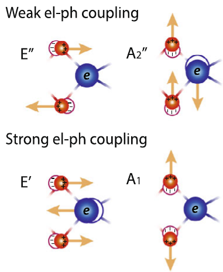

# Electron–phonon coupling

**Electron–phonon coupling (EPC)**은 원자핵이 진동하면서 전자가 느끼는 퍼텐셜과 Hamiltonian을 변화시키는 상호작용이다. 전자는 이 상호작용을 통해 포논을 방출하면서 자신의 에너지를 낮추거나, 포논을 흡수하면서 에너지를 높일 수 있다. **Non-equilibrium Green's function (NEGF)** 방법에서는 이 효과를 전자 self-energy에 넣어 전자의 상태와 점유를 함께 구한다. 따라서 전자–포논 결합의 세기만으로는 산란을 결정할 수 없다. **전자 점유와 비어 있는 최종 상태를 함께 고려하여, 서로 다른 에너지의 상태가 포논의 흡수·방출을 통해 어떻게 연결되는지** 계산해야 한다.[1,2]

이 글은 density functional theory (DFT)로 전자 구조를 계산한 독자를 대상으로 `원자 변위 → 결합 행렬 → 흡수·방출 → 점유와 산란 → 스펙트럼 변화`를 연결한다. 산란을 반복 계산하여 전류와 진동 신호를 얻는 절차는 후속 문서에서 다룬다. 선행하는 [NEGF formalism](negf-formalism.md)의 두 전극 모형에 EPC를 추가하며, 정상 상태와 직교 전자 기저를 사용한다. 포논은 우선 온도가 고정된 열저장고와 평형인 조화 진동으로 취급한다. 이때 전자의 비평형 점유를 구하는 것과 포논의 온도 상승을 구하는 것은 별개의 문제이다.[1,2]

시간·에너지 Fourier 정규화는 선행 문서와 같고 $G(E)$의 단위는 에너지의 역수이다. 아래 행렬의 trace는 spin을 한 번만 포함하며, 단일 준위 예시는 한 spin을 나타낸다. $h$는 Planck 상수, $\hbar=h/(2\pi)$이다. 전자 전하는 $-e$이고 $e>0$이다. 전류를 계산할 때는 전극에서 소자로의 순전자 주입에 $+e$를 곱하는 선행 문서의 부호를 따른다. 이 글의 충돌 무게 자체는 전류가 아니다.[1,2]

## 1. 원자 변위와 전자 Hamiltonian

### (1) 원자 위치와 전자 퍼텐셜

결합 행렬 $M^\lambda$는 진동 모드 $\lambda$가 전자 Hamiltonian을 얼마나, 어떤 행렬 형태로 바꾸는지 나타낸다. 포논 에너지 $\hbar\omega_\lambda$가 전자가 주고받는 **에너지 간격**이라면, $M^\lambda$는 그 과정의 **전자 상태 사이 결합 진폭**이다. 둘은 모두 에너지 단위를 갖지만 역할이 다르다.[1–3]

원자가 이동하면 이온이 만드는 퍼텐셜뿐 아니라 그 주변 전자 밀도도 달라진다. DFT의 Kohn–Sham Hamiltonian에서 이 반응은 이온 퍼텐셜, 전자 밀도가 만드는 Hartree 퍼텐셜, exchange-correlation 퍼텐셜의 변화에 반영된다. 따라서 여기서 미분하는 대상은 전자 응답을 포함한 유효 Hamiltonian이다. 이온의 bare Coulomb 퍼텐셜만 미분한 값과 일반적으로 같지 않다. 고정된 원자 구조에서 얻은 band energy 하나를 입력하는 것만으로는 이 변위 응답을 알 수 없다.[1,3]

평형 원자 위치를 $\mathbf R^0$, 원자 $I$의 Cartesian 방향 $a$ 변위를 $u_{Ia}$라 하자. 원자 위치에 따라 달라지는 전자 단입자 Hamiltonian $H_e$를 작은 변위에 대해 전개하면

$$
H_e(\mathbf R^0+\mathbf u)
\simeq H_e^0+\sum_{Ia}
\left.\frac{\partial H_e}{\partial R_{Ia}}\right|_{\mathbf R^0}u_{Ia}
$$

이다. 미분은 원자를 움직였을 때 전자 에너지와 상태 사이 결합이 얼마나 변하는지 나타낸다. 이 식은 **변위에 대한 선형 근사**이다. 이후 self-energy를 결합의 몇 차수까지 계산할지는 별도로 정해야 한다.[1,3]

### (2) 조화 모드와 변위 정규화

여러 원자가 서로 다른 방향과 크기로 함께 움직이는 패턴을 normal mode로 분해한다. 모든 원자를 같은 거리만큼 일괄적으로 이동시키는 것과 달리, 특정 normal mode에 따른 변위에서는 원자마다 정해진 진동 방향과 상대 진폭을 따라야 한다. 특정 모드에 따른 변위에서는 원자별 상대 변위를 보존해야 한다. 아래에서는 유한한 진동 영역의 안정한 실수 normal mode를 사용한다.[1,3] 원자 질량을 $m_I$, 모드의 각진동수를 $\omega_\lambda>0$, 질량 가중 dynamical matrix의 무차원 고유벡터를 $e_{Ia}^\lambda$라 쓰면, 정규화와 변위 연산자는 다음과 같다.[1,3]

$$
\sum_{Ia}e_{Ia}^{\lambda}e_{Ia}^{\lambda'}
=\delta_{\lambda\lambda'},
\qquad
\widehat u_{Ia}
=\sum_\lambda e_{Ia}^\lambda
\sqrt{\frac{\hbar}{2m_I\omega_\lambda}}
(b_\lambda+b_\lambda^\dagger).
$$

$b_\lambda^\dagger$와 $b_\lambda$는 포논을 하나 생성하고 소멸시키는 연산자이다. 제곱근 인자는 길이 단위를 가지며 질량 인자를 이미 포함한다. $e_{Ia}^\lambda$에 $1/\sqrt{m_I}$를 다시 곱해 정규화하면 같은 규약이 아니다. 이 글의 실수 모드 표기는 복소 Bloch 모드의 $\mathbf q$와 $-\mathbf q$ 짝을 하나로 생략한 표기로 사용해서는 안 된다.[1,3]

원자의 변위 방향이 다르면 전자가 느끼는 퍼텐셜 변화도 다르다. 그림 1은 이 차이를 특정 물질 계열의 모드 패턴으로 보여 준다.[1,3]

<figure markdown="span">
{ width="300" }
<figcaption markdown="1">그림 1. 2H 반도체 transition-metal dichalcogenide에서 원자 진동 패턴과 전자 결합을 비교한 사례이다. 원문의 위·아래 강약 표시는 해당 물질과 모드에 대한 설명이며 모든 재료의 결합 순위를 뜻하지 않는다. 출처: D. H. Lee et al., “Direct probing of phonon mode specific electron–phonon scatterings in two-dimensional semiconductor transition metal dichalcogenides,” <em>Nature Communications</em> 12, 4520 (2021), Fig. 1(a), p. 2, [DOI](https://doi.org/10.1038/s41467-021-24875-2). [CC BY 4.0](https://creativecommons.org/licenses/by/4.0/). 원본 PDF에서 패널 (a)의 도식만 발췌하고 패널 문자·여백과 인접 패널의 작은 축 조각을 제거하여 PNG로 변환했으며, 도식의 레이블과 색은 유지했다.[4]</figcaption>
</figure>

그림의 화살표는 원자가 어느 방향으로 함께 움직이는지를 나타낸다. 실제 결합 진폭은 이 패턴을 Hamiltonian의 변위 미분에 투영해 얻으므로, 그림만으로 수치적인 $M^\lambda$를 읽을 수는 없다.[1,3]

## 2. 모드별 결합 행렬

### (1) Hamiltonian 미분과 결합 진폭

이 변위를 선형 전개에 대입하면 전자 기저 $|i\rangle$, $|j\rangle$ 사이의 결합을 얻는다.

$$
M_{ij}^{\lambda}
=\sum_{Ia}
\left\langle i\left|
\frac{\partial H_e}{\partial R_{Ia}}
\right|j\right\rangle
 e_{Ia}^{\lambda}
\sqrt{\frac{\hbar}{2m_I\omega_\lambda}}.
$$

미분의 단위는 에너지/길이이므로 $M_{ij}^{\lambda}$의 단위는 에너지이다. 국소 궤도 기저에서는 대각 성분이 궤도 에너지의 변화를, 비대각 성분이 궤도 사이 hopping의 변화를 나타낸다. 따라서 포논 진동수 목록만으로는 전류 변화를 예측할 수 없다. 같은 진동 에너지를 가진 모드라도 전류를 운반하는 상태와의 결합 행렬이 다를 수 있다.[1–3]

### (2) DFT 입력과 기저의 변화

실제 계산 입력을 만들 때는 먼저 구조를 정하고, 힘의 변위 응답으로 조화 모드와 진동수를 구한 뒤, 전자 Hamiltonian의 변위 응답을 같은 모드에 투영한다. 힘 상수의 미분 대상은 총에너지이고, $M^\lambda$의 미분 대상은 전자 Hamiltonian이다. 진동수 계산이 끝났다는 사실만으로 결합 행렬까지 계산된 것은 아니다. 두 계산에서 원자 순서, 질량, Cartesian 방향과 모드 정규화를 맞춰야 한다.[1,3]

고정된 전자 기저에서 작은 변위 $\delta$를 사용하면 중앙 차분으로 연산자 미분을 근사할 수 있다. $H_e(+\delta)$와 $H_e(-\delta)$는 같은 원자 좌표 하나만 평형점에서 이동시키고 전자 응답을 구한 Hamiltonian이다.[1,3]

$$
\left.\frac{\partial H_e}{\partial R_{Ia}}\right|_0
\simeq\frac{H_e(+\delta)-H_e(-\delta)}{2\delta}.
$$

$\delta$를 줄여 선형 응답에 접근하되, 전자 계산의 잔여 오차가 차분을 지배하지 않는지도 확인한다. 변위 전후의 에너지 기준과 전자 수 조건을 맞추고, 대칭 차분과 변위 크기를 바꾼 결과가 안정적인지 비교한다. 이 과정에서 얻는 $M^\lambda$는 정한 구조와 전자 근사에서의 입력이며, 이후의 비평형 전자 분포 자체가 아니다.[1,3]

원자 중심 궤도 $|i(\mathbf R)\rangle$가 원자를 따라 움직이는 경우에는 위 식을 저장된 행렬에 그대로 적용할 수 없다. $H_{ij}=\langle i|H_e|j\rangle$를 미분하면 곱의 미분법에 의해

$$
\partial H_{ij}
=\langle\partial i|H_e|j\rangle
+\langle i|\partial H_e|j\rangle
+\langle i|H_e|\partial j\rangle
$$

가 된다. 여기서 $\partial=\partial/\partial R_{Ia}$이다. 가운데 항이 결합에 필요한 연산자 미분이고 양쪽 항은 기저의 이동이다. 이 구분은 연산자를 기준 전자 상태 사이에 투영하는 정의에서 직접 따른다.[1,3] 비직교 국소 궤도에서는 overlap과 기저 변화까지 일관되게 처리해야 하며, 실제 보정 방식은 기저 구현에 의존한다. 이후의 NEGF 식은 이 처리를 마친 공통 직교 표현의 $H_D$와 $M^\lambda$를 사용한다. 단순 차분 행렬과 별도로 직교화한 Hamiltonian을 섞으면 같은 상호작용을 나타내지 않을 수 있다. 이는 위 투영 정의와 곱의 미분식에서 얻는 표현 일관성 조건이다.[1,3]

## 3. 포논 흡수·방출과 상태 점유

### (1) 한 포논 전이와 에너지 보존

전자 생성·소멸 연산자를 $c_i^\dagger$, $c_j$라 하면 선형 상호작용 Hamiltonian은

$$
\widehat H_{e\text{-}ph}
=\sum_{ij\lambda}M_{ij}^{\lambda}
 c_i^\dagger c_j(b_\lambda+b_\lambda^\dagger)
$$

이다. $c_i^\dagger c_j$는 전자 상태 $j$와 $i$를 연결하며, 그와 동시에 $b_\lambda$ 또는 $b_\lambda^\dagger$가 포논 수를 바꾼다. 실수 모드와 Hermitian $H_e$를 사용하므로 $M^\lambda=(M^\lambda)^\dagger$이다.[1,2]

전자 초기·최종 에너지를 $E_i$, $E_f$라 할 때 한 포논 과정의 에너지 보존은

$$
\begin{aligned}
\text{방출:}\quad&E_f=E_i-\hbar\omega_\lambda,\\
\text{흡수:}\quad&E_f=E_i+\hbar\omega_\lambda
\end{aligned}
$$

로 쓴다. 조화 진동자에서 포논을 하나 없애는 진폭은 $\sqrt{N}$, 하나 만드는 진폭은 $\sqrt{N+1}$이다. 포논 수 $N$에 대한 평균을 $n_\lambda$라 하면 확률의 가중치는 각각 $n_\lambda$, $n_\lambda+1$이 된다. 포논이 없는 상태에서도 방출 가중치의 1은 남지만, 전자 쪽에 허용된 초기·최종 상태가 있어야 실제 산란이 일어난다.[1,2]

계산 입력의 역할은 다음처럼 구분한다. 같은 모드를 나타내는 $M^\lambda$, $\omega_\lambda$, $n_\lambda$를 한 묶음으로 사용해야 한다.[1–3]

| 입력 | 물리적 의미 | 단위 |
|---|---|---|
| $H_D$와 전극 결합 | 진동이 없을 때의 열린 전자계 | 에너지 |
| $\hbar\omega_\lambda$ | 한 번의 흡수·방출로 교환하는 에너지 | 에너지 |
| $M^\lambda$ | 해당 모드가 전자 상태를 연결하는 진폭 | 에너지 |
| $n_\lambda$ | 흡수·방출 가중치를 정하는 평균 포논 수 | 무차원 |

### (2) Bose 점유와 Pauli 차단

포논 점유는 진동 양자가 흡수·방출될 가중치를 정하고, 전자 점유는 그 전이를 시작할 전자와 도착할 빈 상태가 있는지를 정한다. 최종 전자 상태가 이미 차 있으면 Pauli exclusion principle에 의해 그 상태로의 전이는 차단된다. 두 종류의 통계를 함께 넣어야 방출 가중치의 1을 실제 산란율과 혼동하지 않는다.[1,2]

온도 $T_{\mathrm{ph}}$의 열저장고가 포논 점유를 고정한다고 가정하면 Bose–Einstein 분포는

$$
n_\lambda=
\frac{1}{\exp[\hbar\omega_\lambda/(k_BT_{\mathrm{ph}})]-1}
$$

이다. $k_B$는 Boltzmann 상수이다. 전극 전자 온도 $T_e$와 $T_{\mathrm{ph}}$는 입력에서 구별한다. 포논이 전류에 의해 가열되어도 이 식을 그대로 사용하는 계산은 가열된 포논 점유를 스스로 구하지 않는다.[1,2]

산란을 계산하려면 전자 상태가 존재하는지와 그 상태가 채워져 있는지를 구별해야 한다. Retarded Green's function을 $G^R(E)$, advanced 성분을 $G^A=(G^R)^\dagger$라 하자. 에너지별 상태의 무게를 나타내는 spectral function $A$와 점유·비점유 성분을 다음과 같이 정의한다.[1,2]

$$
A(E)=i[G^R(E)-G^A(E)],
\qquad
G^n(E)=-iG^<(E),
\qquad
G^p(E)=iG^>(E).
$$

$G^<$와 $G^>$는 각각 lesser와 greater Green's function이다. 이 글에서 $n$, $p$는 점유된 상태와 비어 있는 상태를 구별하는 표지이며, $G^p$가 별도의 정공 band Hamiltonian을 뜻하지는 않는다. 이들 행렬의 단위는 모두 에너지의 역수이다. Green's function 항등식으로부터

$$
A(E)=G^n(E)+G^p(E)
$$

를 얻는다. 단일 전자 준위라면 $G^n=A f_{\mathrm{eff}}$, $G^p=A(1-f_{\mathrm{eff}})$로 읽을 수 있다. $f_{\mathrm{eff}}(E)$는 그 준위의 에너지별 유효 점유율이다. 여러 궤도가 결합한 일반 행렬 문제에서는 하나의 스칼라 $f_{\mathrm{eff}}$로 모든 점유를 표현할 수 있다고 가정하지 않는다.[1,2]

## 4. 에너지별 산란 self-energy

### (1) 전극 경계와 내부 상호작용

소자 Hamiltonian을 $H_D$, 단위행렬을 $\mathbb 1$, 좌우 전극을 $L,R$로 표시한다. 전극과 EPC의 retarded self-energy를 함께 넣으면

$$
G^R(E)=\left[
(E+i0^+)\mathbb 1-H_D
-\Sigma_L^R(E)-\Sigma_R^R(E)
-\Sigma_{e\text{-}ph}^R(E)
\right]^{-1}
$$

이다. 전극 self-energy는 열린 경계를, EPC self-energy는 진동과 상호작용한 전자의 응답을 나타낸다. 이에 대응하는 점유는 Keldysh 식으로 구한다.[1,2]

$$
G^{</>}(E)=G^R(E)
\left[\Sigma_L^{</>}(E)+\Sigma_R^{</>}(E)
+\Sigma_{e\text{-}ph}^{</>}(E)\right]G^A(E).
$$

이 식의 적용 범위는 전극 또는 산란 환경과 연결되어 정상 점유가 정해지는 상태로 한정한다. 완전히 고립된 속박 상태의 초기 점유 문제는 제외한다. 또한 이 글은 모든 전자 행렬을 같은 직교 기저로 표현하며, 비직교 기저의 행렬을 변환 없이 섞지 않는다.

전극 $\alpha=L,R$의 Fermi 분포를 $f_\alpha$, 폭 행렬을 $\Gamma_\alpha=i(\Sigma_\alpha^R-\Sigma_\alpha^A)$라 하면

$$
\Sigma_\alpha^<=if_\alpha\Gamma_\alpha,
\qquad
\Sigma_\alpha^>=-i(1-f_\alpha)\Gamma_\alpha.
$$

전극은 자신의 Fermi 분포로 전자를 공급하고 받아들인다. 반면 포논은 전자를 새로 공급하는 전자 저장고가 아니다. 소자 안의 전자를 다른 에너지의 상태로 옮기므로 $\Sigma_{e\text{-}ph}^{</>}$는 **소자의 $G^{</>}$에 의존**한다. 이 차이가 EPC 계산에서 반복 계산이 필요한 이유이다.[1,2]

### (2) 유입·유출과 에너지 이동

폭이 없는 조화 포논 스펙트럼을 사용하면, $M^\lambda$의 2차 Fock self-energy는 다음처럼 간단해진다. 전체 EPC 성분은 모드별 성분을 합한 것이다.[1,2]

$$
\begin{aligned}
\Sigma_\lambda^<(E)=M^\lambda\big[&
(n_\lambda+1)G^<(E+\hbar\omega_\lambda)\\
&+n_\lambda G^<(E-\hbar\omega_\lambda)
\big]M^\lambda,
\end{aligned}
$$

$$
\begin{aligned}
\Sigma_\lambda^>(E)=M^\lambda\big[&
(n_\lambda+1)G^>(E-\hbar\omega_\lambda)\\
&+n_\lambda G^>(E+\hbar\omega_\lambda)
\big]M^\lambda.
\end{aligned}
$$

이때 lesser self-energy $\Sigma^<$는 일반적으로 복소 행렬이므로, 그 자체를 양의 산란율로 해석할 수 없다. 유입을 해석할 때는 $-i\Sigma^<$, 유출을 해석할 때는 $i\Sigma^>$를 사용하면 각각 $G^n$, $G^p$와 대응한다. 두 식의 에너지 부호가 다른 이유는 **유입에서는 도착 에너지를, 유출에서는 출발 에너지를 $E$로 고정하기 때문**이다.[1,2]

| $E$에서 보는 과정 | 연결되는 전자 에너지 | 참조하는 상태 | 포논 가중치 |
|---|---|---|---|
| 방출하며 $E$로 유입 | 출발 $E+\hbar\omega_\lambda$ | 점유 $G^n$ | $n_\lambda+1$ |
| 흡수하며 $E$로 유입 | 출발 $E-\hbar\omega_\lambda$ | 점유 $G^n$ | $n_\lambda$ |
| $E$에서 방출하며 유출 | 도착 $E-\hbar\omega_\lambda$ | 비점유 $G^p$ | $n_\lambda+1$ |
| $E$에서 흡수하며 유출 | 도착 $E+\hbar\omega_\lambda$ | 비점유 $G^p$ | $n_\lambda$ |

표의 네 과정은 바로 위 두 식에 나타난 과정을 정리한 것이다. 예를 들어 방출 유입 항의 $G^<(E+\hbar\omega_\lambda)$를 보고 전자가 에너지를 얻는다고 해석하면 안 된다. 그 전자는 높은 에너지에서 출발해 포논에 에너지를 넘긴 뒤 $E$로 도착한다. $MGM$의 단위는 에너지이므로 self-energy의 단위와도 일치한다.[1,2]

### (3) 영온 방출과 빈 상태

위 식의 의미를 단일 준위와 한 모드로 확인하자. 결합을 실수 $m$, 포논 에너지를 $\hbar\omega$라 하고 $T_{\mathrm{ph}}\to0$으로 두면 $n\to0$이다. 유입·유출 폭을 $\Sigma^{\mathrm{in}}=-i\Sigma^<$, $\Sigma^{\mathrm{out}}=i\Sigma^>$로 정의하면

$$
\begin{aligned}
\Sigma^{\mathrm{in}}(E)
&=m^2 A(E+\hbar\omega)f_{\mathrm{eff}}(E+\hbar\omega),\\
\Sigma^{\mathrm{out}}(E)
&=m^2 A(E-\hbar\omega)
[1-f_{\mathrm{eff}}(E-\hbar\omega)].
\end{aligned}
$$

이는 새로운 근사가 아니라 앞의 행렬식을 이 단일 준위 모형에 대입한 결과이다. 유입 항은 높은 에너지의 전자가 있어야 생기며, 유출 항은 낮은 에너지에 빈 상태가 있어야 생긴다. 실제 충돌에 의한 유입·유출에는 각각 도착점의 $G^p(E)$와 출발점의 $G^n(E)$도 곱해진다. 즉 $n+1=1$이라는 사실만으로 영온에서 모든 전자가 계속 에너지를 잃는 것은 아니다.[1,2]

전자계도 영온 평형이고 화학 퍼텐셜이 $\mu$라면, $\mu$ 아래의 전자는 더 낮은 이미 채워진 상태로 방출할 수 없다. $\mu$ 위에는 출발할 전자가 없다. 유한 바이어스에서는 이 점유 구조가 달라져 방출이 가능해진다. 흡수·방출을 포논 분포만으로 판단하지 않고 전자 점유와 빈 상태를 함께 계산해야 하는 이유이다.[1,2]

## 5. 단일 준위의 에너지 재분배

### (1) 전극이 만드는 초기 점유

앞 절의 $f_{\mathrm{eff}}$는 임의로 정하는 산란 확률이 아니라 열린 전자계를 풀어 얻는 점유이다. 이를 구체적으로 보기 위해 EPC를 넣기 전의 단일 준위부터 시작하자. 준위 에너지를 $\varepsilon_0$, 전극에 의한 총 폭을 $\Gamma=\Gamma_L+\Gamma_R>0$라 하고, 전극의 실수 준위 이동은 $\varepsilon_0$에 포함한다. 관심 에너지 범위에서 전극 폭이 일정하다고 근사하면

$$
G_0^R(E)=\frac{1}{E-\varepsilon_0+i\Gamma/2}
$$

이다. 여기서 $0$은 고립된 준위가 아니라 **전극과 연결되어 있으나 EPC가 없는 해**를 뜻한다. 따라서 EPC가 0이어도 준위 폭은 남는다. Spectral function은 retarded 식에서 직접 계산된다.[1,2]

$$
A_0(E)=\frac{\Gamma}
{(E-\varepsilon_0)^2+(\Gamma/2)^2}.
$$

이 식은 어떤 에너지에서 전자 상태를 사용할 수 있는지를 나타낸다. 에너지 $E$가 공명 중심 $\varepsilon_0$와 달라도 유한한 spectral weight가 있을 수 있다. 단일 준위 모형에서 $E\pm\hbar\omega$를 참조한다는 말은, 그 위치마다 별도의 고립된 전자 궤도를 추가한다는 뜻이 아니다. 열린 소자의 에너지별 스펙트럼을 참조하는 것이다.[1,2]

이제 두 전극의 주입을 Keldysh 식에 넣으면

$$
G_0^n(E)=|G_0^R(E)|^2
[\Gamma_L f_L(E)+\Gamma_R f_R(E)]
$$

이고, $G_0^n=A_0 f_0$로 정의한 탄성 유효 점유는

$$
f_0(E)=\frac{\Gamma_L f_L(E)+\Gamma_R f_R(E)}{\Gamma}
$$

가 된다. 위의 네 관계식은 앞 절에서 정의한 유입·유출과 전자 점유의 일반식을 단일 준위 모형에 적용해 얻은 것이다. 예를 들어 영온에서 $\mu_L>E>\mu_R$이면 $f_L=1$, $f_R=0$이므로 $f_0=\Gamma_L/\Gamma$이다. 대칭 접촉에서는 $f_0=1/2$이다. 왼쪽이 공급하고 오른쪽이 받아들이는 상황에서는 열린 준위가 완전히 차지도, 완전히 비지도 않을 수 있다.[1,2]

이 탄성 해를 흡수·방출 self-energy에 대입하면 산란의 첫 보정을 계산할 수 있다. 산란이 유의하면 점유도 달라지므로 $f_0$를 최종 분포로 고정해서는 안 된다. 특히 같은 $M$과 포논 에너지를 사용하더라도 접촉 비대칭이나 바이어스를 바꾸면 점유와 빈 상태가 달라지고, 그 결과 산란도 달라진다. 이 관계가 다음 편에서 다룰 자기일관성의 출발점이다.[1,2]

### (2) 유입·유출과 전자 수 보존

유입 self-energy만으로 전자 수의 증가량을 판단할 수는 없다. 단일 준위에서는 도착 상태의 비점유 성분까지 곱해야 한다. 에너지별 충돌의 유입·유출 무게를 각각 $C_{\mathrm{in}}$, $C_{\mathrm{out}}$으로 정의하면

$$
C_{\mathrm{in}}(E)=\Sigma^{\mathrm{in}}(E)G^p(E),
\qquad
C_{\mathrm{out}}(E)=\Sigma^{\mathrm{out}}(E)G^n(E)
$$

이다. 이 무게들은 무차원이다. 에너지 적분 후 $1/h$를 곱해야 단위 시간당 전자 수에 해당하는 양이 된다. 행렬 문제의 충돌 항은 같은 순서의 곱에 trace를 취하며, 단일 준위에서 얻는 스칼라 확률 해석을 모든 행렬 성분에 그대로 적용하지 않는다.[1,2]

한 모드의 포논 에너지를 $w=\hbar\omega>0$라 줄여 쓰자. $n$은 이 모드의 포논 점유이고 $m$은 실수 결합이다. 높은 에너지 $E+w$에서 낮은 에너지 $E$로의 방출 기여는

$$
C_{\mathrm{em}}(E+w\to E)
=m^2(n+1)A(E+w)A(E)
 f_{\mathrm{eff}}(E+w)[1-f_{\mathrm{eff}}(E)]
$$

이다. 이는 단일 준위의 self-energy 식에 $G^n=A f_{\mathrm{eff}}$, $G^p=A(1-f_{\mathrm{eff}})$를 대입한 결과이다. 포논 인자, 출발·도착 스펙트럼, 출발 점유, 도착 비점유가 모두 있어야 한다. 이 곱은 $m$이 크다는 사실만으로 산란이 크다고 판단할 수 없는 이유를 보여 준다.[1,2]

같은 방출 사건은 높은 에너지 쪽에는 유출로, 낮은 에너지 쪽에는 유입으로 나타난다. 따라서 모든 에너지를 합하면 전자 수는 변하지 않는다. 위 두 이동 self-energy를 대입하고 적분 변수를 $E\pm w$로 바꾸면

$$
\int_{-\infty}^{\infty}dE\,
[C_{\mathrm{in}}(E)-C_{\mathrm{out}}(E)]=0
$$

임을 확인할 수 있다. 이는 방출과 흡수 각각에 대해 에너지 사이의 전자 이동을 중복 없이 세었을 때의 결과이다. 에너지 $E$ 하나에서 유입과 유출이 항상 같다는 뜻은 아니다. 또한 전자 수가 보존되어도 전자는 포논에 에너지를 줄 수 있다. 유한한 적분 범위를 쓰는 수치 계산은 양쪽으로 이동한 에너지 상태를 빠뜨리지 않도록 해야 한다.[1,2]

### (3) 평형에서의 정방향·역방향 상쇄

열평형 검사는 $E+w$와 $E$의 부호 및 $n+1$, $n$의 위치가 맞는지 확인하는 직접적인 방법이다. 전자와 포논이 같은 유한 온도 $T$에 있고 전자 화학 퍼텐셜이 공통 $\mu$라 하자. 이때 $\beta=1/(k_BT)$, 전자 Fermi 분포 $f(E)=[\exp(\beta(E-\mu))+1]^{-1}$를 사용한다. 방출의 역과정은 낮은 에너지 $E$에서 포논을 흡수하여 $E+w$로 올라가는 과정이다.[1,2]

$$
C_{\mathrm{abs}}(E\to E+w)
=m^2nA(E)A(E+w)f(E)[1-f(E+w)].
$$

방출과 역방향 흡수의 비를 취하면 두 스펙트럼 인자는 소거되고, 분포 함수에서 다음 관계를 얻는다.[1,2]

$$
\frac{f(E+w)[1-f(E)]}{f(E)[1-f(E+w)]}
=e^{-\beta w},
\qquad
\frac{n+1}{n}=e^{\beta w}.
$$

두 비율의 곱이 1이므로 $C_{\mathrm{em}}=C_{\mathrm{abs}}$이다. 이것이 해당 에너지 쌍의 **상세평형**이다. 전자는 높은 에너지를 점유하기 어렵지만 방출의 포논 가중치는 더 크며, 평형에서는 두 효과가 정확히 맞물린다. 유한 온도 평형에서 개별 흡수·방출이 사라지는 것이 아니라 정방향과 역방향의 순효과가 상쇄된다. 영온 극한에서는 앞 절의 Pauli 차단 설명으로 돌아간다.[1,2]

반대로 $T_e\ne T_{\mathrm{ph}}$이거나 두 전극의 화학 퍼텐셜이 다르면 이 상쇄를 보장하는 공통 분포가 없다. 전자 수 보존은 유지되어도 에너지 재분배의 순효과가 생길 수 있다. 따라서 평형 검사는 산란을 없애는 검사가 아니라, 산란을 포함한 식이 올바른 평형으로 돌아오는지 보는 검사이다.[1,2]

### (4) 상세평형의 수치 검산

다음 코드는 앞의 식에서 공통 온도와 화학 퍼텐셜을 넣어 두 가지 상쇄를 검사한다. 하나는 에너지 쌍의 방출과 역방향 흡수이고, 다른 하나는 고정된 에너지에서의 총 유입·유출이다. $\varepsilon_0=0$, $\Gamma_L=\Gamma_R=0.05$, $w=0.04$, $m=0.01$, $k_BT=0.025$, $\mu=0$은 모두 eV 단위의 설명용 입력이며 특정 물질의 측정값이 아니다. 전자 스펙트럼은 EPC 이전 $A_0$를 사용한다. 이 검사는 에너지 이동과 통계 인자의 배치를 확인하며 self-consistent Born approximation (SCBA)의 수렴을 검사하지 않는다.[1,2]

```python
from math import exp, expm1

# One spin, energies in eV; illustrative inputs, not measured data.
epsilon0, gamma_l, gamma_r = 0.0, 0.05, 0.05
w, m, kbt, mu = 0.04, 0.01, 0.025, 0.0
n = 1.0 / expm1(w / kbt)
gamma = gamma_l + gamma_r

def a(e):
    return gamma / ((e - epsilon0)**2 + (gamma / 2)**2)

def f(e):
    return 1.0 / (1.0 + exp((e - mu) / kbt))

def gn(e):
    return a(e) * f(e)

def gp(e):
    return a(e) * (1.0 - f(e))

pair_error, collision_error = 0.0, 0.0
for j in range(401):
    e = -0.2 + j * 0.001
    emission = m*m*(n+1)*gn(e+w)*gp(e)
    absorption = m*m*n*gn(e)*gp(e+w)
    pair_error = max(pair_error, abs(emission-absorption)
                     / max(emission, absorption, 1e-30))
    sin = m*m*((n+1)*gn(e+w) + n*gn(e-w))
    sout = m*m*((n+1)*gp(e-w) + n*gp(e+w))
    cin, cout = sin*gp(e), sout*gn(e)
    collision_error = max(collision_error, abs(cin-cout)
                          / max(cin, cout, 1e-30))
assert pair_error < 1e-10 and collision_error < 1e-10
print(f"Bose occupation: {n:.8f}")
print(f"pair relative error: {pair_error:.3e}")
print(f"collision relative error: {collision_error:.3e}")
```

Python 3.10 실행에서 Bose 점유는 0.25297035이고, 두 최대 상대 잔차는 각각 $3.65\times10^{-13}$과 $3.48\times10^{-13}$이었다. 이 수치는 위 입력과 코드에서 얻은 부동소수점 검산 결과이다. $n$과 $n+1$ 또는 이동 에너지 부호를 잘못 넣으면 평형에서도 잔여 충돌이 남으므로 실제 self-energy 구현의 작은 기준 문제로 사용할 수 있다. 전자 수 보존의 전체 에너지 적분 검사는 별도로 수행해야 한다.[1,2]

## 6. 스펙트럼 변화와 적용 한계

### (1) 준위 이동과 수명 폭

점유를 바꾸는 산란은 전자 스펙트럼도 바꾼다. Lesser·greater 성분과 retarded 성분은 다음 항등식으로 연결된다.[1,2]

$$
\Gamma_{e\text{-}ph}(E)
=i[\Sigma_{e\text{-}ph}^>(E)-\Sigma_{e\text{-}ph}^<(E)],
\qquad
\Sigma_{e\text{-}ph}^R(E)
=\Delta_{e\text{-}ph}(E)-\frac{i}{2}\Gamma_{e\text{-}ph}(E).
$$

$\Delta_{e\text{-}ph}$는 Hermitian 준위 이동이고, $\Gamma_{e\text{-}ph}$는 수명에 따른 에너지 폭이다. 행렬에서는 $\Gamma=i(\Sigma^R-\Sigma^{R\dagger})$로 정의한다. 따라서 retarded 식에 허수 폭만 임의로 더하면 산란 후의 점유와 에너지 재분배가 빠진다. 앞 절의 Keldysh 식을 함께 풀어야 한다.[1,2]

고에너지에서 사라지는 Fock 성분의 실수부는 인과성에 의해 폭과 연결된다. 이 글의 부호 규약에서는 Cauchy 주값 $\mathcal P$를 사용하여

$$
\Delta_F(E)=\mathcal P\int_{-\infty}^{\infty}
\frac{dE'}{2\pi}\,
\frac{\Gamma_{e\text{-}ph}(E')}{E-E'}
$$

로 복원한다. 선형 EPC Hamiltonian의 2차 근사에는 별도로 정적 Hartree 항 $\Sigma_H$도 존재한다. 따라서 $\Delta_{e\text{-}ph}=\Sigma_H+\Delta_F$이며, $\Sigma_H$는 위 lesser·greater 항의 차이에서 복원되지 않는다. 여기서는 에너지 교환을 설명하는 Fock 반복을 중심으로 다루되, 실제 계산에서는 Hartree 항의 포함·생략 여부를 명시해야 한다. Hartree 이동을 생략하는 선택과 Fock의 주값 적분을 생략하는 선택은 서로 다르다.[1,2]

이전 절의 한 spin 공명 준위에 이 self-energy를 넣으면 다음 스펙트럼을 얻는다. 전극의 실수 이동은 $\varepsilon_0$에 포함하고, 전극 폭 $\Gamma$는 상수로 둔다.[1,2]

$$
A(E)=\frac{\Gamma+\Gamma_{e\text{-}ph}(E)}
{[E-\varepsilon_0-\Delta_{e\text{-}ph}(E)]^2
+[\Gamma+\Gamma_{e\text{-}ph}(E)]^2/4}.
$$

이 식은 스칼라 Dyson 식에서 얻은 결과이지 일정한 폭의 Lorentzian fitting을 새로 가정한 식이 아니다. 산란에 연결되는 $E\pm\hbar\omega$의 상태와 점유가 달라지면 $\Gamma_{e\text{-}ph}(E)$도 에너지에 따라 변하고, 그와 연결된 $\Delta_{e\text{-}ph}(E)$가 공명 위치와 모양을 함께 바꾼다. 따라서 하나의 상수 수명만 더하는 모형은 이 에너지 선택성을 놓칠 수 있다. 구조의 세부 모양은 준위 위치, 접촉 폭, 점유와 근사에 의존한다.[1,2]

### (2) 결합 입력과 자기일관 전자 상태

이 문서의 self-energy 식은 **선형 EPC, 안정한 조화 모드, 폭이 없는 포논 스펙트럼, 지정한 포논 점유, 2차 Fock 구조**를 사용한다. 이 조건들은 서로 다른 단계의 가정이다. 작은 원자 변위를 가정했다는 사실만으로 전자의 반복 산란이 작아지는 것은 아니며, 전자 계산을 반복한다고 해서 포논 분포가 자동으로 바뀌는 것도 아니다.[1–3]

| 관계 | 설명하는 대상 | 식을 사용할 때의 조건 |
|---|---|---|
| $M^\lambda$의 변위 미분 | 진동이 바꾸는 전자 결합 | 같은 기저, 모드 정규화, 변위 선형화 |
| $A=G^n+G^p$ | 전체·점유·비점유 상태 | 같은 Green's function 규약 |
| $\Sigma^{</>}(E)$의 이동 항 | 흡수·방출의 유입·유출 | 선택한 2차 근사와 포논 점유 |
| $\Delta_F$의 주값 적분 | 산란 폭과 인과적인 준위 이동 | 에너지 범위 전체의 일관성 |
| 상세평형 관계 | 정방향·역방향의 상쇄 | 공통 온도와 화학 퍼텐셜 |

같은 2차 Fock 구조에서도 내부에 산란 전 $G_0$를 넣는 Born approximation과, 산란을 포함한 $G$를 반복해서 넣는 SCBA는 다르다. SCBA는 선택한 diagram 구조를 반복해 일부 고차 과정을 합하지만 모든 상호작용을 정확히 포함하는 방법은 아니다. 변위의 선형화, self-energy의 diagram 선택, 전자 해의 자기일관성은 서로 다른 근사 단계이다. 이 글에서는 고정된 조화 포논 분포를 사용하므로 전자 해를 반복해도 포논 분포가 자동으로 갱신되지 않는다.[1,2]

이 관계를 이용하면 계산 입력과 결과를 구별할 수 있다. $M^\lambda$와 $\omega_\lambda$는 모드별 입력이지만 $G^n$, $G^p$는 열린 전자계의 해이다. $\Sigma^{</>}$는 그 해에 의존하며, 다시 $G^{R,</>}$를 바꾼다. [Inelastic electron transport](inelastic-electron-transport.md)는 이 순환을 실제로 푸는 방법과 그 결과로 전류·진동 신호·에너지 전달을 계산하는 절차를 다룬다.

## 7. 요약

- $M^\lambda$는 진동에 의한 전자 Hamiltonian의 변화이고, $\hbar\omega_\lambda$는 한 포논 과정에서 교환하는 에너지이다.
- $G^n$은 점유된 상태, $G^p$는 비어 있는 상태의 에너지별 무게이다. 전자 산란에는 두 정보가 모두 필요하다.
- Lesser 유입 식의 $E+\hbar\omega_\lambda$는 방출 전의 출발 에너지이며, greater 유출 식의 $E-\hbar\omega_\lambda$는 방출 후의 도착 에너지이다.
- Retarded self-energy의 폭과 준위 이동은 인과성으로 연결된다. 정적 Hartree 이동은 별도로 처리한다.
- EPC는 전자를 에너지 사이에 재분배하며 전자 수를 보존한다. 공통 온도·화학 퍼텐셜의 평형에서는 방출과 역방향 흡수가 상세평형을 이룬다.

## 8. 참고문헌

1. T. Frederiksen, M. Paulsson, M. Brandbyge, and A.-P. Jauho, "Inelastic transport theory from first principles: Methodology and application to nanoscale devices," *Physical Review B* **75**, 205413 (2007). [DOI](https://doi.org/10.1103/PhysRevB.75.205413), [arXiv](https://arxiv.org/abs/cond-mat/0611562). 결합 행렬: Sec. II.A; 전자 점유와 산란: Secs. III.B–III.E; 산란 convolution과 retarded 성분: Sec. III.D, Eqs. (38)–(39).
2. M. Galperin, M. A. Ratner, and A. Nitzan, "Molecular transport junctions: Vibrational effects," *Journal of Physics: Condensed Matter* **19**, 103201 (2007). [DOI](https://doi.org/10.1088/0953-8984/19/10/103201), [arXiv](https://arxiv.org/abs/cond-mat/0612085). 단일 준위 모형과 결합: Secs. 3a–3b; NEGF: Sec. 3d; 약결합 근사와 점유: Secs. 5b, 5d; 에너지 이동과 점유 가중치: Sec. 5f, Eq. (61).
3. F. Giustino, "Electron-phonon interactions from first principles," *Reviews of Modern Physics* **89**, 015003 (2017). [DOI](https://doi.org/10.1103/RevModPhys.89.015003), [arXiv](https://arxiv.org/abs/1603.06965). 변위 전개와 모드별 결합: Sec. III.B.2.
4. D. H. Lee et al., "Direct probing of phonon mode specific electron–phonon scatterings in two-dimensional semiconductor transition metal dichalcogenides," *Nature Communications* **12**, 4520 (2021). [DOI](https://doi.org/10.1038/s41467-021-24875-2). Fig. 1(a)의 모드 도식; CC BY 4.0.
