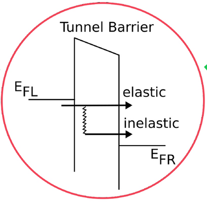
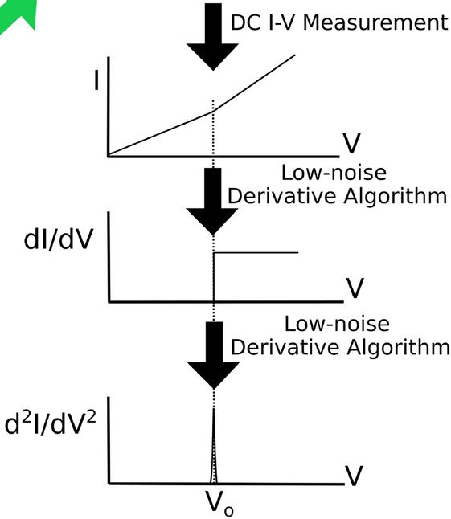

# Inelastic electron transport

**Inelastic electron transport**는 전자가 진동 등 다른 자유도와 에너지를 주고받으며 이동하는 수송이다. 전자가 포논을 방출하면 낮은 에너지로, 흡수하면 높은 에너지로 옮겨 가므로 한 에너지의 transmission만으로 모든 전류를 정할 수 없다. 바뀐 전자 스펙트럼과 점유를 함께 구하고, 그 해에서 단자 전류를 계산해야 한다.[1,2]

이 글은 density functional theory (DFT)로 전자 구조를 계산한 독자를 대상으로 포논이 전류와 진동 분광 신호에 미치는 영향을 설명한다. [Coherent quantum transport](coherent-quantum-transport.md)의 탄성 기준 모형과 [NEGF formalism](negf-formalism.md)의 non-equilibrium Green's function (NEGF) 규약을 따른다. Electron–phonon coupling (EPC)의 원자 변위 미분과 결합 행렬 $M^\lambda$의 구성은 [Electron–phonon coupling](electron-phonon-coupling.md)에서 다룬다. 여기서는 그 입력을 받아 전자의 비평형 수송을 푸는 단계에 집중한다.[1,2]

정상 상태, 공통 직교 전자 기저, 선형 EPC와 조화 진동을 가정한다. 전극은 $L,R$, 전자 전하는 $-e$ ($e>0$), $h=2\pi\hbar$이다. $I_\alpha$는 전극 $\alpha$에서 소자로 들어오는 순전자 흐름에 $+e$를 곱한 값이다. 행렬 trace는 spin을 한 번만 포함하며, 단일 준위 예시는 한 spin이다. 모든 에너지는 공통 영점을 사용하고 $\mu_L-\mu_R=eV$로 바이어스 $V$를 정의한다.[1,2]

## 1. 탄성·비탄성 전자 산란

### (1) 산란 전후의 전자 에너지

탄성 산란에서는 전자의 입사·출사 에너지가 같고, 비탄성 산란에서는 전자가 환경과 에너지를 교환한다. 정적인 장벽이나 결함에 의한 반사는 탄성일 수 있다. 따라서 transmission이 1보다 작거나 전류가 작다는 사실만으로 비탄성 산란을 뜻하지 않는다. Coherent 기준 문제는 그러한 정적 반사와 간섭을 이미 포함한다.[1,2]

한 포논의 에너지를 $w=\hbar\omega>0$, 전자의 초기·최종 에너지를 $E_i,E_f$라 하면 다음 관계로 구분한다. 비탄성 과정에서도 전자와 진동을 합친 계의 에너지는 보존된다.[1,2]

$$
E_f=E_i\quad\text{(탄성)},\qquad
E_f=E_i-w\quad\text{(방출)},\qquad
E_f=E_i+w\quad\text{(흡수)}.
$$

그림 1은 같은 장벽을 통과하는 탄성 경로와 포논에 에너지를 넘기는 경로를 비교한다. 아래로 꺾인 경로를 전자의 에너지 손실로 읽어야 한다.[1,2]

<figure markdown="span">
{ width="408" }
<figcaption markdown="1">그림 1. 터널 장벽에서 탄성 전달과 에너지 방출을 동반한 전달의 개략도. $E_{FL}$과 $E_{FR}$은 원그림의 좌우 전극 Fermi 준위 표기이다. 출처: S. Kesarwani et al., “Simplified inelastic electron tunneling spectroscopy based on low-noise derivatives,” <em>Scientific Reports</em> 12, 19216 (2022), Fig. 1, [DOI](https://doi.org/10.1038/s41598-022-21302-4), [CC BY 4.0](https://creativecommons.org/licenses/by/4.0/). 원본 중앙 영역을 직사각형으로 발췌했으며 레이블과 색은 변경하지 않았다.[3]</figcaption>
</figure>

### (2) 포논 보조 과정과 Pauli 차단

포논의 평균 점유를 $n$이라 하면 흡수의 통계 가중치는 $n$, 방출은 $n+1$이다. 영온에서 포논이 없어도 방출 가중치의 1은 남지만, 출발 전자와 도착할 빈 상태가 모두 있어야 한다. 평형 Fermi sea 아래의 전자는 더 낮은 이미 채워진 상태로 계속 내려갈 수 없다. 유한 바이어스가 만드는 비평형 점유가 방출 가능 구간을 연다.[1,2]

전자 에너지가 바뀌면 다른 에너지의 상태와 점유를 참조해야 한다. 반면 전극과 연결되어 생기는 공명 폭은 전극으로 빠져나가는 열린 경계의 효과이며, 그 자체가 소자 내부의 포논 방출을 나타내지는 않는다. 전극 self-energy와 EPC self-energy를 구별하는 출발점이다.[1,2]

## 2. 단일 준위와 포논 모형

계산의 공통 예시는 좌우 전극에 연결된 전자 준위 하나와 진동 하나이다. 준위 에너지는 $\varepsilon_0$, 일정한 전극 폭은 $\Gamma_L,\Gamma_R>0$, 총 폭은 $\Gamma=\Gamma_L+\Gamma_R$이다. 전극의 상수 실수 이동은 $\varepsilon_0$에 포함한다. 전자 생성 연산자 $c^\dagger$, 포논 생성 연산자 $b^\dagger$, 실수 결합 에너지 $m$을 사용하면 소자의 모형은

$$
\widehat H_{\mathrm{model}}=\varepsilon_0 c^\dagger c+w b^\dagger b
+m c^\dagger c(b+b^\dagger)
$$

이다. $w$는 한 번에 주고받는 에너지이고 $m$은 그 과정의 결합 진폭이다. 두 양의 단위가 같아도 의미는 다르다. 실제 다중 궤도 문제에서는 $m$을 모드별 행렬 $M^\lambda$로 바꾼다.[1,2]

EPC가 없는 전극 연결 해를 아래첨자 0으로 표시한다. Wide-band approximation으로 전극 폭을 상수로 둘 때

$$
G_0^R(E)=\frac{1}{E-\varepsilon_0+i\Gamma/2},\qquad
A_0(E)=\Gamma|G_0^R(E)|^2,
$$

$$
G_0^n(E)=|G_0^R(E)|^2[\Gamma_L f_L(E)+\Gamma_R f_R(E)]
$$

이다. $G_0^R$와 spectral function $A_0$의 단위는 역에너지이다. $f_\alpha(E)=[\exp((E-\mu_\alpha)/(k_BT_e))+1]^{-1}$는 전극의 Fermi 분포이며, $T_e$는 공통 전자 온도, $k_B$는 Boltzmann 상수이다. 이 $G_0$는 고립된 준위가 아니라 전극 주입과 탈출을 이미 포함한 기준 해이다.[1,2]

포논은 온도 $T_{\mathrm{ph}}$의 외부 bath에 의해 점유가 고정된 것으로 두며

$$
n=\frac{1}{\exp[w/(k_BT_{\mathrm{ph}})]-1}
$$

을 사용한다. 전자 해를 반복한다고 이 $n$이 자동으로 변하지 않는다. 아래 수치 예제는 $T_e=T_{\mathrm{ph}}$와 바이어스에 무관한 $\varepsilon_0,\Gamma_\alpha,m,w$를 선택한다. 이는 수송식 검증용 입력이며, 실제 DFT 접합의 전하 재배치나 바이어스에 따른 구조 변화를 계산한 결과가 아니다.[1,2]

## 3. 산란 self-energy와 에너지 재분배

### (1) 점유와 비점유 상태의 연결

Lesser와 greater Green's function을 각각 $G^<$, $G^>$라 하고

$$
G^n=-iG^<,\qquad G^p=iG^>,\qquad
A=i(G^R-G^A)=G^n+G^p,\qquad G^A=(G^R)^\dagger
$$

로 둔다. $G^n$은 채워진 상태, $G^p$는 빈 상태의 에너지별 무게이다. $\Sigma^{\mathrm{in}}=-i\Sigma^<$, $\Sigma^{\mathrm{out}}=i\Sigma^>$는 이에 대응하는 유입·유출 self-energy이며 에너지 단위이다.[1,2]

폭이 없는 조화 포논 하나에 대해 2차 Fock 구조는 다음과 같다. 아래 $G$를 실제 산란 해로 평가할지가 근사 방법을 결정한다.[1,2,4]

$$
\Sigma_{\mathrm{ph}}^{\mathrm{in}}(E)
=m^2[(n+1)G^n(E+w)+nG^n(E-w)],
$$

$$
\Sigma_{\mathrm{ph}}^{\mathrm{out}}(E)
=m^2[(n+1)G^p(E-w)+nG^p(E+w)].
$$

유입 식의 방출 항이 $E+w$를 읽는 것은 높은 에너지에서 출발한 전자가 $w$를 잃고 $E$로 도착하기 때문이다. 유출 식에서는 출발점을 $E$로 고정하므로 방출 후 빈 상태를 $E-w$에서 찾는다. 이 이동 부호를 바꾸면 흡수와 방출의 물리적 방향이 바뀐다.[1,2]

다중 모드·행렬 문제에서는 각 항의 $m^2G$를 $M^\lambda G M^\lambda$로 바꾸고 $w\to\hbar\omega_\lambda$, $n\to n_\lambda$를 적용한 뒤 모드에 대해 합한다. 모든 $M^\lambda$와 $G$는 같은 직교 기저로 표현한다. 서로 다른 기저에서 얻은 행렬을 그대로 곱하는 절차는 이 식의 적용 범위가 아니다.[1,2,4]

### (2) 산란 폭과 인과적인 준위 이동

점유를 옮기는 산란은 스펙트럼도 바꾼다. Fock 폭과 retarded 성분은

$$
\Gamma_{\mathrm{ph}}=\Sigma_{\mathrm{ph}}^{\mathrm{in}}+
\Sigma_{\mathrm{ph}}^{\mathrm{out}},\qquad
\Sigma_F^R(E)=\Delta_F(E)-\frac{i}{2}\Gamma_{\mathrm{ph}}(E)
$$

로 연결된다. 고에너지에서 사라지는 Fock 성분에는 인과성에 따른 주값 관계가 적용된다. $\mathcal P$는 Cauchy 주값이다.[1,2,4]

$$
\Delta_F(E)=\mathcal P\int_{-\infty}^{\infty}
\frac{dE'}{2\pi}\frac{\Gamma_{\mathrm{ph}}(E')}{E-E'}.
$$

이 관계에서 허수부의 폭과 실수부의 준위 이동은 독립 입력이 아니다. 유한 에너지 범위에서 실수부를 구할 때에는 bias window 밖의 꼬리도 영향을 주므로 적분 범위를 늘려 확인한다.[1,4]

선형 EPC의 2차 근사에는 정적인 Hartree 이동 $\Sigma_H$도 있어 전체 retarded 성분은 $\Sigma_{\mathrm{ph}}^R=\Sigma_H+\Sigma_F^R$이다. $\Sigma_H$는 위 lesser·greater 차이로 복원되지 않는다. 아래 예제는 **동적인 Fock 항만 반복하고 Hartree 항은 생략**한다. 이는 명시적인 모형 근사이며, Hartree 항을 자기일관하게 계산한 것과 같지 않다. Fock의 실수부는 유지한다. 정적 이동을 DFT 기준 Hamiltonian에 반영하는 경우에는 무엇을 이미 포함했는지 확인하여 중복을 피해야 한다.[1,2,4]

## 4. SCBA의 자기일관 해

### (1) 응답과 점유의 동시 갱신

Self-consistent Born approximation (SCBA)은 선택한 2차 self-energy 안에 산란을 포함한 동일한 dressed $G$를 넣고, 그 self-energy로 다시 $G$를 구하는 방법이다. 따라서 retarded 응답과 lesser·greater 점유를 함께 갱신한다.[1,2]

$$
G^{R,</>}\longrightarrow\Sigma_{\mathrm{ph}}^{R,</>}[G]
\longrightarrow G^{R,</>}.
$$

소자 전자 Hamiltonian을 $H_D$, 항등행렬을 $\mathbb 1$이라 하면 Dyson 식과 Keldysh 식은

$$
G^R=\left[(E+i0^+)\mathbb 1-H_D-\Sigma_L^R-\Sigma_R^R
-\Sigma_{\mathrm{ph}}^R\right]^{-1},
$$

$$
G^{</>}=G^R\left[\Sigma_L^{</>}+\Sigma_R^{</>}
+\Sigma_{\mathrm{ph}}^{</>}\right]G^A
$$

이다. 여기서는 전극과 연결되어 정상 점유가 정해지는 상태를 다루며 완전히 고립된 속박 상태의 초기 점유 문제는 제외한다. $0^+$는 retarded 경계조건이고, 유한한 수치 폭으로 사용할 때는 그 영향도 수렴시켜야 한다. 점유 식의 EPC 항은 다른 에너지에서 산란해 들어온 전자까지 세는 데 필요하다.[1,2]

단일 준위의 한 반복은 더 직접적으로 읽을 수 있다. 같은 $G^R$를 사용하여

$$
G^n=|G^R|^2(\Gamma_Lf_L+\Gamma_Rf_R+\Sigma_{\mathrm{ph}}^{\mathrm{in}}),
$$

$$
G^p=|G^R|^2[\Gamma_L(1-f_L)+\Gamma_R(1-f_R)
+\Sigma_{\mathrm{ph}}^{\mathrm{out}}]
$$

를 얻고, 이 두 배열을 $E\pm w$에서 읽어 새 self-energy를 만든다. 스펙트럼만 넓힌 뒤 점유는 계속 $G_0^n$으로 두면 이 자기일관 조건을 만족하지 않는다.[1,2]

### (2) 반복 순서와 근사 차수

실제 반복은 다음 순서로 구성할 수 있다. 입력 $H_D,M^\lambda,\omega_\lambda,n_\lambda$는 고정하고 전자 해만 반복하는 경우이다.[1,2]

1. EPC self-energy를 0으로 두고 전극 연결 해에서 시작한다.
2. 현재 retarded 성분으로 $G^R$를 계산하고 같은 self-energy의 유입·유출로 $G^n,G^p$를 구한다.
3. 이동 에너지의 $G^n,G^p$로 새 $\widehat\Sigma^{\mathrm{in,out}}$를 만들고 인과 관계로 $\widehat\Sigma_F^R$를 복원한다.
4. 갱신 전후의 차이와 양쪽 전류를 검사한다. 필요하면 새 값과 기존 값을 혼합하여 다음 반복으로 넘긴다.

혼합 인자 $0<a\le1$에 대해 $\Sigma_{k+1}=(1-a)\Sigma_k+a\widehat\Sigma[G_k]$로 둘 수 있다. $a$를 작게 하면 연속 반복의 차이는 작아지므로, 그것만으로 수렴을 판정하지 않는다. 원래 방정식의 잔차 $\widehat\Sigma[G_k]-\Sigma_k$를 직접 측정해야 한다. 아래 예제는 $a=1/2$와 최대 절대 잔차를 사용한다.

| 계산 | self-energy 안의 전자 해 | 전류 계산의 의미 |
| --- | --- | --- |
| 비자기일관 Born approximation | EPC가 없는 $G_0$ | 한 번 얻은 self-energy로 응답·점유 계산 |
| 전자 SCBA | 같은 dressed $G$를 반복 | 선택한 근사 방정식의 고정점 |
| 엄밀한 2차 전류 전개 | 기준 해 주변에서 전개 | 전류까지 결합 2차로 절단 |

첫 번째 계산에서 2차 self-energy를 Dyson 역행렬에 그대로 넣으면 일부 고차 항이 포함된다. 따라서 SCBA 첫 반복, 비자기일관 Born 계산과 전류를 2차까지 전개한 결과는 구별해야 한다. SCBA의 수렴 역시 모든 고차 diagram이나 vertex 보정을 포함했다는 뜻은 아니다.[1,2,4]

## 5. 단자 전류와 전하 보존

### (1) 유입과 유출의 차이

전류를 정하는 것은 전극에서 들어오는 전자와 전극으로 빠져나가는 전자의 차이이다. 에너지별 순유입을 나타내는 무차원 충돌 항 $C_\alpha$를 정의하면 단자 전류는 다음과 같다.[1,2]

$$
\begin{aligned}
C_\alpha(E)&=\operatorname{Tr}
[\Sigma_\alpha^<G^>-\Sigma_\alpha^>G^<]\\
&=\operatorname{Tr}
[\Sigma_\alpha^{\rm in}G^p-\Sigma_\alpha^{\rm out}G^n],\\
I_\alpha&=\frac{e}{h}\int_{-\infty}^{\infty}dE\,C_\alpha(E).
\end{aligned}
$$

첫 항에는 전극의 공급과 소자의 빈 상태가, 둘째 항에는 소자의 점유된 상태와 전극으로의 유출이 곱해진다. 두 항 각각은 클 수 있지만 평형에서는 차이가 0이다. 전류 단위도 이 구조에서 확인된다. $\Sigma G$는 무차원이고 $dE/h$는 시간의 역수이므로 최종 단위는 전하/시간이다.[1,2]

전극의 Fermi 함수를 $f_\alpha(E)$, 전극 결합에 의한 선폭 행렬을 $\Gamma_\alpha=i(\Sigma_\alpha^R-\Sigma_\alpha^A)$라 하면 $\Sigma_\alpha^{\rm in}=f_\alpha\Gamma_\alpha$, $\Sigma_\alpha^{\rm out}=(1-f_\alpha)\Gamma_\alpha$이다. 이를 대입하면 같은 전류를 다음처럼 표현한다.[1,2]

$$
I_\alpha=\frac{e}{h}\int dE\,
\operatorname{Tr}\!\left[\Gamma_\alpha(f_\alpha A-G^n)\right].
$$

이 형태는 전극이 채우려는 양 $f_\alpha A$와 실제 점유 $G^n$의 차이를 보여 준다. 스펙트럼 $A$만으로는 전류가 정해지지 않는다. 전극과의 결합이 강한 상태라도 그 상태가 양쪽에서 어떻게 채워지는지 알아야 순흐름을 구할 수 있다.[1,2]

### (2) 정상 상태의 연속 방정식

EPC 충돌 항 $C_{\mathrm{ph}}$도 단자 항과 같은 방식으로 정의한다. Dyson·Keldysh 식과 self-energy 관계를 일관되게 만족하면 정상 상태의 trace 항등식은 다음과 같다.[1,2]

$$
C_L(E)+C_R(E)+C_{\mathrm{ph}}(E)=0.
$$

각 에너지에서는 포논 산란이 전자를 가져오거나 내보내므로 $C_L+C_R$만 0일 필요는 없다. 그러나 EPC는 전자를 생성·소멸시키지 않는다. 일관된 SCBA에서 모든 에너지에 대해 합하면 산란에 의한 입자 변화가 상쇄된다.[1,2]

$$
\int dE\,C_{\mathrm{ph}}(E)=0
\quad\Longrightarrow\quad I_L+I_R=0.
$$

앞 절의 한 포논 과정으로 보면, 어떤 에너지에서 사라진 전자는 $\hbar\omega_\lambda$만큼 떨어진 다른 에너지에 나타난다. 적분 변수를 그만큼 옮기면 두 기여가 상쇄된다. 이 검산에는 같은 $G$, 같은 이동 규칙, 충분한 적분 범위가 필요하다. 미수렴 반복이나 경계에서 잘린 에너지 격자는 수치적으로 그 상쇄를 깨뜨릴 수 있다.[1,2]

### (3) Landauer 극한과 단일 준위의 점유

$M^\lambda=0$이면 EPC self-energy가 사라진다. 탄성 해 $G_0$에서는 전극별 spectral 기여를 더하여 $A_0$와 $G_0^n$을 구성할 수 있다.[1,2]

$$
\begin{aligned}
A_0&=G_0^R(\Gamma_L+\Gamma_R)G_0^A,\\
G_0^n&=G_0^R(f_L\Gamma_L+f_R\Gamma_R)G_0^A.
\end{aligned}
$$

이를 왼쪽 전류식에 넣으면 같은 전극의 주입·유출이 상쇄되고 두 전극의 점유 차이만 남는다. 그 결과가 coherent Landauer 식이다.[1,2]

$$
I_0=\frac{e}{h}\int dE\,T_0(E)[f_L-f_R],
\qquad
T_0(E)=\operatorname{Tr}[\Gamma_LG_0^R\Gamma_RG_0^A].
$$

EPC가 있을 때 $G_0$를 산란으로 넓어진 $G$로 바꿔 이 식에 넣는 것만으로는 일반적인 상호작용 전류가 되지 않는다. 누락되는 점유 기여를 보기 위해 한 spin의 단일 준위를 생각하자. 이 경우 행렬은 스칼라가 되며 $A>0$인 에너지에서 $f_{\rm eff}=G^n/A$를 정의할 수 있다. $\Gamma_{\mathrm{ph}}=\Sigma_{\mathrm{ph}}^{\rm in}+\Sigma_{\mathrm{ph}}^{\rm out}$라 두면 Keldysh 식으로부터 다음 결과를 직접 얻는다.[1,2]

$$
f_{\rm eff}(E)=
\frac{\Gamma_Lf_L+\Gamma_Rf_R+\Sigma_{\mathrm{ph}}^{\rm in}}
{\Gamma_L+\Gamma_R+\Gamma_{\mathrm{ph}}},
\qquad
C_\alpha=\Gamma_\alpha A(f_\alpha-f_{\rm eff}).
$$

분모는 전체 선폭이고 분자는 채워지는 양이다. EPC를 선폭에만 넣으면 분모만 바꾸는 셈이다. 실제로는 $E\pm\hbar\omega_\lambda$에서 오는 $\Sigma^{\rm in}_{\mathrm{ph}}$도 분자에 들어간다. 이 식은 단일 준위에서 도출한 설명용 관계이며, 비가환 행렬 문제에서 분자와 분모를 그대로 나누어서는 안 된다.[1,2]

전자 수가 보존되어도 전자 에너지는 포논으로 전달될 수 있다. 같은 충돌 적분에 에너지 $E$를 곱하면 에너지 이동의 차이가 남기 때문이다. 따라서 전하 보존 검사를 통과했다는 사실은 전자가 에너지를 교환하지 않는다는 뜻이 아니다. 여기서는 포논 점유를 고정하며 전자의 단자 전류를 계산한다.[1,2]

## 6. IETS의 비탄성 문턱

**Inelastic electron tunneling spectroscopy (IETS)**는 전류의 전압 미분에 나타나는 진동 신호를 분석한다. 낮은 온도에서 $\mu_L>\mu_R$이고 한 포논을 방출하는 전자가 왼쪽의 점유 상태에서 오른쪽의 빈 상태로 이동한다고 생각하자. 초기 에너지 $E_i$는 다음 두 조건을 동시에 만족해야 한다.[1,2]

$$
E_i\leq\mu_L,
\qquad E_i-\hbar\omega_\lambda\geq\mu_R
\quad\Longrightarrow\quad
\mu_L-\mu_R\geq\hbar\omega_\lambda.
$$

따라서 대표적인 방출 문턱은 $|eV|\simeq\hbar\omega_\lambda$이다. 이는 전자의 절대 에너지가 아니라 점유된 출발 상태와 빈 도착 상태를 동시에 확보할 수 있는 에너지 구간에 대한 조건이다. 유한 온도에서는 경계가 퍼지고, 이미 점유된 포논의 흡수도 가능하므로 날카로운 문턱이라는 설명은 낮은 온도의 약결합 한계에 해당한다.[1,2]

진동 모드가 존재한다고 모두 강한 IETS 신호를 만드는 것은 아니다. $M^\lambda$가 실제 수송 상태를 연결해야 한다. 또한 비탄성 경로가 열리는 기여와 탄성 전파 진폭의 보정이 함께 전류를 바꾼다. 따라서 문턱에서 전도도가 증가하거나 감소할 수 있고, 이차 미분에는 peak, dip 또는 비대칭 구조가 나타날 수 있다. 진동 에너지 목록만 맞추는 검증으로는 신호의 크기와 부호를 설명할 수 없다.[1,2]


그림 2는 문턱의 전류 변화를 미분 신호로 읽는 과정을 보여 준다. 그림의 전도도 증가와 양의 peak는 터널링 개략도의 한 경우이며, 모든 접합의 부호를 예측하는 규칙은 아니다.[1,2]

<figure markdown="span">
{ width="420" }
<figcaption markdown="1">그림 2. 전류의 꺾임, $dI/dV$의 계단, $d^2I/dV^2$의 peak를 연결한 개략도이다. $V_o$는 원그림의 문턱 전압 표기이다. 출처: S. Kesarwani et al., “Simplified inelastic electron tunneling spectroscopy based on low-noise derivatives,” <em>Scientific Reports</em> 12, 19216 (2022), Fig. 1, [DOI](https://doi.org/10.1038/s41598-022-21302-4), [CC BY 4.0](https://creativecommons.org/licenses/by/4.0/). 원본 오른쪽 미분 도식을 발췌했으며 레이블·곡선·색은 변경하지 않았다. 원문의 low-noise derivative algorithm을 아래 예제에서 구현한다는 뜻은 아니다.[3]</figcaption>
</figure>

!!! info "[Measurement]"
    전극 온도와 접합 구조를 고정하고 바이어스 $V$를 주사하여 $I(V)$를 구한다. 계산은 각 전압에서 같은 수렴 기준을 사용한다. 미분 전도도 $\mathcal G$와 비정규화 IETS 신호 $\mathcal S$는

    $$
    \mathcal G(V)=\frac{dI}{dV},
    \qquad \mathcal S(V)=\frac{d^2I}{dV^2}
    $$

    로 정의하며 단위는 각각 A/V, A/V$^2$이다. 문턱 위치는 $\hbar\omega_\lambda/e$와 비교하고, 세기·부호는 결합 행렬을 포함한 전체 전류로 해석한다. 온도, 전압 간격, 미분 구간, 실험의 변조 전압을 함께 보고한다. 측정 곡선과 비교할 때에는 열적 퍼짐과 측정의 에너지 분해능도 맞춰야 한다.[1,2]

## 7. LOE와 물리적 적용 범위

### (1) 전개 차수와 전자 에너지 척도

**Lowest order expansion (LOE)**은 탄성 해 주변에서 전류를 EPC의 최저 비영차수인 2차까지 전개한다. 무차원 매개변수 $s$로 모든 결합을 $M^\lambda\mapsto sM^\lambda$로 바꾸면, 고정된 기준 구조와 포논 bath에 대한 약결합 전개는 다음처럼 표현할 수 있다.[1,2]

$$
I(s)=I_0+s^2\delta I^{(2)}+O(s^4).
$$

$\delta I^{(2)}$에는 실제 포논 교환뿐 아니라 같은 차수의 탄성 보정도 포함한다. SCBA의 첫 반복에서 self-energy를 얻었다고 곧바로 전류를 엄밀하게 2차까지만 전개한 것과 같지는 않다. 그 self-energy를 Dyson 역행렬에 그대로 넣으면 일부 고차 항도 포함되기 때문이다. 비교할 때는 self-energy의 차수와 최종 전류의 차수를 구별해야 한다.[1,2]

널리 쓰이는 효율적인 LOE는 이 전개에 더하여 관련 에너지 구간에서 $G_0^R$와 전극 self-energy가 천천히 변한다고 가정한다. 이때 전자 행렬을 기준 에너지에서 평가하고 Fermi·Bose 함수의 에너지 적분을 별도로 처리할 수 있다. 약한 결합과 느린 에너지 의존성은 서로 다른 조건이다.[1,4]

단일 준위로 두 번째 조건을 구체화할 수 있다. 준위 에너지를 $\varepsilon_0$, 에너지에 무관한 전극 선폭을 $\Gamma=\Gamma_L+\Gamma_R>0$라 하면

$$
G_0^R(E)=\frac{1}{E-\varepsilon_0+i\Gamma/2},
\qquad
\left|\frac{\delta G_0^R}{G_0^R}\right|
\simeq\frac{|\delta E|}
{\sqrt{(E-\varepsilon_0)^2+(\Gamma/2)^2}}.
$$

오른쪽은 작은 에너지 변화 $\delta E$에 대한 미분으로 얻은 추정이다. 포논 에너지와 바이어스·열적 구간을 움직였을 때 이 비가 작아야 상수 $G_0$ 근사가 자연스럽다. 공명에서 멀면 분모는 준위까지의 에너지 차이가, 공명 부근에서는 선폭이 정한다. 따라서 매우 좁은 공명은 EPC가 작아도 상수 전자 행렬을 사용하는 LOE에 불리하다. 이 비는 해당 스칼라 모형의 진단이며 다중 준위 접합의 보편적 오차 한계는 아니다.[1,2,4]

### (2) SCBA의 물리적 적용 범위

SCBA의 반복 수렴은 선택한 근사 방정식의 해를 얻었다는 뜻이다. 모든 고차 산란이나 vertex 보정까지 정확히 포함했다는 뜻은 아니다. 전극과의 결합이 약하여 전자가 준위에 오래 머물고 진동 결합이 큰 경우, 구조의 재배열이나 강한 전자–진동 상관은 이 근사의 범위를 벗어날 수 있다.[1,2]

| 방법 | 유지하는 내용 | 별도로 확인할 조건 |
|---|---|---|
| LOE | 탄성 전류와 2차 EPC 보정 | 약결합, 채택한 전자 에너지 의존성 근사 |
| 고정 bath 전자 SCBA | 선택한 2차 self-energy를 dressed $G$로 반복 | 전하 보존, 포논 분포 고정의 타당성 |

어느 방법이든 조화 진동, 선형 EPC, 전자 Hamiltonian의 정확도라는 공통 전제가 남는다. 더 많은 반복으로 잘못된 기저 모형이나 누락된 물리를 보완할 수는 없다. 결과를 해석할 때는 수치 오차와 물리적 근사 오차를 분리해서 평가한다.[1,2]

## 8. 수치 예제와 수렴 검사

### (1) 실행 가능한 단일 준위 SCBA

아래 코드는 Python 3와 NumPy만 사용하는 교육용 예제이다. 앞의 단일 준위 식을 그대로 배열에 적용하여 Fock self-energy, 전자 응답과 점유를 반복한다. 입력은 $\varepsilon_0=0.12$, $\Gamma_L=0.06$, $\Gamma_R=0.04$, $w=0.04$, $m=0.015$, $k_BT_e=k_BT_{\mathrm{ph}}=0.003$ eV, $V=0.12$ V이다. 모두 설명을 위해 정한 값이며 특정 물질의 측정값이나 DFT 결과가 아니다. 정적 Hartree 항, 바이어스에 따른 Hamiltonian 변화, 포논 분포의 되먹임은 제외한다.[1,2]

전류는 양쪽 접촉에서 각각 계산하며 마지막에 두 값을 강제로 반대 부호로 맞추지 않는다. 모든 에너지 배열은 eV 단위이므로 전류 적분 앞의 수치 계수는 SI 단위 $e^2/h$이다. 이 추가 $e$는 eV를 joule로 바꾸는 변환에서 나온다. 한 spin 계산이므로 spin 축퇴 인자 2는 넣지 않는다.[1,2]

Hilbert transform은 fast Fourier transform (FFT)의 주파수 승수 $-i\operatorname{sgn}\nu$로 계산한다. 여기서 $\nu$는 이산 Fourier 주파수이다. 이 구현은 앞의 주값 적분을 유한 구간·주기적 배열로 근사하므로, 배열 뒤에 0을 붙이는 padding과 원래 에너지 범위를 각각 늘려 오차를 확인한다. $w/\Delta E$를 정수로 제한하여 이동 에너지 보간 오차를 배제하고, 격자 밖 $G^{n,p}$는 0으로 놓는다. 이 선택은 유한 구간 근사이지 실제 전자 스펙트럼에 유한 cutoff가 있다는 주장이 아니다. 넓은 적분 범위가 필요한 이유는 산란 이동과 retarded 주값 적분에서 따른다.[1,4]

```python
import numpy as np

# All energies are in eV; one spin; fixed bath; dynamic Fock only.
e, h = 1.602176634e-19, 6.62607015e-34

def solve(V=0.12, m=0.015, dE=0.001, cutoff=2.0, pad=8, tol=1e-11):
    E = np.arange(-round(cutoff/dE), round(cutoff/dE)+1)*dE
    eps, gl, gr, w, kT = 0.12, 0.06, 0.04, 0.04, 0.003
    N = 1/np.expm1(w/kT)
    f = lambda mu: 1/(1+np.exp(np.clip((E-mu)/kT, -700, 700)))
    fl, fr = f(V/2), f(-V/2)
    k = round(w/dE)
    assert np.isclose(k*dE, w)
    def shift(x, sign):
        y = np.zeros_like(x)
        if sign == 1: y[:-k] = x[k:]    # x(E+w)
        else: y[k:] = x[:-k]           # x(E-w)
        return y
    def hilbert(x):
        n = pad*len(x)
        # Zero-padding reduces periodic-image errors; still converge cutoff/pad.
        z = np.zeros(n)
        z[:len(x)] = x
        multiplier = -1j*np.sign(np.fft.fftfreq(n))
        if n % 2 == 0: multiplier[n//2] = 0
        return np.fft.ifft(np.fft.fft(z)*multiplier).real[:len(x)]
    sin, sout = np.zeros_like(E), np.zeros_like(E)
    sr = np.zeros_like(E, dtype=complex)
    for it in range(2000):
        g = 1/(E-eps+0.5j*(gl+gr)-sr)
        gn = abs(g)**2*(gl*fl+gr*fr+sin)
        gp = abs(g)**2*(gl*(1-fl)+gr*(1-fr)+sout)
        newin = m*m*((N+1)*shift(gn,1)+N*shift(gn,-1))
        newout = m*m*((N+1)*shift(gp,-1)+N*shift(gp,1))
        width = newin+newout
        newr = 0.5*hilbert(width)-0.5j*width
        residual = max(np.max(abs(newin-sin)), np.max(abs(newout-sout)),
                       np.max(abs(newr-sr)))
        if residual < tol: break
        sin, sout, sr = [(old+new)/2 for old,new in
                        [(sin,newin),(sout,newout),(sr,newr)]]
    else: raise RuntimeError('SCBA did not converge')
    # Currents evaluated from the same final G, without symmetrizing.
    currents = e*e/h*dE*np.array([np.sum(gl*(fl*gp-(1-fl)*gn)),
                                 np.sum(gr*(fr*gp-(1-fr)*gn))])
    i0 = e*e/h*dE*np.sum(gl*gr/( (E-eps)**2+((gl+gr)/2)**2)*(fl-fr))
    balance = abs(currents.sum())/max(np.max(abs(currents)),1e-15)
    return currents, balance, residual, it+1, i0

if __name__ == '__main__':
    for step,cut,padding,tol in [(0.002,2.,8,1e-11),(0.001,2.,8,1e-11),
                               (0.001,4.,8,1e-11),(0.001,4.,16,1e-11),
                               (0.001,4.,16,1e-13)]:
        I,b,r,n,i0=solve(dE=step,cutoff=cut,pad=padding,tol=tol)
        print(step,cut,padding,tol,'I_uA=',I*1e6,'balance=',b,'res=',r,'n=',n)
        assert b < 1e-7
    I,b,r,n,i0=solve(m=0)
    print('zero coupling',I,i0)
    assert np.isclose(I[0],i0,rtol=1e-12)
    I,b,r,n,i0=solve(V=0)
    print('equilibrium',I)
    assert np.max(abs(I)) < 1e-15
```

`residual`은 세 self-energy 성분의 갱신 전후 최대 절대 차이로, 단위는 eV이다. `tol`은 이 예제의 허용치이며 보편적인 SCBA 기준이 아니다. 수렴 분기에서는 현재 저장된 self-energy와 그로부터 얻은 $G$로 전류를 계산한다. `balance`는 $\max(|I_L|,|I_R|,10^{-15}\,\mathrm A)$로 나눈 $|I_L+I_R|$이다. 평형의 작은 전류에는 코드 마지막의 절대 허용치를 적용한다.

### (2) 격자·범위·반복의 독립 검사

위 코드의 Python 3.10 실행 결과는 다음과 같다. 모든 행은 동일한 물리 입력을 사용한다. $E_{\max}$는 에너지 구간 $[-E_{\max},E_{\max}]$의 경계, padding은 FFT 배열 길이의 배수, $r_\Sigma$는 종료 시 self-energy 절대 잔차이다. 양쪽 전류는 표의 표시 정밀도에서 반대 부호였다.

| $\Delta E$ (eV) | $E_{\max}$ (eV) | padding | 허용치 (eV) | $I_L$ ($\mu$A) | $r_\Sigma$ (eV) | 전하 상대 잔차 |
| --- | --- | --- | --- | --- | --- | --- |
| 0.002 | 2 | 8 | $10^{-11}$ | 0.80972515 | $6.28\times10^{-12}$ | $7.78\times10^{-13}$ |
| 0.001 | 2 | 8 | $10^{-11}$ | 0.80972515 | $6.30\times10^{-12}$ | $7.78\times10^{-13}$ |
| 0.001 | 4 | 8 | $10^{-11}$ | 0.80972693 | $6.30\times10^{-12}$ | $7.78\times10^{-13}$ |
| 0.001 | 4 | 16 | $10^{-11}$ | 0.80972714 | $6.30\times10^{-12}$ | $7.78\times10^{-13}$ |
| 0.001 | 4 | 16 | $10^{-13}$ | 0.80972714 | $7.23\times10^{-14}$ | $7.45\times10^{-15}$ |

처음 두 행에서 에너지 간격을 절반으로 줄여도 표시한 전류는 같지만, 적분 범위를 늘리면 마지막 자릿수가 변한다. 반복 잔차나 전하 잔차만 작게 만드는 것으로 적분 범위 오차까지 해결되지 않는다는 예이다. Padding을 늘리는 검사는 FFT의 주기적 복제 영향을, 에너지 범위를 늘리는 검사는 잘린 전자 스펙트럼과 주값 적분의 영향을 확인한다. 이 표로 예제 전류가 약 $0.809727\,\mu\mathrm A$에 안정적임을 확인할 수 있지만, 모든 바이어스의 이차 미분 신호가 수렴했다는 결론은 아직 얻을 수 없다.

$M=0$ 검사에서는 $I_L=0.7921039707\,\mu\mathrm A$로 같은 격자의 Landauer 적분과 일치했다. 공통 전자·포논 온도와 $V=0$에서는 양쪽 전류의 절댓값이 $3\times10^{-25}\,\mathrm A$ 미만이었다. 이는 코드가 선택한 근사 안에서 무결합·평형 극한을 회복한다는 검산이다. 유한 바이어스에서 약 $0.01762\,\mu\mathrm A$의 전류 차이는 이 설명용 입력의 결과이며, EPC가 언제나 전류를 증가시킨다는 뜻은 아니다.[1,2]

다중 모드에서는 포논 에너지가 공통 격자 간격의 정수배가 아닐 수 있다. 그때는 이동 보간을 추가하고 보간 방법·격자 간격에 대해 전류와 보존 잔차를 다시 수렴시켜야 한다. 반복적으로 연결되는 에너지 영역과 Hilbert transform의 비국소성 때문에, 최대 포논 에너지 한 번만큼 bias window를 늘렸다는 사실만으로 충분한 범위를 보장할 수 없다.[1,4]

### (3) IETS 미분과 오차 전파

IETS에는 전류보다 작은 진동 보정을 분해할 정확도가 필요하다. 균일한 전압 간격 $\Delta V$에서 중앙 차분은

$$
\mathcal S(V)\simeq
\frac{I(V+\Delta V)-2I(V)+I(V-\Delta V)}{(\Delta V)^2}
$$

이다. 세 전류값의 계산 오차가 각각 절댓값 $\delta I$ 이하이면 삼각부등식으로 차분에 들어가는 오차의 상한은 $4\delta I/(\Delta V)^2$이다. 이는 위 차분식의 직접적인 오차 전파이며 물리적인 peak 폭이 아니다. 전압 간격만 줄이면 수치 잡음이 커질 수 있으므로, 각 전압의 SCBA 잔차와 에너지 적분 오차도 함께 낮춘다. 실험과 비교할 때에는 전극 온도와 변조 전압에 의한 퍼짐도 맞춰야 한다.[1–3]

결과를 보고할 때에는 $M^\lambda$, 진동 에너지와 포논 점유 가정, Hartree 처리, 전자 Hamiltonian의 바이어스 의존성, 에너지 범위·간격·이동 보간, 반복 허용치, 양쪽 전류 잔차, 전압 간격을 함께 남긴다. 위 코드의 `solve(V=...)`를 여러 전압에서 호출할 수 있지만, 이 글의 실행 표는 한 유한 바이어스와 두 극한 검사를 검증한 것이다. 새로운 IETS 곡선을 계산하면 그 곡선의 전압 격자와 미분 수렴을 별도로 확인한다.

## 9. 요약

- 탄성 산란은 전자 에너지를 유지하며, 포논 방출·흡수는 전자를 각각 낮은·높은 에너지로 옮긴다.
- EPC self-energy는 다른 에너지의 점유와 빈 상태를 연결한다. Retarded 폭과 실수 이동, lesser·greater 성분을 같은 근사로 처리해야 한다.
- SCBA는 같은 dressed $G$와 self-energy의 고정점을 구한다. 수렴은 선택한 근사 방정식의 해를 뜻하며 모든 고차 상호작용의 정확성을 뜻하지 않는다.
- 일반 단자 전류는 유입과 유출의 차이이다. 전하 보존을 검사하고, 전극 self-energy만 있는 한계에서 coherent Landauer 식을 회복한다.
- IETS 문턱은 포논 에너지와 점유 가능한 전이 구간에서 정해지지만 신호의 부호와 크기는 전자 구조와 탄성 보정에도 의존한다.
- LOE의 약결합 조건과 전자 에너지 의존성 근사, 반복·적분·미분의 수렴 조건을 각각 확인한다.

## 10. 참고문헌

1. T. Frederiksen, M. Paulsson, M. Brandbyge, and A.-P. Jauho, “Inelastic transport theory from first principles: Methodology and application to nanoscale devices,” *Physical Review B* **75**, 205413 (2007). [DOI](https://doi.org/10.1103/PhysRevB.75.205413), [author manuscript](https://arxiv.org/abs/cond-mat/0611562). 원고의 Secs. III.2–III.5: 전류, Fock self-energy, SCBA와 LOE; Appendices A–B: Hilbert transform과 수치 구현. 판본에 따라 절·식 번호가 다르다.
2. M. Galperin, M. A. Ratner, and A. Nitzan, “Molecular transport junctions: Vibrational effects,” *Journal of Physics: Condensed Matter* **19**, 103201 (2007). [DOI](https://doi.org/10.1088/0953-8984/19/10/103201), [author manuscript](https://arxiv.org/abs/cond-mat/0612085). Sec. 3d, Eqs. (23)–(30): NEGF와 전류; Secs. 5a–5b, 5g: IETS, SCBA, 전개 차수와 적용 범위.
3. S. Kesarwani et al., “Simplified inelastic electron tunneling spectroscopy based on low-noise derivatives,” *Scientific Reports* **12**, 19216 (2022). [DOI](https://doi.org/10.1038/s41598-022-21302-4). Fig. 1의 중앙·오른쪽 영역을 발췌. [CC BY 4.0](https://creativecommons.org/licenses/by/4.0/).
4. J. K. Viljas, J. C. Cuevas, F. Pauly, and M. Häfner, “Electron-vibration interaction in transport through atomic gold wires,” *Physical Review B* **72**, 245415 (2005). [DOI](https://doi.org/10.1103/PhysRevB.72.245415), [author manuscript](https://arxiv.org/abs/cond-mat/0508470). Sec. IV: 전자 에너지 척도와 wide-band 근사; Appendix C: self-energy와 Green's function; Appendix E: 에너지 의존성을 유지한 2차 전류.
