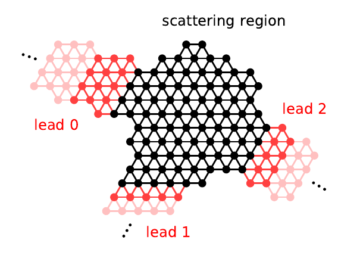

# NEGF formalism

Nonequilibrium Green's function (NEGF)은 반무한 전극에 연결된 소자의 전자 상태와 비평형 점유, 단자 전류를 일관되게 계산하는 방법이다. 닫힌 계의 DFT에서는 하나의 Fermi level을 기준으로 고유상태를 채우지만, 열린 소자에서는 **왼쪽 전극에서 주입된 상태와 오른쪽 전극에서 주입된 상태가 각 전극의 Fermi 분포를 따른다.** 따라서 같은 에너지에서도 두 전극과의 결합에 따라 소자 내부의 점유가 달라질 수 있다. NEGF는 전극의 영향을 self-energy로 포함하여 전자 상태를 계산하고, lesser Green's function에서 구한 전자 밀도로 Kohn–Sham (KS) Hamiltonian을 갱신할 수 있게 한다.[1–5]

이 문서는 SIESTA/TranSIESTA와 같은 **localized linear combination of atomic orbitals (LCAO)** 계산을 기본 모형으로 사용한다. 처음부터 일반적인 비직교 overlap 행렬 $S$를 포함하고, 식이 단순해지는 경우에만 $S=I$인 정규직교 기저로 제한한다. 좌우 전극을 $L,R$, 소자 영역을 $D$로 표기한다. 그리스 문자 **$\alpha\in\{L,R\}$는 전극을 선택하는 지표**, **$\mu,\nu$는 localized basis orbital을 선택하는 지표**이다. 전극의 electrochemical potential은 $\mu_\alpha$로 적는데, 여기의 아래첨자 $\alpha$는 orbital 지표 $\mu,\nu$와 서로 다른 역할을 한다. 각 기호의 물리적 의미와 정의를 필요한 절에서 다시 확인한다.[4,5]

전자는 전하 $-e$를 가지며 $e>0$이다. 이 글에서는 $I_\alpha>0$을 전극 $\alpha$에서 소자로 들어오는 **전자 입자 flux에 $+e$를 곱한 값**으로 정의한다. 따라서 이는 전자가 운반하는 실제 음전하의 방향과 반대인 전류 부호 규약이다. Spin을 행렬의 자유도로 포함한 경우에는 추가로 spin 축퇴 인자 2를 곱하지 않는다. 기본 전개는 정상 직류, 비상호작용 전극, 유효 단일입자 KS Hamiltonian과 coherent 수송을 기준으로 한다. 내부 산란 self-energy를 넣는 일반화는 필요한 곳에서 구분한다.[1–3]

## 1. Localized LCAO 기저와 전극–소자 분할

### (1) 원자 궤도에서 Hamiltonian 행렬까지

원자 규모의 소자를 기술할 때에는 원자 주변에 국소화된 basis function $|\phi_\mu\rangle$를 사용한다. 하나의 원자에 여러 s, p, d 또는 polarization orbital이 포함될 수 있으므로, **$\mu$는 원자 번호가 아니라 전체 basis orbital 번호**이다. 전자 상태를 $|\psi\rangle=\sum_\mu c_\mu|\phi_\mu\rangle$로 전개하면 전자구조 문제는 다음 일반화된 고유값 문제로 표현된다.[4,5]

$$
H_{\mu\nu}=\langle\phi_\mu|\hat H_{\mathrm{KS}}|\phi_\nu\rangle,\qquad
S_{\mu\nu}=\langle\phi_\mu|\phi_\nu\rangle,\qquad
H\mathbf c_n=\varepsilon_n S\mathbf c_n.
$$

$H_{\mu\nu}$는 orbital $\nu$와 $\mu$ 사이의 Hamiltonian matrix element이고, $S_{\mu\nu}$는 두 orbital의 overlap이다. Localized AO들은 서로 겹칠 수 있으므로 일반적으로 $S_{\mu\nu}\ne\delta_{\mu\nu}$이다. 고유벡터는 $\mathbf c_n^\dagger S\mathbf c_n=1$로 정규화한다. 이 문서에서 아래첨자 $\mu,\nu$가 붙은 $H$, $S$, $G$, $P$는 모두 **동일한 localized basis에서 표현한 행렬**이다. $H$와 $S$에는 각각 에너지와 무차원의 단위가 부여된다.

수송 방향을 따라 전체 계를 왼쪽의 반무한 전극 $L$, 명시적으로 계산하는 유한 영역 $D$, 오른쪽의 반무한 전극 $R$로 나눈다. Localized basis를 세 영역별로 정렬하면 **full Hamiltonian과 overlap 행렬**은 다음과 같다.[4,5]

$$
H_{\mathrm{full}}=
\begin{pmatrix}
H_L&H_{LD}&0\\
H_{DL}&H_D&H_{DR}\\
0&H_{RD}&H_R
\end{pmatrix},
\qquad
S_{\mathrm{full}}=
\begin{pmatrix}
S_L&S_{LD}&0\\
S_{DL}&S_D&S_{DR}\\
0&S_{RD}&S_R
\end{pmatrix}.
$$

$H_D,S_D$는 $D$에 포함된 $N_D$개 orbital의 유한 $N_D\times N_D$ 행렬이다. $H_\alpha,S_\alpha$는 전극 $\alpha=L,R$의 반무한 행렬이며, $H_{D\alpha},S_{D\alpha}$는 소자와 해당 전극에 속한 orbital 사이의 결합 및 overlap 블록이다. 이 두 full matrix에서 $L$–$R$ 직접 결합을 0으로 둔 이유는 양 전극의 상호작용을 유한 영역 $D$를 통해 모두 포함하도록 분할했기 때문이다. 더 멀리까지 미치는 Hamiltonian 또는 overlap 결합이 있으면 principal layer나 소자 영역을 확대해야 한다.[4,5]

| 표기 | 정의 | 이후 식에서의 역할 |
| --- | --- | --- |
| $\mu,\nu$ | Localized AO 번호 | $H_{\mu\nu}$, $S_{\mu\nu}$, $G_{\mu\nu}$, $P_{\mu\nu}$의 행·열 |
| $L,D,R$ | 왼쪽 전극, 유한 소자, 오른쪽 전극 | Full matrix의 block 분할 |
| $\alpha$ | 전극 지표, $\alpha=L$ 또는 $R$ | $\Sigma_\alpha$, $\Gamma_\alpha$, $f_\alpha$, $I_\alpha$ |
| $\mu_L,\mu_R$ | 전극별 electron electrochemical potential | Reservoir의 Fermi 점유 결정 |
| $E,z=E+i\eta$ | 실제 전자 에너지, retarded 복소 에너지 | Green's function의 energy argument |
| $G^R,G^A,G^<$ | 전파 응답, advanced 응답, 점유 상관 | Spectral weight와 density kernel |
| $P_{\mu\nu}$ | Density kernel의 orbital matrix element | 실공간 전자 밀도 복원 |

유한 영역에는 분자·결함뿐 아니라 접촉부에서 전하와 전위가 변하는 전극의 일부 원자층도 포함한다. 소자와 반무한 전극의 경계가 충분히 bulk-like한 곳에 놓여야, 반복 전극에서 얻은 self-energy와 소자 경계의 Hamiltonian·overlap이 일관된다. 이러한 분할의 개념을 아래 그림에 나타냈다.[4,5]

<figure markdown="span">

<figcaption markdown="1">
그림 1. 검은 영역은 명시적으로 계산하는 유한 영역, 붉은 영역은 반무한 전극이다. 원도는 lead 0, 1, 2의 세 단자이며, 아래 유도는 그중 일반적인 두 단자 구조를 별도로 가정한다. 출처: X. Waintal et al., “Computational quantum transport: A scattering approach perspective,” arXiv:2407.16257v3, Fig. 3, p. 17, [원문](https://arxiv.org/abs/2407.16257v3), [CC BY 4.0](https://creativecommons.org/licenses/by/4.0/). 수정하여 재현: PDF의 그림 영역만 발췌하여 PNG로 변환했으며 색과 레이블은 변경하지 않았다.[1]
</figcaption>
</figure>

원래 그림은 세 단자 사례를 보여 주지만, 이하의 유도에서는 그중 두 단자인 $L$–$D$–$R$을 사용한다. 전극은 첫 번째 경계 셀 뒤에도 무한히 반복되므로 첫 셀만 계산하고 끝내면 열린 경계조건을 잃게 된다. 다음 절에서는 이 반무한 반복 구조의 영향을 $D$에 작용하는 self-energy로 바꾼다.[1,5]

### (2) 전극의 electrochemical potential과 인가 전압

각 전극은 커다란 electron reservoir와 연결되어 있고, 내부에서는 국소 열평형을 유지한다. 전극 $\alpha$의 electron electrochemical potential $\mu_\alpha$는 **그 전극의 전자 점유를 구분하는 Fermi level(에너지 단위)**이며, 온도 $T_\alpha$와 함께 Fermi–Dirac 분포 $f_\alpha(E)$를 결정한다. 평형에서는 $\mu_L=\mu_R=E_F$이고, 두 전극 사이에 bias를 인가하면 일반적으로 $\mu_L\ne\mu_R$가 된다.[2–5]

아래에서는 에너지 차이를 전압으로 환산한 bias를

$$
V_b\equiv\frac{\mu_L-\mu_R}{e}
$$

로 **정의**한다. 따라서 $V_b>0$이면 $\mu_L>\mu_R$이며, 동일 온도에서 그 사이 에너지에 있는 상태는 왼쪽 전극의 주입이 더 많아질 수 있다. 예를 들어 평형 Fermi energy를 $E_F$로 잡고 대칭 bias를 사용하면 $\mu_L=E_F+eV_b/2$, $\mu_R=E_F-eV_b/2$이다. 이것은 전자 에너지 차이에 대한 부호 규약이다. 물리적 electrostatic voltage $\varphi_L-\varphi_R$와 비교할 때에는 전자의 potential energy가 $-e\varphi$라는 점과 전극의 work function, 접촉 전위를 함께 고려해야 한다.[4,5]

**전극의 $\mu_\alpha$와 소자 내 한 orbital의 onsite energy $\varepsilon_\mu$는 다른 물리량이다.** $\mu_\alpha$는 reservoir의 경계조건이며, $\varepsilon_\mu$는 Hamiltonian으로부터 얻는 전자 상태의 에너지이다. 특히 두 전극에 서로 다른 Fermi 분포가 존재하는 coherent 비평형 소자에는 모든 orbital에 공통으로 적용할 단 하나의 소자 chemical potential을 일반적으로 정의할 수 없다. 따라서 뒤에서는 소자 점유를 전극별 주입으로 계산한다.[2–5]

## 2. Retarded Green's function과 열린 경계

### (1) Localized basis의 Green's function

제1절의 일반화된 고유값 문제 $H_D\mathbf c=E S_D\mathbf c$를 에너지 $E$에서의 선형 응답 문제로 생각하자. 에너지 차원의 작은 양수 $\eta>0$로 복소 에너지 $z=E+i\eta$를 정의하고, 소자 orbital 공간의 외부 source 벡터를 $\mathbf b$라 쓰면 다음과 같다.[1–3,5]

$$
(zS_D-H_D)\mathbf c=\mathbf b,\qquad
\mathbf c=G_0^R(E)\mathbf b,\qquad
G_0^R(E)=(zS_D-H_D)^{-1}.
$$

아래첨자 0은 **아직 전극에 연결하지 않은 고립 소자**를 의미하고, 위첨자 $R$은 retarded Green's function을 의미한다. 행렬 원소 $G^R_{0,\mu\nu}(E)$는 $\nu$번째 orbital 성분의 source에 대한 $\mu$번째 orbital 성분의 응답이다. 따라서 $G^R$는 하나의 물리적 orbital이나 고유상태가 아니라, 선택한 모든 localized basis를 연결하는 $N_D\times N_D$ 행렬이다. 이 설명에서 $\mu,\nu$는 모두 $D$에 속한 orbital 번호이다.

$+i\eta$는 시간상 나중에 발생하는 응답을 선택하는 retarded boundary condition이며, 실제 물리식에는 $\eta\to0^+$의 극한을 사용한다. 전극으로의 탈출에 따른 물리적 broadening은 다음 절에서 정의할 $\Gamma_L,\Gamma_R$가 결정한다. 수치적 $\eta$를 크게 사용하면 상태가 인위적으로 넓어질 수 있으므로 두 효과를 구분해야 한다.[1–3]

고립 소자의 고유벡터 $\mathbf c_m$을 $\mathbf c_m^\dagger S_D\mathbf c_n=\delta_{mn}$로 정규화하면, 완결된 유한 기저 안에서 Green's function은 다음과 같이 전개된다.[4,5]

$$
G_0^R(E)=\sum_m\frac{\mathbf c_m\mathbf c_m^\dagger}{E-\varepsilon_m+i\eta}.
$$

분모는 고립 소자의 고유에너지 $\varepsilon_m$에 대한 응답을, 분자의 바깥곱 $\mathbf c_m\mathbf c_m^\dagger$는 해당 상태가 여러 AO에 어떻게 분포하는지를 나타낸다. 따라서 $G^R_{0,\mu\nu}$에는 서로 다른 localized orbital 사이의 혼합도 포함된다. 정규직교 기저를 쓰면 $S_D=I_D$가 되어 익숙한 $(zI_D-H_D)^{-1}$을 회복한다.

### (2) 두 전극에 연결된 소자의 Green's function

실제 NEGF에서는 전자가 $D$에서 왼쪽·오른쪽 전극으로 이동한 뒤 전극의 연속 상태에 흡수될 수 있다. 이 영향을 소자 orbital 공간의 retarded self-energy $\Sigma_\alpha^R(E)$에 포함하면, 앞의 고립 소자 Green's function은 다음의 **열린 소자 Green's function**으로 바뀐다.[1–5]

$$
G^R(E)=
\left[
zS_D-H_D-\Sigma_L^R(E)-\Sigma_R^R(E)
\right]^{-1},\qquad
G^A(E)=[G^R(E)]^\dagger.
$$

여기서 $\Sigma_L^R$와 $\Sigma_R^R$는 **각각 왼쪽 전극과 오른쪽 전극의 영향**이다. 보다 간결하게 쓸 때 $\sum_{\alpha=L,R}\Sigma_\alpha^R$로 표기한다. 즉, 이 문서의 $\alpha$는 언제나 $L$ 또는 $R$을 대신하는 전극 지표이다. $H_D,S_D,G^R,\Sigma_\alpha^R$는 모두 $N_D\times N_D$ 행렬이며, 예를 들어 $G_{\mu\nu}^R$와 $(\Sigma_\alpha^R)_{\mu\nu}$의 $\mu,\nu$는 동일한 소자 basis를 가리킨다.

Advanced Green's function $G^A$는 retarded Green's function의 Hermitian conjugate로 정의한다. 이 두 행렬을 사용하여 상태의 spectral weight와 실제 점유를 계산한다. $\Sigma_\alpha^R$가 복소수 행렬이고 에너지에 의존할 수 있으므로, 전극에 연결된 공명 준위는 고립계 고유에너지에서 이동하거나 폭을 가질 수 있다. 다음 절에서는 full $H,S$로부터 이 self-energy가 어떻게 나오는지 유도한다.

## 3. 전극 self-energy와 broadening

### (1) Full Hamiltonian·overlap의 전극 자유도 소거

제1절에서 정의한 **full Hamiltonian $H_{\mathrm{full}}$과 overlap $S_{\mathrm{full}}$**로 돌아가자. 두 행렬은 localized orbital을 $L,D,R$ 순서로 정렬한 것이며, 그 차이인 energy matrix는 다음 블록 구조를 갖는다.[4,5]

$$
\mathcal K(z)\equiv zS_{\mathrm{full}}-H_{\mathrm{full}}
=
\begin{pmatrix}
zS_L-H_L&zS_{LD}-H_{LD}&0\\
zS_{DL}-H_{DL}&zS_D-H_D&zS_{DR}-H_{DR}\\
0&zS_{RD}-H_{RD}&zS_R-H_R
\end{pmatrix}.
$$

전극의 자유도를 제거할 때 필요한 전체 Green's function은 $G_{\mathrm{full}}^R=\mathcal K^{-1}$이다. 여기서 $G_{DD}^R$는 full Green's function 중 소자 orbital의 행과 열에 해당하는 유한 블록을 뜻한다. 전극 $\alpha=L,R$에 대해서는 $K_{\alpha\alpha}=zS_\alpha-H_\alpha$, $K_{D\alpha}=zS_{D\alpha}-H_{D\alpha}$라고 표기할 수 있다.

$\mathcal K G_{\mathrm{full}}^R=I$에서 소자 열을 선택하면, 전극 $\alpha$에 해당하는 행은 다음을 만족한다.

$$
K_{\alpha\alpha}G_{\alpha D}^R
+K_{\alpha D}G_{DD}^R=0.
$$

이 방정식을 $G_{\alpha D}^R$에 대해 풀면 $G_{\alpha D}^R=-(K_{\alpha\alpha})^{-1}K_{\alpha D}G_{DD}^R$이다. 전극 내부의 무한한 자유도가 $G_{DD}^R$에 미치는 영향을 이 식으로 대체할 수 있다. 이를 전체 행렬의 소자 행에 대입하면 다음 Schur complement를 얻는다.[4,5]

$$
\left[
zS_D-H_D
-\sum_{\alpha=L,R}K_{D\alpha}
 (zS_\alpha-H_\alpha)^{-1}K_{\alpha D}
\right]G_{DD}^R=I_D.
$$

따라서 $G^R\equiv G_{DD}^R$와 $\widetilde g_\alpha^R=(zS_\alpha-H_\alpha)^{-1}$를 정의하면, 전극 self-energy는 아래와 같다.

$$
\Sigma_\alpha^R(z)=
 (H_{D\alpha}-zS_{D\alpha})
 \widetilde g_\alpha^R(z)
 (H_{\alpha D}-zS_{\alpha D}).
$$

앞의 두 괄호는 full energy matrix의 off-diagonal block에 각각 마이너스 부호를 붙인 것이므로 Schur complement의 전체 부호가 일치한다. 즉, $H_D$에서 전극 원자와 전극–소자 결합을 단순히 삭제하는 대신, **전극의 무한한 응답을 유한한 self-energy 행렬로 정확히 접어 넣은 결과**이다. 이 소거는 주어진 single-particle $H,S$에 대해서 정확하며, KS 근사 자체의 정확성까지 보장하는 주장은 아니다.[4,5]

### (2) Surface Green's function과 orbital별 결합

실제 소자 orbital과 직접 결합하는 것은 각 전극의 첫 번째 principal layer에 있는 orbital들이다. 따라서 $\widetilde g_\alpha^R$ 전체를 저장하는 대신 전극의 경계 orbital에 해당하는 **surface Green's function** $g_{\alpha,s}^R$만 계산한다. 소자와 경계 orbital 사이의 결합을 $C_{D\alpha}(z)=H_{D\alpha}-zS_{D\alpha}$로 정의하면 self-energy는 다음과 같이 쓸 수 있다.[4,5]

$$
\Sigma_\alpha^R(z)
=C_{D\alpha}(z)\,
g_{\alpha,s}^R(z)\,
C_{\alpha D}(z),\qquad
C_{\alpha D}(z)=H_{\alpha D}-zS_{\alpha D}.
$$

이 식에서 $C_{D\alpha}$는 $N_D\times N_{\alpha,s}$, $g_{\alpha,s}^R$는 $N_{\alpha,s}\times N_{\alpha,s}$ 행렬이다. 결과인 $\Sigma_\alpha^R$의 크기는 $N_D\times N_D$가 된다. 여기서 $N_{\alpha,s}$는 전극 경계 principal layer의 orbital 수이다. 앞서 사용한 $\alpha$는 여전히 **전극의 종류**이며, orbital 번호는 $\mu,\nu$를 계속 사용한다.

예를 들어 소자 orbital $\mu,\nu\in D$에 대한 self-energy 성분은 다음과 같다. 합의 지표 $p,q$는 해당 전극 경계의 localized orbital을 가리킨다.

$$
(\Sigma_\alpha^R)_{\mu\nu}
=\sum_{p,q\in\alpha\text{ surface}}
(C_{D\alpha})_{\mu p}
(g_{\alpha,s}^R)_{pq}
(C_{\alpha D})_{q\nu}.
$$

따라서 전극 하나에 연결되어 있어도 여러 소자 orbital 사이에 self-energy의 비대각 성분이 생길 수 있다. Surface Green's function은 반무한 전극 전체를 고려한 경계 응답이며, **고립된 첫 번째 원자층의 Hamiltonian 역행렬이 아니다.** 구체적인 반복·decimation 계산은 [Surface Green's function](surface-greens-function.md)에서 설명한다.[4,5]

비직교 기저에서는 $H_{D\alpha}$와 $S_{D\alpha}$를 **모두** 포함해야 한다. 또한 $z=E+i\eta$가 복소수이므로 $C_{\alpha D}(z)$를 일반적으로 $C_{D\alpha}(z)^\dagger$로 대체할 수 없다. Hermitian $H,S$에 대해 $C_{D\alpha}(z)^\dagger=H_{\alpha D}-z^*S_{\alpha D}$인 반면, 정확한 retarded self-energy에서는 양쪽 결합을 같은 $z$에서 평가한다. 실수 에너지축의 $\eta\to0^+$ 극한에서는 이러한 차이가 사라진다.[4,5]

### (3) Level shift와 broadening 행렬

전극 self-energy는 일반적으로 복소수이며, Hermitian 부분과 anti-Hermitian 부분을 다음처럼 분리한다.[1–3]

$$
\Lambda_\alpha(E)
=\frac{\Sigma_\alpha^R+\Sigma_\alpha^A}{2},
\qquad
\Gamma_\alpha(E)
=i\bigl(\Sigma_\alpha^R-\Sigma_\alpha^A\bigr),
\qquad
\Sigma_\alpha^R=\Lambda_\alpha-\frac{i}{2}\Gamma_\alpha.
$$

$\Sigma_\alpha^A=(\Sigma_\alpha^R)^\dagger$이다. $\Lambda_\alpha$는 전극과 결합하면서 소자의 에너지 준위가 이동하고 혼합되는 효과를, $\Gamma_\alpha$는 해당 전극의 연속 상태로 전자가 빠져나갈 수 있는 폭을 나타낸다. 두 행렬의 단위는 모두 에너지이다. 정상적인 수동 전극에 대해 실수 에너지에서 $\Gamma_\alpha$는 Hermitian 양의 준정부호이다.

**$\Gamma_\alpha$는 소자 orbital 공간의 전체 행렬**이다. 특히 $(\Gamma_\alpha)_{\mu\nu}$는 orbital $\mu,\nu$가 전극 $\alpha$를 통해 어떻게 연결되는지를 나타낸다. 단일 orbital 모형에서는 이 행렬이 비음수 실수 하나로 축소되지만, 일반적인 LCAO 계산에서는 각 orbital에 공통인 하나의 탈출률로 바꿔서는 안 된다. 실제로 특정 에너지에 전극의 전파 상태가 없으면 해당 연속체로의 broadening은 0이 될 수 있지만, $\Lambda_\alpha$에 의한 에너지 이동은 남을 수 있다.[1–3]

이제 전극 자유도 소거와 self-energy를 모두 포함한 **핵심 행렬식**을 다시 쓰면 다음과 같다.

$$
\boxed{
G^R(E)=
\left[zS_D-H_D-\Sigma_L^R(E)-\Sigma_R^R(E)\right]^{-1}
}
$$

이 식의 모든 행렬은 소자 영역 $D$의 동일한 $\mu,\nu$ 기저로 표현한다. 따라서 나중에 구하는 점유 행렬과 전류식도 **바로 이 $G^R$와 동일한 $\Sigma_\alpha,\Gamma_\alpha$**를 사용해야 한다.

## 4. Spectral function과 DOS

### (1) 에너지에 따른 상태의 분포

제3절에서 계산한 $G^R$는 전자가 주어진 에너지에서 어떻게 전파되는지 나타낸다. 이로부터 구성하는 **spectral function** $A(E)$는 소자의 각 orbital과 orbital 사이에 해당 에너지의 전자 상태가 얼마나 존재하는지 나타낸다. $A$는 $G^R$, $G^A$와 같은 $N_D\times N_D$ 행렬이다.[1–3]

$$
A(E)=i[G^R(E)-G^A(E)],\qquad
A_{\mu\nu}(E)=i[G_{\mu\nu}^R(E)-G_{\mu\nu}^A(E)].
$$

$G^R$와 $A$의 단위는 에너지의 역수이다. 여기서 $A_{\mu\nu}$의 $\mu,\nu$는 제1절에서 정의한 **localized 소자 orbital 번호**이다. 정규직교 기저($S_D=I_D$)를 사용하면 전체 orbital density of states (DOS)와 orbital-resolved DOS는 다음과 같이 쓸 수 있다.[1,2]

$$
D(E)=\frac1{2\pi}\operatorname{Tr}A(E),\qquad
D_\mu(E)=\frac{A_{\mu\mu}(E)}{2\pi}
=-\frac1\pi\operatorname{Im}G^R_{\mu\mu}(E).
$$

이러한 DOS는 **에너지 $E$에서 이용할 수 있는 상태**에 대한 정보이다. 실제로 전자가 얼마만큼 채워져 있는지는 전극의 $\mu_L,\mu_R$에 의해 정해지는 점유 분포를 추가로 알아야 한다. 예를 들어 DOS peak가 있어도 두 전극의 Fermi level보다 훨씬 위에 위치하면 전자 점유는 작을 수 있다.

### (2) 두 전극에서 유입된 partial spectral function

전극만이 전자 상태의 broadening을 만든 coherent 모형에서는, 제3절의 Green's function을 이용하여 다음 항등식을 얻는다.[1–3]

$$
A=G^R[\Gamma_L+\Gamma_R+2\eta S_D]G^A.
$$

이 식은 원래의 **비직교 localized basis**에 대해서도 성립한다. 여기서 $2\eta S_D$는 retarded boundary condition에 사용한 $z=E+i\eta$에서 발생한다. 직교 기저($S_D=I_D$)에서는 이 항이 $2\eta I_D$로 바뀐다. $\eta\to0^+$에서 전극 연속체와 연결된 상태에 주목하면, 전극별로 주입될 수 있는 spectral weight를 다음처럼 분리한다.

$$
A_\alpha(E)=G^R(E)\Gamma_\alpha(E)G^A(E),
\qquad
A=A_L+A_R.
$$

$\alpha=L$은 왼쪽 전극에서, $\alpha=R$은 오른쪽 전극에서 유입된 상태를 뜻한다. 행렬 원소까지 쓰면 다음과 같다.

$$
(A_\alpha)_{\mu\nu}
=\sum_{\lambda,\kappa\in D}
G^R_{\mu\lambda}\,
(\Gamma_\alpha)_{\lambda\kappa}\,
G^A_{\kappa\nu}.
$$

따라서 $(A_L)_{\mu\nu}$와 $(A_R)_{\mu\nu}$는 같은 localized orbital 쌍 $\mu,\nu$에서도 다를 수 있다. **어떤 전극의 전자를 얼마나 점유할지는 다음 절에서 각 partial spectral function에 $f_\alpha(E)$를 곱하여 결정한다.**

완전히 고립된 bound state가 있으면 $2\eta G^RS_DG^A$ 항을 $\eta\to0^+$ 전에 단순히 삭제할 수 없다. 적분 후에도 해당 상태의 spectral weight가 남을 수 있기 때문이다. 그런 상태에는 전극의 주입만으로 정해지지 않는 점유 조건이 추가로 필요하다.[1,2,4]

### (3) 비직교 LCAO에서 real-space LDOS

LCAO 계산의 $A_{\mu\nu}$는 **matrix coefficient**이다. Nonorthogonal basis에서는 대각 원소 $A_{\mu\mu}$만을 독립적인 원자 orbital DOS라고 해석하면 overlap으로 생기는 다른 orbital의 기여가 빠진다. 실제 공간의 local density of states (LDOS)는 모든 관련 basis function의 곱으로 spectral kernel을 복원하여 구한다.[4,5]

$$
D(\mathbf r,E)=
\frac1{2\pi}
\sum_{\mu,\nu}
\phi_\mu(\mathbf r)\,
A_{\mu\nu}(E)\,
\phi_\nu^*(\mathbf r).
$$

유한한 완결 basis의 전체 상태 수를 세는 matrix trace에는 overlap metric이 들어가며, 그 표현은 $D(E)=\operatorname{Tr}[S A(E)]/(2\pi)$이다. 다만 열린 소자 영역의 $S_D$와 $A_{DD}$만을 취한 부분 trace를 임의의 실공간 구간에 존재하는 정확한 총 DOS로 동일시할 수는 없다. 소자와 전극의 경계에서 orbital 꼬리와 교차 overlap을 어떻게 포함했는지에 따라 공간 분할이 달라지기 때문이다. 이러한 경계 기여는 DFT-NEGF 밀도 계산에서도 일관되게 처리해야 한다.[4,5]

이 절의 $A$, $A_L$, $A_R$는 **상태의 에너지 분포**를 나타낸다. 실제 전자 수와 전류를 구하려면 전극의 Fermi 점유까지 포함한 lesser Green's function이 필요하다.

## 5. Lesser Green's function과 비평형 전자 점유

### (1) 왜 retarded Green's function만으로 점유를 알 수 없는가

제4절의 $A(E)$는 전자 상태의 spectral weight를 알려 주지만, 각 상태에 전자가 실제로 얼마나 채워져 있는지는 결정하지 않는다. 그 점유를 기술하는 상관 함수가 **lesser Green's function** $G^<(E)$이다. 먼저 정규직교 단일입자 표현에서 orbital 상태 $\mu$의 소멸 연산자를 $c_\mu$, 생성 연산자를 $c_\mu^\dagger$라고 하자. 정상 상태에서 시간 차이 $\tau=t-t'$의 Fourier transform을 사용하면[1–3]

$$
G^<_{\mu\nu}(E)=\frac{i}{\hbar}\int d\tau\,
 e^{iE\tau/\hbar}
 \left\langle c_\nu^\dagger(0)c_\mu(\tau)\right\rangle,
\qquad
G^>_{\mu\nu}(E)=-\frac{i}{\hbar}\int d\tau\,
 e^{iE\tau/\hbar}
 \left\langle c_\mu(\tau)c_\nu^\dagger(0)\right\rangle
$$

로 정의한다. $\hbar=h/(2\pi)$이다. Lesser 함수 $G^<$는 점유된 전자 상태의 상관을, greater 함수 $G^>$는 비점유 상태의 상관을 담는다. $G^<$의 대각 원소는 점유와 관련되고 비대각 원소는 서로 다른 orbital 사이의 상관을 포함한다. 첨자 $\mu,\nu$의 순서가 정의된 연산자 순서와 연결되므로 이후 density kernel의 첨자도 동일하게 사용한다.

위 연산자 식은 **정규직교한 상태와 canonical 생성·소멸 연산자**에서 직접 정의한 표현이다. 실제 localized LCAO는 비직교하므로 생성·소멸 연산자를 그대로 정규직교 orbital처럼 다루기보다는, 해당 상관 함수를 비직교 basis로 변환하여 **$G^R=(zS-H-\Sigma)^{-1}$와 일관된 coefficient-matrix 표현**을 사용한다. 이하에서 $G^<_{\mu\nu}$와 density kernel $P_{\mu\nu}$는 바로 이 동일한 LCAO 표현의 성분을 뜻한다.[4,5]

전자 및 비점유 상관을 양의 spectral weight와 연결하기 위해

$$
G^n=-iG^<,\qquad G^p=iG^>,\qquad A=G^n+G^p
$$

로 정의한다. 위첨자 $n$은 electron correlation, $p$는 같은 전자 상태의 비점유 부분을 가리킨다. 여기서는 별도의 정공 유효질량 모형을 도입한 것이 아니다. 에너지 단위는 $G^R$, $G^<$와 같다. 평형에서는 하나의 Fermi 분포 $f(E)$가 있으므로 $G^n=fA$와 $G^p=(1-f)A$가 성립한다.[1–3]

### (2) Reservoir Fermi 분포와 chemical potential

제1절에서 정의한 전극 지표 $\alpha=L,R$를 다시 사용하자. $\mu_\alpha$는 전극 $\alpha$의 **electron electrochemical potential**이고, $T_\alpha$는 해당 전극의 온도이다. 전극 내부는 열평형을 유지하므로 주입되는 전자의 Fermi–Dirac 점유는 다음과 같다.[2–5]

$$
f_\alpha(E)=
\frac{1}{1+\exp[(E-\mu_\alpha)/(k_BT_\alpha)]},
\qquad \alpha\in\{L,R\}.
$$

여기서 $k_B$는 Boltzmann 상수이고, $E$와 $\mu_\alpha$는 **같은 에너지 기준**으로 측정한다. 에너지가 $\mu_\alpha$보다 충분히 낮으면 $f_\alpha\approx1$, 충분히 높으면 $f_\alpha\approx0$이다. 영온에서는 $\mu_\alpha$가 점유와 비점유 에너지 구간의 경계가 된다. 두 전극의 온도가 같고 $\mu_L=\mu_R$이면 전역 평형을 이루며 공통 Fermi 함수 하나를 사용한다.

비평형에서는 일반적으로 $f_L(E)\ne f_R(E)$이다. 이는 **소자 내부의 모든 orbital이 서로 다른 두 Fermi 분포를 갖는다**는 말이 아니라, 왼쪽과 오른쪽에서 들어오는 전자 상태의 주입 조건이 다르다는 뜻이다. 전극과 소자 사이의 결합 행렬이 각 주입 상태의 공간 분포를 결정하므로, 소자 안의 실제 점유는 아래 Keldysh 관계로 구해야 한다.[2–5]

전극 $\alpha$가 제공하는 lesser·greater self-energy는

$$
\Sigma_\alpha^<(E)=if_\alpha(E)\Gamma_\alpha(E),\qquad
\Sigma_\alpha^>(E)=-i[1-f_\alpha(E)]\Gamma_\alpha(E)
$$

이다. 여기서 $f_\alpha$는 **에너지별 scalar 점유 함수**이고, $\Gamma_\alpha$는 제3절에서 정의한 **$N_D\times N_D$ broadening 행렬**이다. 두 값을 곱하면 전극 $\alpha$가 소자 orbital 공간에 제공하는 점유·비점유 주입 행렬이 된다.

### (3) Keldysh 관계와 orbital matrix의 점유

내부에 별도의 inelastic scattering self-energy가 없고, 전극과 완전히 분리된 bound state의 점유도 별도로 필요하지 않은 coherent 정상 상태를 생각하자. 그러면 소자의 lesser Green's function은

$$
G^<(E)=G^R(E)\bigl[\Sigma_L^<(E)+\Sigma_R^<(E)\bigr]G^A(E)
$$

로 주어진다. $\Sigma_\alpha^<$를 대입하고 제4절의 $A_\alpha=G^R\Gamma_\alpha G^A$를 이용하면 다음 결과를 얻는다.[1–5]

$$
\boxed{G^n(E)=f_L(E)A_L(E)+f_R(E)A_R(E)}
$$

이 식이 **일반적인 다중 orbital LCAO 모형에서 점유를 계산하는 기본 관계**이다. 좌변의 $G^n$은 $N_D\times N_D$ 행렬이고, 우변의 $A_L,A_R$도 동일한 크기이다. 특히 orbital 행렬 원소로 쓰면

$$
G^n_{\mu\nu}(E)=
f_L(E)(A_L)_{\mu\nu}(E)
+f_R(E)(A_R)_{\mu\nu}(E),
\quad \mu,\nu\in D.
$$

따라서 diagonal 성분뿐 아니라 orbital 사이의 비대각 상관도 왼쪽·오른쪽 전극의 점유로부터 결정된다. 앞 절에 정의한 $G^R$, $\Gamma_\alpha$, $G^A$를 다시 대입하면, 같은 식을 모든 행렬곱이 드러난 형태로 쓸 수 있다.

$$
G^n(E)=
G^R(E)
\left[
f_L(E)\Gamma_L(E)+f_R(E)\Gamma_R(E)
\right]G^A(E).
$$

비평형 다중 orbital 소자에서는 일반적으로 **$G^n=f_{\mathrm{eff}}A$를 만족하는 하나의 scalar $f_{\mathrm{eff}}$가 존재하지 않는다.** 이는 전극별 spectral 행렬 $A_L$와 $A_R$가 서로 다른 orbital 혼합을 포함하기 때문이다. 뒤의 제7절에서 소개할 $f_{\mathrm{eff}}=(\Gamma_Lf_L+\Gamma_Rf_R)/(\Gamma_L+\Gamma_R)$는 **한 개의 정규화된 orbital만 남긴 scalar 모형**에 대한 별도의 결과이다. 따라서 모든 orbital 쌍 $\mu,\nu$에 같은 식을 대입하거나 소자 전체에 하나의 chemical potential을 부여하지 않는다.[2,3]

정규직교 기저에서 특정 orbital $\mu$의 **에너지별 diagonal spectral 점유 비율**은 $A_{\mu\mu}>0$인 경우

$$
f_\mu^{\mathrm{diag}}(E)
=\frac{G^n_{\mu\mu}(E)}{A_{\mu\mu}(E)}
=\frac{f_L(A_L)_{\mu\mu}+f_R(A_R)_{\mu\mu}}
       {(A_L)_{\mu\mu}+(A_R)_{\mu\mu}}
$$

로 정의할 수 있다. 여기의 가중치는 단순한 scalar $\Gamma_L,\Gamma_R$가 아니라 **그 orbital에 실제로 도달한 partial spectral weight**이다. 다른 orbital에서는 가중치가 달라질 수 있고, 비대각 성분에 대한 같은 비율은 점유 확률로 해석할 수 없다. 비직교 LCAO에서는 한 원소의 diagonal 비율도 기저 변환과 orbital population 규약에 의존하므로, 실제 공간의 spectral density를 복원한 뒤 해석하는 편이 명확하다.

### (4) Density kernel과 실공간 전자 밀도

점유된 spectral 행렬을 모든 에너지에 걸쳐 적분하면 single-particle density kernel $P$를 얻는다. 이 문서에서 사용하는 에너지·Fourier 규약은 다음과 같다.[1–5]

$$
P_{\mu\nu}
=\frac1{2\pi}\int_{-\infty}^{\infty}G^n_{\mu\nu}(E)\,dE
=-\frac{i}{2\pi}\int_{-\infty}^{\infty}G^<_{\mu\nu}(E)\,dE.
$$

정규직교 기저에서 $P_{\mu\nu}$는 $P_{\mu\nu}=\langle c_\nu^\dagger c_\mu\rangle$에 대응한다. 비직교 LCAO 계산에서도 일관된 coefficient-matrix 표현으로 구한 $P_{\mu\nu}$를 사용하여 공간 밀도를 복원한다.

$$
n(\mathbf r)=
\sum_{\mu,\nu}
\phi_\mu(\mathbf r)\,P_{\mu\nu}\,\phi_\nu^*(\mathbf r),
\qquad
N=\int n(\mathbf r)\,d\mathbf r
=\operatorname{Tr}(PS).
$$

여기서 $n(\mathbf r)$는 전하밀도가 아니라 electron number density이다. **$\mu,\nu$에 대한 이중합은 모든 orbital의 diagonal 점유뿐 아니라 orbital 사이의 비대각 coherence도 포함한다.** $N=\operatorname{Tr}(PS)$는 선택한 전체 비직교 기저의 overlap을 포함하여 전자 수를 계산하는 관계이다. $P_{\mu\mu}$만 합하는 $\operatorname{Tr}P$는 $S=I$일 때의 전자 수 식이다.[4,5]

열린 영역의 $P_{DD}$만 계산했다면 소자 바깥에 중심을 둔 basis orbital의 꼬리나 경계 교차항이 실제 공간 밀도에 영향을 줄 수 있다. 전극과 닮은 원자층을 소자에 충분히 포함하고, 필요한 경계 기여를 bulk density와 일관되게 연결해야 한다. Mulliken이나 Löwdin과 같은 orbital population 분석은 별도의 분할 규약을 사용하므로 density kernel의 diagonal을 원자별 전자 수와 동일시하지 않는다.[4,5]

전극에서 완전히 분리된 bound state는 전극별 주입식으로 점유가 결정되지 않는다. 이 상태에는 초기 준비 또는 추가 평형화 조건에 대한 별도의 가정이 필요하다. Self-consistent density를 계산할 때 임의의 평균 Fermi 함수를 넣어 누락된 점유를 채우면 전위도 인위적으로 달라질 수 있다.[1,4]

## 6. Transmission과 전극별 전류

### (1) 점유 상관으로 계산하는 접촉 전류

전극 $\alpha=L,R$에서 소자로 주입되는 순전류를 계산하려면 해당 전극이 제공하는 점유뿐 아니라 이미 소자에 존재하는 전자의 역방향 흐름도 알아야 한다. 비상호작용 전극이 소자에 bilinear coupling으로 연결된 정상 상태에서는 다음의 접촉 전류식을 사용할 수 있다. 소자 내부에 상호작용 self-energy가 있다면 그 영향을 포함하여 계산한 $G^{<,>}$를 사용해야 한다.[2,3]

$$
I_\alpha
=\frac{e}{h}\int dE\,
\operatorname{Tr}\!\left[
\Sigma_\alpha^<G^>
-\Sigma_\alpha^>G^<
\right]
=\frac{e}{h}\int dE\,
\operatorname{Tr}\!\left[
\Gamma_\alpha(f_\alpha A-G^n)
\right].
$$

여기서 $\Sigma_\alpha^{<,>}$와 $\Gamma_\alpha$는 전극 **$\alpha$의 주입·탈출 행렬**이고, $G^<,G^n,A$는 **소자 전체 $\mu,\nu$ orbital 공간의 행렬**이다. Trace는 이 소자 orbital 공간에 대해 취한다. 예를 들어 $\operatorname{Tr}(\Gamma_\alpha G^n)=\sum_{\mu,\nu\in D}(\Gamma_\alpha)_{\mu\nu}G^n_{\nu\mu}$이므로, 일반적으로 비대각 orbital 상관도 전류에 기여한다.

첫 번째 형태의 $\Sigma_\alpha^<G^>$는 전극에서 채워진 상태가 소자의 비점유 상태로 유입되는 기여이고, $\Sigma_\alpha^>G^<$는 소자의 점유 상태가 전극의 빈 상태로 이동하는 기여이다. 두 번째 형태에는 전극의 Fermi 함수 $f_\alpha$와 소자의 실제 점유 행렬 $G^n$를 사용한다. 이 식에서 전극의 electrochemical potential $\mu_\alpha$는 $f_\alpha(E)$를 통해 전류를 결정한다.[2,3]

소자 내부에 전자가 장시간 축적되지 않는 정상 상태에서 전하가 보존되면 $I_L+I_R=0$을 만족한다. 전극 하나의 전류만 확인하는 대신 양쪽 값을 독립적으로 계산하면 부호 규약이나 수치 적분 오차를 검사할 수 있다. 물리적인 산란 self-energy를 포함한 계산에서는 전류 보존이 성립하도록 self-energy와 점유를 일관되게 구해야 한다.[2,3]

### (2) Coherent 단일입자 전류와 Caroli transmission

소자 내부에 별도의 inelastic self-energy가 없는 coherent 유효 단일입자 문제로 제한하자. 제5절의

$$
G^n=f_LA_L+f_RA_R,\qquad
A=A_L+A_R,\qquad
A_\alpha=G^R\Gamma_\alpha G^A
$$

를 왼쪽 전류식에 대입하면, 같은 왼쪽 전극에서 주입·유출되는 성분이 서로 상쇄되고 $f_L-f_R$에 비례하는 항이 남는다. 이를 **Caroli transmission**으로 정의하면[1–3,5]

$$
T(E)=\operatorname{Tr}\!\left[
\Gamma_L(E)G^R(E)\Gamma_R(E)G^A(E)
\right],
$$

$$
I_L=\frac{e}{h}\int_{-\infty}^{\infty}
T(E)\,[f_L(E)-f_R(E)]\,dE,\qquad I_R=-I_L.
$$

$T(E)$는 에너지 $E$에서 왼쪽과 오른쪽 전극 사이에 전자를 전달하는 **무차원 확률의 채널별 합**이다. 앞의 $A(E)$와 $A_\alpha(E)$는 에너지 역수 차원의 spectral weight이므로, DOS peak가 크다는 사실만으로 transmission이 크다고 결론 내릴 수 없다. 전달을 위해서는 두 전극 모두에 연결되는 경로가 필요하다.

**이 식도 LCAO의 full 소자 행렬을 사용한다.** $\Gamma_L,\Gamma_R,G^R,G^A$는 모두 $N_D\times N_D$이며, 개별 행렬 원소의 곱이 아니라 행렬곱과 trace를 계산한다. 특히 $\Gamma_\alpha$의 비대각 성분과 $G_{\mu\nu}^R$의 간섭 기여를 포함한다. 전류식의 spin 자유도가 이미 행렬에 포함되어 있으면 추가 인자 2를 곱하지 않는다. 한 spin 블록만 계산하고 두 spin이 독립적으로 축퇴된 경우에 한하여 전류를 두 배로 한다. 횡방향 주기성을 사용하면 $\mathbf k_\perp$별 transmission에 Brillouin-zone 가중치를 적용한다.[4,5]

같은 온도 $T$에서 $\mu_L=\mu_R=E_F$를 기준으로 두고 작은 bias $V_b=(\mu_L-\mu_R)/e$를 가하면, 선형 응답 conductance는

$$
G_{\mathrm{lin}}
=\left.\frac{\partial I_L}{\partial V_b}\right|_{V_b=0}
=\frac{e^2}{h}\int dE\,T(E,0)
\left(-\frac{\partial f(E)}{\partial E}\right).
$$

여기서 $f$는 평형 Fermi 함수이며 $T(E,0)$은 평형 Hamiltonian에서 계산한 transmission이다. 영온에서는 $G_{\mathrm{lin}}=(e^2/h)T(E_F,0)$가 된다. 유한 bias에서 Poisson 전위와 KS Hamiltonian이 바뀌는 경우에는 $T(E,V_b)$도 bias별로 계산해야 한다.[1,3–5]

## 7. 단일 공명 준위와 effective occupation

### (1) 다중 orbital 행렬에서 하나의 상태로 축소하는 가정

제1–6절에서는 소자 영역에 $N_D$개의 localized basis orbital이 있는 일반적인 NEGF 문제를 다뤘다. $H_{\mu\nu}$, $S_{\mu\nu}$, $G^R_{\mu\nu}$, $G^n_{\mu\nu}$는 모두 **$\mu,\nu=1,\ldots,N_D$에 대한 행렬**이다. 이 절에서는 그 일반식을 모든 orbital에 독립적으로 적용하는 대신, **소자의 수송을 대표하는 spin-resolved 공명 상태 하나만 남긴 별도의 모형**을 정의한다.[2,3]

예를 들어 여러 AO의 선형결합 $|d\rangle=\sum_{\mu\in D}u_\mu|\phi_\mu\rangle$로 유효 상태 하나를 만들 수 있다. 해당 상태를 $u^\dagger S_Du=1$로 정규화하고, 그 공간에서의 onsite energy를 $\varepsilon_0=u^\dagger H_Du$로 정의하자. 이후 다른 소자 상태와의 결합을 무시하거나 효과적인 energy-dependent self-energy로 처리한다면, 남긴 유효 상태 $|d\rangle$의 기저 차원은 **1**이 된다. 정규화한 단일 상태에 대한 overlap은 $S_d=1$이다.[2–5]

$$
H_D\quad(N_D\times N_D),\qquad
S_D\quad(N_D\times N_D)
\quad\longrightarrow\quad
H_d=(\varepsilon_0),\quad S_d=(1).
$$

이는 단지 임의의 AO 번호 $\mu$ 하나를 고르면 모든 물리량이 정확히 분리된다는 의미가 아니다. 원래 다중 orbital 공간에서 제외한 상태들이 남긴 상태와 혼합한다면 그 영향을 제거 과정에서 생기는 추가 self-energy로 포함해야 한다. 여기서는 **전자 수송이 하나의 고립된 공명으로 지배되고 나머지 모드의 영향이 이미 유효 에너지와 결합에 반영되었다는 근사**를 사용한다.

이 한 상태에 왼쪽·오른쪽 전극이 결합하면 self-energy도 각각 복소수 하나로 축소된다. 전극 $\alpha=L,R$에 대해 $\Sigma_{\alpha,d}^R(E)=\Delta_\alpha(E)-i\Gamma_\alpha(E)/2$라고 쓰자. $\Delta_\alpha$는 준위 이동, $\Gamma_\alpha\ge0$는 탈출에 의한 broadening을 나타낸다. 이 절에서 아래첨자가 생략된 $\Gamma_L,\Gamma_R$는 **단일 상태의 scalar coupling**이며, 앞 절에 등장한 $N_D\times N_D$ 행렬 $\Gamma_\alpha$와 같은 종류의 물리량이지만 차원은 1이다.

### (2) Wide-band 모형의 spectral function과 transmission

전극이 제공하는 상태 밀도와 결합이 관심 에너지 범위에서 거의 일정하다면 **wide-band approximation**을 사용할 수 있다. 여기서는 $\Delta_\alpha$와 $\Gamma_\alpha$를 에너지와 무관한 상수로 놓고, $\bar\varepsilon=\varepsilon_0+\Delta_L+\Delta_R$, $\Gamma=\Gamma_L+\Gamma_R>0$로 정의한다. 그러면 제2절의 열린 소자 resolvent는 다음 scalar 식이 된다.[2,3]

$$
G_d^R(E)=\frac{1}{E-\bar\varepsilon+i\Gamma/2},
\qquad
A_d(E)=\frac{\Gamma}
{(E-\bar\varepsilon)^2+(\Gamma/2)^2}.
$$

$A_d$는 중심 에너지가 $\bar\varepsilon$이고 전체 폭이 $\Gamma$인 Lorentzian spectral function이다. 각 전극에 연결된 partial spectral function은

$$
A_{\alpha,d}(E)=|G_d^R(E)|^2\Gamma_\alpha
=\frac{\Gamma_\alpha}
{(E-\bar\varepsilon)^2+(\Gamma/2)^2},
\qquad
A_d=A_{L,d}+A_{R,d}
$$

이다. 따라서 전체 spectral weight $A_d$는 **두 전극의 결합 합**에 비례하지만, 전류를 결정하는 transmission은 좌우 결합의 **곱**에 비례한다.

$$
T_d(E)=\Gamma_L\Gamma_R|G_d^R(E)|^2
=\frac{\Gamma_L\Gamma_R}
{(E-\bar\varepsilon)^2+(\Gamma/2)^2}.
$$

공명 중심 $E=\bar\varepsilon$에서는 $T_d=4\Gamma_L\Gamma_R/\Gamma^2\le1$이다. 좌우 결합이 같으면 하나의 spin-resolved channel에서 최대 transmission 1에 도달한다. 한쪽 결합이 매우 약하면 spectral peak는 존재하더라도 반대쪽 전극으로 전달되는 전자의 수는 작아진다.[2,3]

### (3) $f_{\mathrm{eff}}$의 유도와 chemical potential의 의미

이제 **단일 준위에서만** 왜 scalar effective occupation이 나오는지 유도하자. 일반적인 Keldysh 식은 제5절에서 설명한 $G^n=f_LA_L+f_RA_R$이다. 단일 준위에는 행렬곱이 모두 scalar 곱셈으로 바뀌므로 다음처럼 쓸 수 있다.

$$
G_d^n(E)
=|G_d^R(E)|^2
\left[\Gamma_Lf_L(E)+\Gamma_Rf_R(E)\right].
$$

전체 spectral function도 $A_d(E)=|G_d^R(E)|^2(\Gamma_L+\Gamma_R)$이므로, $A_d>0$인 경우 두 식의 비율로 다음 **energy-resolved effective occupation**을 정의할 수 있다.[2,3]

$$
\boxed{
f_{\mathrm{eff}}(E)
\equiv\frac{G_d^n(E)}{A_d(E)}
=\frac{\Gamma_Lf_L(E)+\Gamma_Rf_R(E)}
{\Gamma_L+\Gamma_R}
}
\qquad
(G_d^n=A_df_{\mathrm{eff}}).
$$

이 식에서는 $\Gamma_L/\Gamma$와 $\Gamma_R/\Gamma$가 왼쪽·오른쪽 전극의 상대적인 결합 가중치이다. **$\Gamma_\alpha$가 같아야 한다는 가정은 사용하지 않았다.** 따라서 두 전극의 점유가 다르면 결합이 강한 전극이 그 준위의 점유에 더 크게 기여한다. 한 준위에서의 이 scalar 가중 평균은 전극 주입의 균형을 나타내는 결과이지, 새로운 열역학적 reservoir를 추가한 것이 아니다.

특히 **$f_{\mathrm{eff}}(E)$와 하나의 effective chemical potential $\mu_{\mathrm{eff}}$는 같은 개념이 아니다.** 실제로 정의한 electrochemical potential은 왼쪽 reservoir의 $\mu_L$와 오른쪽 reservoir의 $\mu_R$이다. $f_{\mathrm{eff}}$는 두 Fermi 함수의 가중합이므로 $\mu_L\ne\mu_R$인 비평형에서 일반적으로 단일 Fermi–Dirac 함수가 아니다. 예를 들어 영온에서 $\mu_L>\mu_R$이면 $f_{\mathrm{eff}}$는 다음 세 에너지 구간에서 달라진다.

| 에너지 구간 | $f_L(E)$ | $f_R(E)$ | $f_{\mathrm{eff}}(E)$ |
| --- | --- | --- | --- |
| $E<\mu_R$ | 1 | 1 | 1 |
| $\mu_R<E<\mu_L$ | 1 | 0 | $\Gamma_L/(\Gamma_L+\Gamma_R)$ |
| $E>\mu_L$ | 0 | 0 | 0 |

중간 구간의 0과 1 사이 plateau는 하나의 Fermi level에서 생기는 영온 계단과 다르다. 따라서 이 준위의 점유를 표현하기 위해 **소자에 고유한 $\mu_D$를 가정할 필요도 없고, 일반적으로 그렇게 정할 수도 없다.** 평형에서 $\mu_L=\mu_R$이고 $T_L=T_R$이면 $f_L=f_R=f$가 되어 비로소 $f_{\mathrm{eff}}=f$를 얻는다. 실제로 국소적으로 열평형에 가까운 경우에 quasi-Fermi level을 도입하려면 별도의 산란·평형화 근거가 필요하다.[2,3]

이 단일 준위 모형에서는 $\Gamma_\alpha(E)$가 에너지에 의존해도 동일한 비율식이 **각 에너지마다** 성립한다. 그러나 아래의 Lorentzian 적분 결과는 $\Gamma_\alpha$와 $\bar\varepsilon$를 일정하게 놓는 wide-band approximation을 사용한다.

### (4) 다중 orbital의 $\mu,\nu$ 성분과의 관계

원래의 $N_D\times N_D$ LCAO 문제에서는 $A_\alpha=G^R\Gamma_\alpha G^A$가 서로 다른 행렬이다. 일반적으로 $A_L$와 $A_R$는 같은 고유벡터로 대각화되지 않고 두 전극이 여러 orbital을 서로 다르게 혼합한다. 따라서 $G^n=f_LA_L+f_RA_R$를 다음처럼 하나의 scalar 함수로 묶을 수 없다.

$$
G^n(E)\ \overset{\text{general}}{\ne}\
f_{\mathrm{eff}}(E)\,A(E).
$$

대신 **각 orbital 쌍에 대해** $(G^n)_{\mu\nu}=f_L(A_L)_{\mu\nu}+f_R(A_R)_{\mu\nu}$를 그대로 계산하고, 그 결과를 에너지 적분하여 $P_{\mu\nu}$를 구한다. 정규직교 기저에서는 제5절에서 정의한 $f_\mu^{\mathrm{diag}}=G^n_{\mu\mu}/A_{\mu\mu}$를 계산할 수 있지만, 그 값은 orbital $\mu$에 따라 다르고 비대각 $\mu\ne\nu$ 성분까지 설명하는 하나의 확률 분포는 아니다. **비직교 basis에서의 orbital population은 overlap을 고려해야 하므로** scalar 한 준위의 $f_{\mathrm{eff}}$를 각 $P_{\mu\mu}$에 직접 대입해서는 안 된다.

### (5) Chemical potential로부터 총 점유와 전류 계산

한 spin-resolved 준위의 전체 spectral weight는 wide-band approximation에서 다음처럼 정규화된다.

$$
\int_{-\infty}^{\infty}\frac{A_d(E)}{2\pi}\,dE=1.
$$

그러나 실제 **전자 점유수** $n_d$는 spectral function만 적분한 1이 아니라 Fermi 점유까지 포함한 $G_d^n$을 적분하여 구한다.

$$
n_d=\int_{-\infty}^{\infty}
\frac{A_d(E)f_{\mathrm{eff}}(E)}{2\pi}\,dE,
\qquad 0\le n_d\le1.
$$

영온에서 전극 $\alpha$의 electrochemical potential $\mu_\alpha$까지 차지하는 누적 spectral weight를 $F_\alpha$라 하면 다음과 같다.[2,3]

$$
F_\alpha=\int_{-\infty}^{\mu_\alpha}
\frac{A_d(E)}{2\pi}\,dE
=\frac12+\frac1\pi
\arctan\frac{2(\mu_\alpha-\bar\varepsilon)}{\Gamma}.
$$

따라서 두 전극의 주입을 함께 고려한 준위 점유수는

$$
\boxed{n_d=\frac{\Gamma_LF_L+\Gamma_RF_R}{\Gamma}}.
$$

**$f_{\mathrm{eff}}(E)$는 특정 에너지에서의 점유 가중치**이고, **$n_d$는 그 가중치를 전체 spectral function과 함께 에너지 적분한 총 점유수**이다. 두 양을 구분해야 한다. 예를 들어 공명 중심의 $f_{\mathrm{eff}}(\bar\varepsilon)$만 확인해서는 공명 바깥쪽 spectral tail에 있는 전자를 셀 수 없다.

같은 조건에서 전류를 $I_L=(e/h)\int T_d(E)[f_L-f_R]dE$로 적분하면, 영온에서 다음 관계를 얻는다.[2,3]

$$
I_L=\frac{e}{h}
\frac{2\Gamma_L\Gamma_R}{\Gamma}
\left[
\arctan\frac{2(\mu_L-\bar\varepsilon)}{\Gamma}
-\arctan\frac{2(\mu_R-\bar\varepsilon)}{\Gamma}
\right].
$$

여기서 $\mu_L>\mu_R$이면 제1절에서 정한 순주입 전류 규약에 따라 $I_L>0$이다. 에너지는 모든 항에서 같은 단위로 계산해야 하며, 전류를 SI 단위로 환산할 때에는 에너지 적분의 단위와 $h$를 일치시켜야 한다.

간단한 검산으로 $\Gamma_L=\Gamma_R=\Gamma/2$, $\mu_L-\bar\varepsilon=\Gamma/2$, $\mu_R-\bar\varepsilon=-\Gamma/2$를 선택하자. 이때 $n_d=1/2$이지만 $I_Lh/(e\Gamma)=\pi/4$이다. 반대로 전극 chemical potential이 같고 공명이 공통 Fermi level에 놓여 있으면 $n_d=1/2$이면서도 전류는 0이다. **같은 점유수라도 양 전극에서 주입되는 전자의 불균형에 따라 전류가 달라질 수 있다.** 이 단일 준위 모형의 구분은 일반 다중 orbital NEGF에서도 spectral weight·점유·전류를 별도로 계산해야 하는 이유를 보여 준다.

## 8. DFT-NEGF 자기일관 계산

### (1) Density kernel로 Kohn–Sham Hamiltonian 갱신

NEGF는 주어진 Hamiltonian의 전자 상태와 점유를 계산한다. DFT–NEGF에서는 전극에서 주입된 전자가 소자 내부의 electron density와 electrostatic potential을 변화시키고, 이 변화가 다시 KS Hamiltonian과 수송에 반영된다. 따라서 전극별 점유를 계산한 뒤 실공간 밀도를 복원하고 Hamiltonian을 갱신하는 self-consistent field (SCF) 반복이 필요하다. 고정된 원자 구조에서 그 흐름은 다음과 같다.[4,5]

$$
n^{(k)}(\mathbf r)
\longrightarrow H_D[n^{(k)}]
\longrightarrow G^{R,(k)},\,G^{n,(k)}
\longrightarrow P^{(k)}_{\mu\nu}
\longrightarrow n_{\rm out}^{(k)}(\mathbf r)
\longrightarrow n^{(k+1)}(\mathbf r)
$$

이다. $k$는 SCF 반복 번호이고, $P^{(k)}_{\mu\nu}$는 제5절에서 전극별 Fermi 분포로 계산한 LCAO density kernel이다. 마지막에는 입력 밀도와 출력 밀도를 mixing하여 다음 반복의 밀도를 만든다. 전극 bulk 계산은 이 반복 전에 수행하여 각 전극의 $H_\alpha,S_\alpha$, Fermi level 및 정전기 경계값의 기준을 정한다.[4,5]

전체 행렬의 관점에서는 제1절의 $L$–$D$–$R$ 블록 구성을 반복마다 유지한다. 일반적인 비직교 LCAO 계산에서 다음과 같이 이해할 수 있다.

$$
H_{\mathrm{full}}[n^{(k)}]=
\begin{pmatrix}
H_L&H_{LD}&0\\
H_{DL}&H_D[n^{(k)}]&H_{DR}\\
0&H_{RD}&H_R
\end{pmatrix},
\quad
S_{\mathrm{full}}=
\begin{pmatrix}
S_L&S_{LD}&0\\
S_{DL}&S_D&S_{DR}\\
0&S_{RD}&S_R
\end{pmatrix}.
$$

반무한 전극의 bulk $H_L,H_R,S_L,S_R$는 지정한 reservoir 상태에 따라 준비하고, 소자 $H_D[n]$는 self-consistent density로 갱신한다. 계면의 $H_{D\alpha},S_{D\alpha}$도 전극의 bulk 반복 구조와 정전기 조건에 맞게 유지해야 한다. 전극의 전위 이동으로 이 경계 블록이 변하면 $\Sigma_\alpha^R$도 그 변경을 반영해야 한다. 따라서 단지 $H_D$를 갱신하는 것으로 전체 bias 문제를 완성했다고 볼 수는 없다.[4,5]

KS Hamiltonian의 구조를

$$
\hat H_{\rm KS}[n]=\hat T+\hat V_{\rm ion}+U_H[n]+V_{\rm xc}[n]
$$

로 나타낸다. $\hat T$는 운동에너지, $\hat V_{\rm ion}$은 이온 또는 pseudopotential 항, $U_H$는 Hartree potential energy, $V_{\rm xc}$는 exchange–correlation potential이다. 제1절에서 정의한 localized basis를 사용하면 $H_{\mu\nu}[n]=\langle\phi_\mu|\hat H_{\rm KS}[n]|\phi_\nu\rangle$이다. 따라서 $P_{\mu\nu}$에서 $n(\mathbf r)=\sum_{\mu\nu}\phi_\mu(\mathbf r)P_{\mu\nu}\phi_\nu^*(\mathbf r)$를 복원한 뒤, Hartree·XC potential을 계산하여 각 $H_{\mu\nu}$를 갱신한다. **이 과정은 소자 전체에 공통 chemical potential을 가정하지 않고, 두 reservoir의 $\mu_L,\mu_R$가 결정하는 점유를 DFT 밀도에 전달한다.**[4,5]

| 단계 | 입력과 계산 | 다음 단계에 전달할 양 |
| --- | --- | --- |
| 전극 준비 | 같은 기저·functional로 좌우 bulk를 각각 계산 | $H_\alpha,S_\alpha$, 에너지 기준, 경계 전위 |
| 열린 경계 | 주어진 bias의 전극과 경계 결합으로 표면 Green's function 계산 | $\Sigma_\alpha^R,\Gamma_\alpha$ |
| 소자 상태와 점유 | 현재 KS Hamiltonian의 $G^R$ 및 전극 주입 계산 | $G^<$와 density kernel $P$ |
| 실공간 갱신 | 궤도와 경계 기여로 $n(\mathbf r)$ 복원, Poisson과 exchange-correlation (XC) 계산 | 새 전위와 $H_D$ |
| 반복과 관측량 | 밀도·전위 잔차를 줄이고 적분·경계 수렴 확인 | 수렴한 $T(E,V)$와 $I(V)$ |

전극 self-energy를 재사용할 수 있는 범위는 bulk 전극과 경계 결합을 고정했는지에 달려 있다. 반복마다 모든 bulk 계산을 다시 할 필요는 없지만, 경계 결합이나 bias에 따른 전극 에너지 이동이 바뀌었는데도 이전 self-energy를 그대로 써서는 안 된다.[4,5]

### (2) Electrochemical potential과 정전기 경계조건

**전극 chemical potential과 공간적인 electrostatic potential은 구별해야 한다.** 제1절에서 정의한 $\mu_L,\mu_R$는 electron reservoir의 electrochemical potential로, 각 전극에서 전자가 어느 에너지까지 점유되는지 결정한다. 반면 $\varphi(\mathbf r)$는 전압 단위의 electrostatic potential이며, 전자에 작용하는 electrostatic potential energy는 $-e\varphi(\mathbf r)$이다. 소자 내부에서 전위가 실제로 어떻게 떨어지는지는 electron density, 이온 전하, 접촉부의 screening 및 gate 경계조건을 포함한 Poisson 문제로 결정한다.[4,5]

| 물리량 | 단위 | 역할 |
| --- | --- | --- |
| $\mu_\alpha$ ($\alpha=L,R$) | eV 등의 에너지 | 전극 주입 분포 $f_\alpha(E)$를 결정 |
| $V_b=(\mu_L-\mu_R)/e$ | V | 전극 electrochemical potential 차이로 정의한 bias |
| $\varphi(\mathbf r)$ | V | 소자 공간의 electrostatic potential |
| $-e\varphi(\mathbf r)$ | 에너지 | 전자의 electrostatic potential energy |
| $U_H[n](\mathbf r)$ | 에너지 | 전자–전자 Hartree repulsion이 만드는 KS potential energy |
| $\varepsilon_0$ | 에너지 | 제7절의 effective single-level onsite energy |

특히 **$\mu_\alpha$는 전극의 경계조건이지 소자의 각 orbital에 부여하는 onsite energy가 아니다.** Coherent 비평형에서 $f_L\ne f_R$일 때에는 모든 orbital에 적용할 하나의 $\mu_D$를 일반적으로 정의할 수 없으며, 실제 점유는 $G^n_{\mu\nu}=f_L(A_L)_{\mu\nu}+f_R(A_R)_{\mu\nu}$로 계산해야 한다.

전자 밀도만으로는 정전기 문제를 완전히 결정할 수 없고, 전극·gate가 유지하는 경계값과 전체 전하 분포도 필요하다. Hartree atomic units에서 electron density $n(\mathbf r)$가 만드는 Hartree potential energy는

$$
\nabla^2U_H(\mathbf r)=-4\pi n(\mathbf r)
$$

를 만족한다. $U_H[n]$는 electron–electron Hartree repulsion이 만드는 **에너지 단위의 potential**이다. 반면 전압 단위의 electrostatic potential $\varphi$는 모든 전하의 분포와 전극 경계조건을 고려하여 계산한다. 일반적으로 $\nabla\cdot[\epsilon(\mathbf r)\nabla\varphi(\mathbf r)]=-\rho_{\rm charge}(\mathbf r)$로 쓰며, 전자가 받는 electrostatic potential energy는 $-e\varphi$이다. 따라서 $U_H[n]$와 $-e\varphi$는 같은 기호로 취급하지 않는다. 실제 DFT 계산에서는 이온 또는 pseudopotential 항과 XC 항도 KS Hamiltonian에 포함하고, 중성 원자 기준 밀도와 차이 밀도를 사용한다면 Poisson 경계값도 동일한 기준으로 설정해야 한다.[4,5]

수송 방향 양끝에서는 별도 bulk 전극 계산과 일치하는 전위를 부여한다. 횡방향이 주기적인 모형이면 그 방향에는 주기 경계를 쓴다. Gate가 있는 문제에서는 실제 계산 모형에 맞는 추가 정전기 경계를 정한다. 전극에서 차폐가 끝나기도 전에 bulk 전위를 강제하면 접촉 전하와 인공적인 반사가 결과를 바꿀 수 있다.[4,5]

전극 $\alpha$의 단일입자 에너지 전체를 $\delta_\alpha$만큼 rigid shift하는 reservoir 모형을 생각하자. $\delta_\alpha$는 전압이 아니라 **전자 potential energy의 이동량**이며, 다음과 같이 전극의 band와 electrochemical potential을 함께 이동시킨다.

$$
H_\alpha\mapsto H_\alpha+\delta_\alpha S_\alpha,
\qquad \mu_\alpha\mapsto\mu_\alpha+\delta_\alpha
$$

비직교 basis에서 일정한 potential-energy shift의 matrix element가 $\delta_\alpha S_\alpha$로 나타나는 이유는 $\langle\phi_\mu|\delta_\alpha\hat I|\phi_\nu\rangle=\delta_\alpha S_{\mu\nu}$이기 때문이다. 계면에서 이 전위 이동이 적용되는 범위에 따라 $H_{D\alpha}$와 같은 경계 결합도 일관되게 조정한다. $\mu_\alpha$만 바꾸고 전극의 band와 electrostatic 경계값을 원래대로 유지하면 전극의 주입 분포는 바뀌지만 electrostatic boundary condition은 달라지지 않는 **다른 모형**이 된다.[4,5]

에너지의 **공통 원점**을 바꾸는 것과 실제 bias를 바꾸는 것도 구분한다. 모든 영역에 동일한 상수 $\delta$를 더할 때에는 $H_{\mathrm{full}}\mapsto H_{\mathrm{full}}+\delta S_{\mathrm{full}}$, $E\mapsto E+\delta$, $\mu_{L,R}\mapsto\mu_{L,R}+\delta$를 함께 적용해야 관측량이 변하지 않는다. 반면 좌우 전극에 서로 다른 $\delta_L,\delta_R$를 적용하면 $V_b=(\mu_L-\mu_R)/e$가 변하고, 이에 맞는 소자 전위와 charge redistribution을 다시 계산해야 한다. 동일한 물리적 bias 상태를 기술할 때에는 모든 식에서 **같은 에너지 영점**을 사용한다.[4,5]

### (3) Density kernel의 에너지 적분

전자 점유수의 에너지 적분에는 전류가 흐르는 bias window뿐 아니라 그 아래에 이미 채워진 상태도 포함한다. 제5절의 행렬식 $G^n_{\mu\nu}=f_L(A_L)_{\mu\nu}+f_R(A_R)_{\mu\nu}$를 이용하여 왼쪽 전극의 Fermi 함수 $f_L$를 기준으로 정리하면

$$
P=\frac{1}{2\pi}\int dE\,f_L A
+\frac{1}{2\pi}\int dE\,(f_R-f_L)A_R
\equiv P_{\rm ref}+\Delta P
$$

이다. 첫 항 $P_{\rm ref}$는 **현재 bias 조건에서의 $H_D$와 $\Sigma_\alpha$**로 계산한 spectral function $A$에 기준 분포 $f_L$을 적용한 값이다. 따라서 zero-bias Hamiltonian에서 따로 계산한 평형 density matrix가 아니라, 현재 상태의 density kernel을 계산하기 위한 수학적 분해이다. 둘째 항 $\Delta P$는 두 전극의 점유가 달라지는 에너지 구간, 즉 유한 온도 Fermi tail을 포함한 bias window에 집중된다. 어떤 항에서도 소자에 독립적인 하나의 chemical potential을 부과하지 않는다.[4,5]

실제 구현에서는 analytic Green's function을 이용해 첫 항을 complex contour에서 효율적으로 적분하고, $G^R\Gamma_RG^A$가 들어가는 보정항은 실수 에너지축에서 적분한다. 보정항에는 retarded와 advanced 함수가 함께 있으므로 첫 항과 같은 analytic contour 처리를 그대로 적용할 수 없다. 유한 온도에서는 Fermi tail까지 포함하고, 좁은 공명이 있으면 그 폭을 충분히 분해해야 한다.[4,5]

왼쪽과 오른쪽을 바꾼 분해도 동일한 $P$를 주어야 한다. 같은 density kernel을 두 방식으로 계산했을 때의 차이를 비교하면, 에너지 적분의 수치 오차가 충분히 작은지 확인할 수 있다. 진정한 bound state가 있으면 앞서 명시한 별도의 점유 처리를 더해야 하며, contour에 pole이 잡힌다는 사실만으로 비평형 점유의 물리가 자동으로 정해지지는 않는다.[4,5]

### (4) 수렴과 결과 기록

자기일관 수렴과 수치 적분 수렴은 별도로 확인한다. 밀도 잔차가 작아도 전극 경계가 너무 가깝거나 에너지 격자가 공명을 놓쳤다면 전류는 잘못될 수 있다. 반대로 작은 전류 잔차만으로 밀도·Hartree 전위가 충분히 수렴했다고 판단할 수 없다.[4,5]

| 확인 대상 | 비교할 계산 | 물리적 점검 |
| --- | --- | --- |
| 자기일관 반복 | 밀도·전위 잔차와 반복 수 | 접촉 전하와 전위가 안정되는가? |
| 실수축 적분 | 에너지 간격·적분 범위·$\eta$ | 좁은 공명과 Fermi tail을 분해하는가? |
| 전극 경계 | 포함한 전극층 수 | 경계에서 bulk 전위·밀도로 이어지는가? |
| 기저와 횡방향 표본 | 기저 크기와 $\mathbf k_\perp$ 격자 | 전하와 transmission이 안정되는가? |
| 보존 관계 | 양쪽 접촉 전류 | $I_L+I_R$가 수치 오차 안에서 0인가? |

결과에는 원자 구조와 기저, functional, 전극 정의, $(\mu_L,\mu_R)$, 온도, 에너지 기준, spin 처리, 전류 부호, 에너지 적분과 횡방향 표본 조건을 함께 기록한다. 예를 들어 전류 격자 수렴은 선언한 기준 전류 $I_{\rm scale}>0$를 사용하여 $|I_{\rm fine}-I_{\rm coarse}|/\max(I_{\rm scale},|I_{\rm fine}|)$로 비교할 수 있다. 이 지표는 무전류 근처에서 상대 오차가 발산하는 것을 피하기 위한 계산상의 정의이며, 보편적인 허용 오차를 뜻하지 않는다.[4,5]

## 9. 적용 범위와 해석의 한계

**Coherent NEGF**는 전자의 위상 결맞음을 유지하면서 전극에 열린 단일입자 수송을 계산하는 틀이다. 소자 영역의 $H_{\mu\nu}$에 정적인 결함, 무질서나 접합 구조를 포함하면 탄성 산란과 간섭도 계산할 수 있다. 따라서 coherent라는 조건과 산란이 전혀 없는 ballistic 조건은 서로 다르다. 전자–포논 산란이나 일반적인 동적 전자 상관을 포함하려면 해당 과정의 retarded·lesser·greater self-energy를 일관되게 추가해야 한다. 관련 공식은 [Electron–phonon coupling](electron-phonon-coupling.md)과 [Inelastic electron transport](inelastic-electron-transport.md)에서 이어진다.[1–3]

DFT–NEGF에서 정적 KS Hamiltonian을 self-consistent density로 갱신하는 과정은 전극 bias에 따른 정전기적 charge redistribution과 선택한 XC 근사의 효과를 포함한다. 그러나 일반적인 상호작용 비평형계의 정확한 다전자 전류까지 이 계산으로 얻는 것은 아니다. 특히 동적 상관, Coulomb blockade 또는 강한 비탄성 산란이 중요한 계에서는 coherent KS 전자구조 결과와 실제 전자 전달의 근사 수준을 구분해야 한다.[2,4,5]

**Notation과 가정은 해석의 일부이다.** 전극을 뜻하는 $\alpha\in\{L,R\}$와 localized orbital을 뜻하는 $\mu,\nu$, 전극 electrochemical potential $\mu_\alpha$와 소자 resonance energy $\bar\varepsilon$를 구분한다. 비직교 LCAO에서는 전파에 $zS-H$, 총 전자 수에 $\operatorname{Tr}(PS)$가 사용된다. 제7절의 scalar $f_{\mathrm{eff}}$는 오직 단일 준위로 축소한 모형의 점유 가중치이므로, 다중 orbital 계산에서는 $G^n_{\mu\nu}=f_L(A_L)_{\mu\nu}+f_R(A_R)_{\mu\nu}$를 사용해야 한다.[3–5]

마지막으로 $\eta>0$는 retarded boundary condition을 수치적으로 구현하는 매개변수이다. $\eta$를 과도하게 크게 선택하면 공명이 인위적으로 넓어지고, 전극 주입으로 발생한 물리적 broadening과의 구분이 어려워질 수 있다. 에너지 격자, 접촉 principal layer, 소자에 포함한 bulk-like 전극층의 크기, 밀도 및 전류 보존을 독립적으로 점검해야 한다. 전극과 완전히 분리된 bound state에는 별도의 점유 조건이 필요하다.[1,3–5]

## 10. 요약

- **Localized basis:** $H_{\mu\nu}=\langle\phi_\mu|\hat H_{\mathrm{KS}}|\phi_\nu\rangle$와 $S_{\mu\nu}=\langle\phi_\mu|\phi_\nu\rangle$를 사용한다. $\mu,\nu$는 orbital 지표이며, $L,D,R$은 전체 Hamiltonian과 overlap의 영역을 나타낸다.
- **전극과 self-energy:** $\alpha=L,R$은 전극 지표이다. 반무한 전극의 자유도를 소거하여 $\Sigma_\alpha^R$를 얻고, $G^R=[zS_D-H_D-\Sigma_L^R-\Sigma_R^R]^{-1}$로 열린 소자의 상태를 계산한다.
- **상태와 점유:** $A_\alpha=G^R\Gamma_\alpha G^A$는 전극별 spectral weight이다. 각 전극의 $\mu_\alpha$와 $T_\alpha$가 정하는 $f_\alpha$를 사용하여 $G^n=f_LA_L+f_RA_R$를 계산한다.
- **Density kernel과 전류:** $P_{\mu\nu}=\int G^n_{\mu\nu}(E)dE/(2\pi)$를 LCAO basis로 복원하여 $n(\mathbf r)$를 얻는다. Coherent 전류는 $T(E)=\operatorname{Tr}[\Gamma_LG^R\Gamma_RG^A]$와 두 전극의 $f_L-f_R$로 계산한다.
- **단일 준위의 범위:** $f_{\mathrm{eff}}=(\Gamma_Lf_L+\Gamma_Rf_R)/(\Gamma_L+\Gamma_R)$는 정규화된 spin-resolved 준위 하나를 남긴 scalar 모형의 식이다. 일반적인 다중 orbital 소자 전체의 Fermi 분포나 chemical potential을 의미하지 않는다.
- **DFT–NEGF 자기일관성:** 전극 electrochemical potential 차이, Hamiltonian band alignment와 Poisson 전위 경계를 일관되게 설정하고, $H_D[n]$·$G^n$·$P_{\mu\nu}$·$n(\mathbf r)$를 반복하여 수렴시킨다. Bound state의 점유와 비탄성 scattering은 별도의 조건으로 다룬다.

## 11. 참고문헌

1. X. Waintal, M. Wimmer, A. Akhmerov, C. Groth, B. K. Nikolić, M. Istas, T. Ö. Rosdahl, and D. Varjas, "Computational quantum transport: A scattering approach perspective," *arXiv:2407.16257v3* (2026). [arXiv](https://arxiv.org/abs/2407.16257v3).
2. D. A. Ryndyk, R. Gutiérrez, B. Song, and G. Cuniberti, "Green function techniques in the treatment of quantum transport at the molecular scale," *arXiv:0805.0628v2* (2008). [arXiv](https://arxiv.org/abs/0805.0628v2).
3. S. Datta, "Electrical Resistance: An Atomistic View," *Nanotechnology* **15**, S433–S451 (2004). [DOI](https://doi.org/10.1088/0957-4484/15/7/051), [arXiv](https://arxiv.org/abs/cond-mat/0408319).
4. M. Brandbyge, J.-L. Mozos, P. Ordejón, J. Taylor, and K. Stokbro, "Density-functional method for nonequilibrium electron transport," *Physical Review B* **65**, 165401 (2002). [DOI](https://doi.org/10.1103/PhysRevB.65.165401), [arXiv](https://arxiv.org/abs/cond-mat/0110650).
5. T. Ozaki, K. Nishio, and H. Kino, "Efficient implementation of the nonequilibrium Green function method for electronic transport calculations," *Physical Review B* **81**, 035116 (2010). [DOI](https://doi.org/10.1103/PhysRevB.81.035116), [arXiv](https://arxiv.org/abs/0908.4142).
