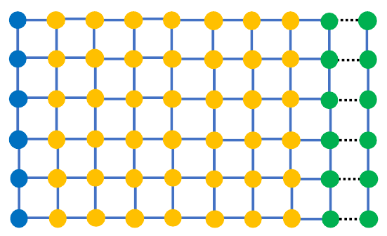

# Recursive Green's function

Recursive Green's function (RGF)은 소자를 수송 방향으로 여러 **slice**로 나눈 뒤, 전체 Green's function 가운데 필요한 행렬 블록만 재귀적으로 계산하는 수치 알고리즘이다. Nonequilibrium Green's function (NEGF)이 정의한 열린 소자 문제를 풀며, 주어진 행렬에 대한 정확한 block Gaussian elimination이다. 따라서 RGF를 사용한다는 사실 자체가 새로운 산란 과정이나 물리 근사를 추가하지 않는다.[1,2]

공통 점유·전류 규약은 [NEGF formalism](negf-formalism.md)을 따른다. $e>0$는 기본 전하의 크기이며 단자 전류는 단위 시간당 전극에서 소자로 순주입되는 전자 수에 $+e$를 곱한 값으로 정의한다. Spin 자유도는 명시한 행렬과 trace에서 한 번만 센다. $h=2\pi\hbar$는 Planck 상수이다. 이 글의 기준계는 정상 상태의 coherent 단일입자 두 단자 소자이며, 먼저 직교 기저에서 유도하고 마지막에 비직교 기저로 확장한다.[1,2]

## 1. 소자의 slice 분할

### (1) 국소 결합과 block-tridiagonal Hamiltonian

유한 소자의 원자 궤도나 격자점을 같은 단면끼리 묶으면 한 slice 내부의 결합은 대각 블록에, 이웃 단면 사이의 결합은 인접 비대각 블록에 들어간다. 이 정렬에서 직접 결합이 이웃 slice를 넘어가지 않아야 RGF의 작은 블록 재귀가 닫힌다. Slice는 계산 단위이므로 결정학적 원자층 하나와 같을 필요가 없고, 유한 소자 내부가 주기적일 필요도 없다.[1–3]

다음 그림은 이미 연결한 유한 영역의 오른쪽에 새로운 slice를 추가하는 과정을 나타낸다. 점선이 새로 포함할 결합이고, 초록색 두 열이 그 결합에 직접 참여한다.[2]

<figure markdown="span">

<figcaption markdown="1">
그림 1. RGF의 slice 연결 단계. 초록색은 새 결합이 직접 작용하는 경계, 파란색은 응답을 보존할 선택된 경계, 주황색은 그 밖의 내부 자유도이다. 색은 전극의 점유나 전류 방향을 뜻하지 않는다. 출처: X. Waintal et al., “Computational quantum transport: a scattering approach perspective,” [arXiv:2407.16257v3](https://arxiv.org/abs/2407.16257v3), Fig. 8, p. 39; 색의 정의는 원문 Fig. 6. [CC BY 4.0](https://creativecommons.org/licenses/by/4.0/). 수정하여 재현: PDF에서 그림 영역만 잘라 PNG로 변환했으며 색과 결합은 변경하지 않았다.[2]
</figcaption>
</figure>

새로 추가한 slice는 기존 영역의 모든 사이트와 직접 결합하는 것이 아니라, 인접한 경계 slice를 통해 나머지 영역과 연결된다. 따라서 기존 영역에서 마지막 경계 slice의 Green's function 블록만 알고 있어도, 앞서 연결한 나머지 영역이 새 slice에 미치는 영향을 self-energy 형태로 계산할 수 있다. 이 과정은 내부 자유도의 물리적 영향을 무시하는 것이 아니다. 내부 영역을 소거하여 그 영향을 경계에서 정의한 유효 응답에 포함시키는 것이다. 이 소거의 일반적인 대수는 [Downfolding and effective Hamiltonians](../../computational-science/model-reduction/downfolding.md)의 Schur complement에 해당한다.[1,2]

### (2) 열린 소자 행렬과 전극 경계

실수 에너지 $E$, 에너지 단위의 $\eta>0$, $z=E+i\eta$를 사용한다. $H_{nn}$은 slice $n$ 내부 Hamiltonian, $V_{nm}=H_{nm}$은 $m$의 계수에서 $n$의 방정식으로 작용하는 결합이다. $I$는 해당 공간의 항등행렬이고, $\Sigma_{L/R}^R$는 반무한 전극을 제거하여 얻은 경계 self-energy이다. 이하 retarded 함수는 모두 같은 $z$에서 평가하며, 물리적인 응답은 $\eta\to0^+$ 극한으로 읽는다.[1–3]

소자 영역을 수송 방향으로 $N$개의 slice로 나누고 인접 slice끼리만 직접 결합하도록 정렬한다. 직교 기저에서 열린 소자의 retarded energy matrix는

$$
\mathcal A(E)
=
(E+i\eta)I-H_D-\Sigma_L^R-\Sigma_R^R
$$

이며, 블록 형태는

$$
\mathcal A=
\begin{pmatrix}
A_1-\Sigma_L^R & -V_{12} & 0 & \cdots & 0\\
-V_{21} & A_2 & -V_{23} & \cdots & 0\\
0 & -V_{32} & A_3 & \ddots & \vdots\\
\vdots & \vdots & \ddots & \ddots & -V_{N-1,N}\\
0 & 0 & \cdots & -V_{N,N-1} & A_N-\Sigma_R^R
\end{pmatrix},
$$

$$
A_n=(E+i\eta)I-H_{nn},
\qquad
G^R=\mathcal A^{-1}
$$

이다. $V_{n,n+1}=V_{n+1,n}^\dagger$이며 전극 self-energy는 경계 slice에만 작용하도록 표시했다.[1,2]

Slice 하나를 반드시 원자 하나 또는 격자점 하나에 대응시킬 필요는 없다. 핵심은 slice를 건너뛰는 직접 결합이 없어야 한다는 점이다. 예를 들어 두 원자층을 건너뛰는 hopping이 있으면 필요한 원자층을 한 slice로 묶거나 자유도를 재정렬해 block-tridiagonal 형태로 만든다.[1,2]

[Surface Green's function](surface-greens-function.md)은 **반무한 주기 전극**의 표면 응답과 $\Sigma_{L/R}^R$를 먼저 계산한다. 이 글의 RGF는 그 결과를 입력으로 받아 **유한하고 비균일해도 되는 소자**를 왼쪽부터 붙인다. 두 방법 모두 블록 소거를 쓰지만, López Sancho decimation은 반복 전극 내부를 제거하며 유효 간격을 두 배로 늘리고, 여기서는 명시적인 $N$개 소자 slice를 차례로 처리한다.[1–3]

| 계산 | 입력 | 계산 대상 | 출력 |
| --- | --- | --- | --- |
| 전극 surface 계산 | 주기 전극의 반복 블록·결합 | 반무한 전극의 경계층 | $g_s^R$, 접촉 $\Sigma^R$ |
| 유한 소자 RGF | 소자 slice·결합과 접촉 $\Sigma^R$ | 양쪽 전극에 열린 유한 소자 | 필요한 $G^R$ 블록 |

## 2. Left-connected Green's function

### (1) 부분계의 응답과 전진 소거

아래 식은 소거하는 각 Schur block이 가역인 에너지에서 적용한다. 양의 $\eta$를 유지해 retarded 응답을 구하되, 좁은 공명 부근에서는 조건수와 $\eta$ 의존성을 함께 확인해야 한다.[1,2]

왼쪽 전극과 첫 번째부터 $n$번째 slice까지만 연결한 계의 마지막 대각 블록을 $g^L_{nn}$이라 하자. 첫 블록은

$$
g^L_{11}
=
\left[A_1-\Sigma_L^R\right]^{-1}
$$

이고, $n=2,\ldots,N-1$에 대해

$$
\Sigma_{n}^{L}
=V_{n,n-1}g^L_{n-1,n-1}V_{n-1,n},
$$

$$
g^L_{nn}
=
\left[A_n-\Sigma_n^L\right]^{-1}
$$

로 갱신한다. $\Sigma_n^L$은 이미 제거한 왼쪽 부분 전체가 $n$번째 slice에 미치는 유효 self-energy이다.[1,2]

마지막 slice에서도 먼저 $\Sigma_N^L=V_{N,N-1}g^L_{N-1,N-1}V_{N-1,N}$을 계산한 뒤 오른쪽 전극까지 연결해

$$
G^R_{NN}
=
\left[
A_N-\Sigma_R^R-\Sigma_N^L
\right]^{-1}
$$

을 얻는다. 왼쪽에서 오른쪽으로 slice를 차례로 추가하는 관점에서는 Dyson equation으로, 이미 처리한 블록을 차례로 소거하는 관점에서는 block Gaussian elimination으로 같은 재귀 과정을 해석할 수 있다.[1,2]

위 재귀는 $N\ge2$에 대한 것이다. Slice가 하나뿐이면 재귀 없이 $G^R_{11}=[A_1-\Sigma_L^R-\Sigma_R^R]^{-1}$로 두 전극을 함께 연결한다.

### (2) 경계 사이 전파와 마지막 경계 연결

Transmission만 필요하면 전체 대각 블록을 복원하지 않고 경계 사이 블록을 함께 전진시킬 수 있다. $n$번째 slice까지만 연결한 부분계의 $(1,n)$ 블록을 $g^L_{1n}$이라 정의한다. 초기값은 앞 절의 $g^L_{11}$이고, $n=2,\ldots,N-1$에서

$$
g^L_{1n}=g^L_{1,n-1}V_{n-1,n}g^L_{nn}
$$

로 갱신한다. 아직 오른쪽 나머지 부분을 연결하지 않았으므로 이 블록은 전체 소자의 $G^R_{1n}$과 일반적으로 다르다. 마지막 단계에서는 양 전극을 포함한 $G^R_{NN}$을 사용하여

$$
G^R_{1N}=g^L_{1,N-1}V_{N-1,N}G^R_{NN}
$$

으로 재귀를 마무리한다. 이 최종 블록으로 두 경계 사이의 transmission을 계산한다. $N=2$이면 중간 반복 없이 $g^L_{11}$에서 바로 마지막 식을 적용한다.[1,2]

이렇게 두 경계 사이의 블록만 계산하면 메모리 사용량은 줄어들지만, 소자 내부 각 slice의 LDOS나 점유와 같은 국소량은 바로 얻을 수 없다. 이후에 필요한 블록이 정해지지 않았다면 $g^L_{nn}$을 저장해 후진 복원이 가능하도록 하는 편이 안전하다.

## 3. 후진 복원

### (1) 대각 블록 복원

$G^R_{NN}$을 얻은 뒤 $n=N-1,\ldots,1$ 순서로 되짚는다. 완전히 연결된 대각 블록은

$$
G^R_{nn}
=
g^L_{nn}
+g^L_{nn}V_{n,n+1}G^R_{n+1,n+1}
V_{n+1,n}g^L_{nn}
$$

로 복원할 수 있다. 첫 항은 $n$번째 slice의 오른쪽 영역을 연결하기 전에 계산한 응답이다. 둘째 항은 $n$번째 slice에서 오른쪽 영역으로 전파된 뒤 다시 돌아오는 경로의 기여를 포함하므로, 두 항을 합하면 전체 소자에 연결된 상태의 대각 Green's function을 얻는다.[1,2]

인접한 비대각 블록은

$$
G^R_{n,n+1}
=
g^L_{nn}V_{n,n+1}G^R_{n+1,n+1},
$$

$$
G^R_{n+1,n}
=
G^R_{n+1,n+1}V_{n+1,n}g^L_{nn}
$$

로 얻는다. 이 식들은 전체 역행렬을 만들지 않고 대각 및 인접 블록을 복원한다.[1,2]

### (2) 두 사이트의 해석적 검산

전진과 후진 단계의 역할은 각 slice에 궤도가 하나씩 있는 두 사이트에서 직접 확인할 수 있다. $z=E+i\eta$, onsite 에너지를 $\varepsilon_1,\varepsilon_2$, hopping을 $t$라 하고 $a=z-\varepsilon_1-\Sigma_L^R$, $d=z-\varepsilon_2-\Sigma_R^R$로 두면

$$
\mathcal A=\begin{pmatrix}a&-t\\-t^*&d\end{pmatrix},\qquad
G^R=\frac{1}{ad-|t|^2}
\begin{pmatrix}d&t\\t^*&a\end{pmatrix}.
$$

이 식은 앞의 열린 소자 행렬을 $N=2$에 대입해 직접 역산한 결과이다. 같은 계에 RGF를 적용하면 $g^L_{11}=1/a$이고, 왼쪽을 제거한 self-energy는 $\Sigma_2^L=|t|^2/a$이므로

$$
G^R_{22}=\frac{1}{d-|t|^2/a},\qquad
G^R_{12}=\frac{t}{a}G^R_{22},\qquad
G^R_{11}=\frac1a+\frac{|t|^2}{a^2}G^R_{22}
$$

를 얻는다. 각 식을 통분하면 직접 역행렬의 해당 원소가 된다. 이 예제는 Dyson 식과 Schur complement가 같은 소거임을 보여 주며, 후진 복원의 마지막 인자가 $g^L_{11}$이지 그 복소켤레가 아니라는 점도 드러낸다. Retarded 응답을 복원하는 단계에 advanced 인자를 섞으면 직접 역행렬과 달라진다.[1,2]

연결을 끊는 $t=0$ 극한에서는 위 식이 $G^R_{11}=1/a$, $G^R_{22}=1/d$, $G^R_{12}=0$으로 환원된다. 두 전극 사이 전파는 사라지지만 각 사이트의 국소 응답은 남는다. 이 극한은 경계 간 transmission이 0이라는 사실과 소자 안에 상태가 없다는 주장을 구별하는 간단한 시험이다.[1,2]

분모 $ad-|t|^2$는 양쪽 전극과 두 사이트가 함께 만드는 공명을 포함한다. 반면 $1/a$는 오른쪽 사이트를 연결하기 전의 응답이므로 최종 local density of states (LDOS)에 사용할 수 없다. LDOS는 해당 위치의 단위 에너지당 상태 수이다. 연결 전 첫 사이트에서 보이지 않던 두 번째 사이트의 영향이 후진 복원의 두 번째 항에 들어간다. 따라서 전진 계산 중 얻은 대각 블록을 바로 최종 소자의 LDOS로 출력하는 구현은 전진 재귀가 정확해도 잘못된 관측량을 낸다.[1,2]

이 예제에서 얻은 스칼라 식을 행렬 블록에 적용할 때에는 분수 형태를 행렬 원소별 나눗셈으로 해석해서는 안 된다. 블록 역연산은 선형계 풀이이며 곱셈 순서를 유지해야 한다. 또한 $G^R_{21}$은 일반적으로 $(G^R_{12})^\dagger$가 아니다. Advanced 함수 $G^A=G^{R\dagger}$와의 관계는 $G^A_{21}=(G^R_{12})^\dagger$이다. 두 사이트에서도 공통 분모가 복소수이므로 이 차이를 확인할 수 있다. 실수 hopping만 시험하면 일부 방향 오류가 가려질 수 있어 복소 hopping을 포함한 작은 계를 별도로 검사하는 것이 유용하다.[1,2]

## 4. Transmission과 국소 관측량

다음 표는 관측량과 필요한 블록을 구분한다.[1,2]

| 관측량 | 주로 필요한 블록 | 계산 전략 |
| --- | --- | --- |
| 두 단자 transmission | $G^R_{1N}$ 또는 경계 블록 | 한 방향 전진과 마지막 경계 연결 |
| slice-resolved LDOS | 모든 $G^R_{nn}$ | $g^L_{nn}$ 저장 후 후진 복원 |
| 전하 밀도 | 모든 $G^<_{nn}$ | retarded 재귀와 주입 상관 재귀 또는 필요한 열 복원 |
| 인접 slice 전류 | $G^<_{n,n+1}$, $G^<_{n+1,n}$ | 인접 비대각 lesser 블록 복원 |
| 여러 단자의 국소량 | 단자별 주입 블록 | geometry-aware slicing 또는 일반 sparse 방법 검토 |

접촉 broadening을 $\Gamma_\alpha=i[\Sigma_\alpha^R-(\Sigma_\alpha^R)^\dagger]$로 정의한다. 두 단자 transmission의 경계 표현은

$$
\mathcal T(E)=\operatorname{Tr}\!\left[
\Gamma_LG^R_{1N}\Gamma_R(G^R_{1N})^\dagger\right]
$$

이다. 왼쪽 경계 크기가 $M_1$, 오른쪽이 $M_N$이면 $G^R_{1N}$은 $M_1\times M_N$이고 trace 안의 최종 행렬은 $M_1\times M_1$이다. 전극 linewidth $\Gamma_{L/R}$는 해당 경계에 투영한 블록으로 사용한다. 여기서는 Hamiltonian에 포함한 spin 자유도 그대로 transmission을 세며, spin을 생략한 모형의 축퇴도 인자는 전류를 계산할 때 별도로 정한다.[1,2]

Transmission 식의 행렬곱에는 에너지 차원의 broadening 행렬 두 개와 역에너지 차원의 Green's function 두 개가 포함되므로, 최종 transmission은 무차원이다. 또한 물리적인 전극에서 $\Gamma_{L/R}$가 양의 준정부호이면 $X=\Gamma_L^{1/2}G^R_{1N}\Gamma_R^{1/2}$를 정의하여 $\mathcal T=\operatorname{Tr}(XX^\dagger)\ge0$로 쓸 수 있다. 이 대수적 결과는 구현에서 큰 음의 transmission이나 유의한 허수부를 발견했을 때 경계 블록·dagger·곱 순서를 점검하는 근거가 된다. 다만 양수라는 조건만으로 값의 정확성이 보장되지는 않으므로 직접 역행렬 비교도 필요하다.[1,2]

### (1) 단자 전류와 spin

전극 분포를 $f_{L/R}(E)$라 하면 coherent 단자 전류는

$$
I_L=\frac{e}{h}\int dE\,T(E)[f_L(E)-f_R(E)],\qquad I_R=-I_L
$$

이다. $T$는 명시한 모든 spin을 합한 transmission이다. 위 경계 trace를 전체 spin 공간에서 평가했다면 $T=\mathcal T$이고 추가 인자 2를 곱하지 않는다. 한 spin만 계산하고 두 spin이 독립적으로 축퇴한 모형이라면 $T=2\mathcal T$이다. 두 전극의 점유가 같으면 transmission이 유한해도 순전류는 0이다.[1,2]

### (2) 상태 밀도와 점유

직교 기저에서 slice $n$의 LDOS는

$$
D_n(E)=-\frac1\pi\operatorname{Im}\operatorname{Tr}G^R_{nn}(E)
$$

이다. 여기의 $D_n$은 단위 에너지당 상태 수이며, 궤도별 값은 trace 대신 해당 대각 원소를 취한다. 전진 중의 $g^L_{nn}$에는 오른쪽 소자의 영향이 빠져 있으므로 최종 LDOS에 사용할 수 없다. LDOS가 크다는 것은 해당 에너지에 이용 가능한 상태가 많다는 뜻이지, 그 상태에 전자가 실제로 점유되어 있다는 뜻은 아니다.[1,2]

전극 $\alpha$의 Fermi 분포를 $f_\alpha$라 하면 coherent 정상 상태에서 전극이 공급하는 lesser self-energy는 $\Sigma_\alpha^<=if_\alpha\Gamma_\alpha$이다. 경계 slice를 $b_L=1$, $b_R=N$으로 쓰면 점유를 포함한 Green's function의 블록은

$$
G^<_{mn}(E)=i\sum_{\alpha=L,R}f_\alpha(E)
G^R_{m b_\alpha}(E)\Gamma_\alpha(E)
[G^R_{n b_\alpha}(E)]^\dagger
$$

이다. Retarded 블록은 전파를, $f_\alpha\Gamma_\alpha$는 전극별 주입 점유를 정한다. 이 식은 전극 연속체와 연결된 산란 상태에 대한 관계이다. 아래의 수치 검증에서는 유한 $\eta$에 따른 보존 관계의 오차를 따로 검사한다.[1,2]

경계 열 $G^R_{m b_\alpha}$는 같은 소거 결과로 구할 수 있다. $\mathcal A X=B$에서 $B$를 원하는 경계 열의 단위행렬로 놓고 나머지 행은 0으로 두면 $X$가 해당 Green's function 열이다. 전진에서 $\widetilde B_1=B_1$로 시작하여

$$
\widetilde B_n=B_n+V_{n,n-1}g^L_{n-1,n-1}\widetilde B_{n-1}
$$

를 계산한다. 후진에서는 $X_N=G^R_{NN}\widetilde B_N$과

$$
X_n=g^L_{nn}\left(\widetilde B_n+V_{n,n+1}X_{n+1}\right)
$$

을 사용한다. 이는 앞의 블록 소거를 여러 우변에 적용한 직접 유도이다. 양쪽 경계 열만 구하면 lesser 대각·인접 블록을 만들 수 있으므로 모든 $N^2$개 retarded 블록을 저장할 필요가 없다.[1,2]

Slice $n$의 단일입자 density-matrix block은

$$
\rho_{nn}=-\frac{i}{2\pi}\int_{-\infty}^{\infty}G^<_{nn}(E)\,dE
$$

이다. $\rho_{ii}$는 궤도의 점유수이고 $G^<$의 차원은 에너지의 역수이다. 전하 계산에는 에너지별 점유뿐 아니라 채워진 에너지 구간 전체의 적분이 필요하다.[1,2] 전극과 분리된 진정한 bound state가 있으면 위 주입식만으로 점유가 정해지지 않는다. 이런 상태에는 별도의 점유 가정이 필요하며, 누락된 상태를 재귀 알고리즘의 오류로 해석해서는 안 된다.[2,4]

### (3) 내부 단면 전류

소자 내부 두 slice 사이의 국소 전류를 계산하려면 Green's function의 전파 정보뿐 아니라 전자 점유를 나타내는 lesser Green's function도 필요하다. 직교 기저에서 **단위 시간당 $n$에서 $n+1$로 순이동하는 전자 수에 $+e$를 곱한 전류**를 $I_{n\to n+1}$로 정의하면

$$
I_{n\to n+1}=\frac{e}{h}\int dE\,
\operatorname{Tr}\left[
V_{n,n+1}G^<_{n+1,n}-G^<_{n,n+1}V_{n+1,n}
\right]
=\frac{2e}{h}\int dE\,\operatorname{Re}\operatorname{Tr}
[V_{n,n+1}G^<_{n+1,n}]
$$

이다. 마지막 등식은 $G^<=-G^{<\dagger}$와 $V_{n+1,n}=V_{n,n+1}^\dagger$에서 따른다. 여기의 2는 두 방향 항을 합친 결과이며 spin 축퇴 인자가 아니다. 이 부호는 density matrix $\rho_{ij}=\langle c_j^\dagger c_i\rangle$를 쓴 연속 방정식에서 $n$의 점유 감소를 양의 유출로 정의하여 얻은 것이다. 문헌의 전하 전류 또는 반대 방향 규약을 가져올 때에는 부호와 spin 계수를 함께 변환해야 한다.[1,2]

전극 외의 입자원·흡수원이 없는 정상 상태에서는 내부 단면 전류가 모두 $I_L=-I_R$와 같아야 한다. 평형에서 단자 순전류는 0이다. 자기장이 있는 계의 국소 순환 전류까지 항상 0이라고 해석하지 않으며, 단면 전체를 합한 수송 전류와 개별 bond current를 구별한다.[1,2]

## 5. 일차원 사슬의 수치 검산

### (1) 기준 Hamiltonian과 입력

[Coherent quantum transport](coherent-quantum-transport.md)의 단일 궤도 tight-binding 사슬을 재사용한다. Hopping 표기의 대응은 $t=-t_0$와 $t_0>0$이며, 균일 onsite는 앞 문서의 $\varepsilon_c$와 같다. 여기서는 전극 onsite를 0으로 정한다. 한 spin만 계산하고, 소자는 $N$개 사이트, onsite energy $\varepsilon_n$, 실수 hopping $t$를 갖는다. Hamiltonian은

$$
(H_D)_{nn}=\varepsilon_n,\qquad
(H_D)_{n,n+1}=(H_D)_{n+1,n}=t
$$

이다. 각 사이트를 하나의 slice로 두면 $M=1$이고, 앞의 행렬 재귀는 복소수 재귀가 된다. 전극은 onsite 0, 같은 $t$의 반무한 사슬이며 소자–전극 hopping도 $t$로 맞춘다. 따라서 각 접촉은 $\Sigma^R=t^2g_s^R(z)$이고 $\Gamma=-2\operatorname{Im}\Sigma^R$이다. $g_s^R$의 물리적 제곱근 선택은 surface 문서의 해석해를 사용한다.[1,2]

아래 입력은 $N=8$, $t=-1$ eV이고, 중앙 사이트 하나에만 장벽 $U=0$ 또는 $0.7$ eV를 둔다. $U=0$이면 소자와 전극이 같은 완전한 사슬이므로 band 내부에서 한 spin의 transmission $\mathcal T\to1$이다. 장벽을 넣으면 같은 경계조건에서 반사와 국소 응답의 변화가 생긴다. 예제의 수치는 특정 물질의 매개변수나 실험 결과가 아니라 위 모형의 계산 입력이다.[1,2]

### (2) NumPy 구현과 직접 역행렬 비교

Python 3와 NumPy로 실행한다. 에너지는 eV, $\eta=10^{-9}$ eV이다. 함수 `rgf`의 `d`에는 이미 양쪽 경계 self-energy를 뺀 대각 블록을 넣는다. 따라서 마지막 `g`는 오른쪽 접촉까지 포함한 $G^R_{NN}$이며, 중간 `g`는 left-connected 블록이다. `u`와 `ell`은 각각 행렬의 위·아래 비대각 블록에 마이너스를 붙인 값이다. 둘을 독립 입력으로 두어 뒤의 비직교 검산에도 같은 함수를 사용한다.

이 코드는 모든 대각·인접 양방향 블록과 양끝 블록을 **같은 $z$의 직접 역행렬**과 비교한다. 직접 역산은 작은 검산계에만 쓰며, 실제 큰 소자에서 전체 역행렬을 생성하라는 절차는 아니다. 각 작은 역연산도 `solve`로 단위행렬을 우변에 놓아 계산한다.[1,2]

```python
import numpy as np

def rgf(d, u, ell):
    """Diagonal d, upper -u, lower -ell of the retarded matrix."""
    inv = lambda a: np.linalg.solve(a, np.eye(len(a)))
    n = len(d)
    g = [inv(d[0])]
    end = g[0].copy()
    for j in range(1, n):
        g.append(inv(d[j] - ell[j-1] @ g[-1] @ u[j-1]))
        end = end @ u[j-1] @ g[j]
    diag = [None]*n
    upper, lower = [None]*(n-1), [None]*(n-1)
    diag[-1] = g[-1]
    for j in range(n-2, -1, -1):
        upper[j] = g[j] @ u[j] @ diag[j+1]
        lower[j] = diag[j+1] @ ell[j] @ g[j]
        diag[j] = g[j] + upper[j] @ ell[j] @ g[j]
    return diag, upper, lower, end

def chain_surface(z, t=1.):
    root = np.sqrt(z*z - 4*t*t + 0j)
    if root.imag < 0:
        root = -root
    return 2/(z+root)  # causal root, eta>0, onsite=0

n, t, eta = 8, -1., 1e-9  # eV; one orbital and one spin/site
for barrier in [0., .7]:
    onsite = np.zeros(n)
    onsite[n//2] = barrier
    for energy in [-1.2, .3, 1.1]:
        z = energy + 1j*eta
        sigma = t*t*chain_surface(z, t)
        gamma = -2*sigma.imag
        d = [np.array([[z-v]], complex) for v in onsite]
        d[0] -= sigma
        d[-1] -= sigma
        u = [np.array([[t]], complex) for _ in range(n-1)]
        ell = [x.conj().T for x in u]  # orthogonal Hamiltonian only
        diag, upper, lower, end = rgf(d, u, ell)
        mat = np.diag([x[0,0] for x in d])
        mat += np.diag(np.full(n-1, -t), 1)
        mat += np.diag(np.full(n-1, -t), -1)
        direct = np.linalg.inv(mat)
        errors = [np.max(abs(np.array(diag)[:,0,0]-direct.diagonal())),
                  np.max(abs(np.array(upper)[:,0,0]-direct.diagonal(1))),
                  np.max(abs(np.array(lower)[:,0,0]-direct.diagonal(-1))),
                  abs(end[0,0]-direct[0,-1])]
        trans = gamma**2*abs(end[0,0])**2
        reference = gamma**2*abs(direct[0,-1])**2
        print(barrier, energy, f"error={max(errors):.2e}", f"T={trans:.9f}")
        assert max(errors) < 1e-12 and abs(trans-reference) < 1e-12
        if barrier == 0:
            assert abs(trans-1) < 1e-7
```

실행하면 여섯 입력에서 선택 블록의 최대 절대 오차가 $5.5\times10^{-16}$ eV$^{-1}$ 미만이다. 균일 사슬의 $\mathcal T$는 약 0.999999990–0.999999992이며, $U=0.7$ eV일 때 세 에너지 순서로 약 0.839344254, 0.888636356, 0.850609748이다. 이 값은 표시한 코드를 실행한 결과이다. 균일 사슬 값이 1과 조금 다른 것은 유한 $\eta$가 만드는 흡수와 수치 오차를 포함한다. 같은 $\eta$에서 직접 역산과 일치하는 검사와, $\eta$를 줄여 물리적 한계에 접근하는 검사는 별개이다.

특히 장벽이 있어도 RGF와 직접 역산은 같은 행렬을 푸므로 일치해야 한다. 두 방법이 일치한다고 Hamiltonian이나 접촉 모형까지 실험에 맞는다는 뜻은 아니다. $N=1$, $N=2$, 결합 하나를 0으로 만든 경우도 시험하면 경계 self-energy의 중복 처리와 재귀 시작·종료 오류를 구별할 수 있다. 서로 다른 궤도가 섞이는 행렬 시험은 6절에서 추가한다.[1,2]

## 6. 계산 비용과 적용 범위

### (1) Slice 폭과 저장 범위

각 slice의 궤도 수가 $M$이고 모든 slice에서 비슷하다고 하자. 조밀한 $M\times M$ 블록의 분해·역연산이 각 slice에서 일어나므로 한 에너지당 계산량은 대략

$$
\mathcal O(NM^3)
$$

이다. 전체 $NM$ 차원 행렬을 조밀하게 직접 역산하는 $\mathcal O((NM)^3)$보다 길이 방향 확장성이 좋지만, 단면이 커져 $M$이 증가하면 비용은 빠르게 커진다.[1,2]

여러 slice를 하나로 합치면 전체 slice 수 $N$은 감소하지만 각 블록의 차원 $M$은 커진다. 따라서 $N$ 감소에 따른 이득보다 블록 연산의 $M^3$ 비용 증가가 크면 총 계산량은 오히려 늘어난다. 결합 범위 조건을 만족하면서 최대 블록 크기와 fill-in을 작게 만드는 정렬이 중요하다.[1,2]

Slice 크기가 서로 다르면 $n$번째 크기를 $M_n$으로 둔다. $g^L_{nn}$은 $M_n\times M_n$ 정사각 행렬이지만 $V_{n,n+1}$은 $M_n\times M_{n+1}$ 직사각 행렬이다. 따라서 $V_{n,n-1}g^L_{n-1,n-1}V_{n-1,n}$은 다시 $M_n\times M_n$이 되어 해당 slice의 대각 블록에서 뺄 수 있다. 동일한 블록 폭은 비용을 간단히 표현하기 위한 가정이며, 재귀식 자체의 필요조건은 아니다. 입력 검증에서는 각 곱의 차원과 경계 self-energy가 작용하는 부분공간을 먼저 확인한다.[1,2]

!!! warning "[Interpretation Caveat]"
    “RGF는 선형 복잡도이다”라는 말은 slice 폭 $M$이 길이 $N$과 무관하게 유지될 때의 길이 의존성을 뜻한다. 2차원 정사각형 소자를 한 방향으로 길게 만들면서 단면도 함께 키우면 $M$도 증가하므로 전체 계산량은 소자 크기에 선형이 아니다.[1,2]

전진 중 현재 $g^L_{nn}$와 경계 전파 블록만 유지하면, 같은 폭 $M$에서 작업 저장량은 $\mathcal O(M^2)$이다. 모든 $g^L_{nn}$을 보존해 한 번의 후진 복원을 수행하면 저장량은 $\mathcal O(NM^2)$이다. 이는 입력 Hamiltonian 저장 공간과 별도로 세는 재귀 작업 공간이다. 3절의 후진 식은 각 slice마다 고정된 수의 $M\times M$ 곱을 하므로 전체 대각·인접 블록 복원도 $\mathcal O(NM^3)$이다. 이 비용은 표시한 식의 연산 수를 직접 센 결과이며, 각 사이트마다 전체 재귀를 다시 실행하는 구현과 구별한다.[1,2]

### (2) 비직교 기저와 행렬 순서

비직교 기저에서는 Hermitian overlap $S_D$를 포함한

$$
\mathcal A(z)=zS_D-H_D-\Sigma_L^R(z)-\Sigma_R^R(z)
$$

를 분할한다. $S_D$는 양의 정부호이고, $H_D$와 $S_D$를 모두 포함해 인접 slice 구조가 성립해야 한다. 대각 입력은 $\mathcal D_n=zS_{nn}-H_{nn}$에서 해당 접촉 self-energy를 뺀 값이다. 위·아래 결합을

$$
U_n=H_{n,n+1}-zS_{n,n+1},\qquad
L_n=H_{n+1,n}-zS_{n+1,n}
$$

로 정의하면 $\mathcal A_{n,n+1}=-U_n$, $\mathcal A_{n+1,n}=-L_n$이다. 앞의 모든 재귀에서 $V_{n,n+1}\mapsto U_n$, $V_{n+1,n}\mapsto L_n$로 치환하면 같은 블록 소거가 된다.[2,3]

유한한 $\eta$에서는 $U_n^\dagger=H_{n+1,n}-z^*S_{n+1,n}$이므로 일반적으로 $L_n\ne U_n^\dagger$이다. 양방향 결합에 **같은 $z$**를 넣어야 원래 $zS-H$의 역행렬을 얻는다. 이는 retarded 재귀 안에 advanced 인자를 섞지 말라는 조건의 비직교 형태이다. 전극 self-energy도 같은 규칙으로 계산해야 한다.[2,3]

또한 비직교 기저의 $-\operatorname{Im}G_{nn}/\pi$를 그대로 원자별 상태 수로 읽을 수 없다. 밀도와 국소량에는 overlap 및 선택한 공간 분할이 필요하다. 이 절은 resolvent의 정확한 소거를 확장한 것이며, 4절의 직교 LDOS·bond current를 수정 없이 비직교 기저에 적용하는 규칙은 아니다. 그 구별은 NEGF 문서의 density kernel 설명을 따른다.[3,4]

스칼라 예제에서는 곱셈 순서를 바꿔도 값이 같아 오류가 드러나지 않는다. 다음 코드는 5절 코드 뒤에 이어 실행한다. 다섯 slice의 두 궤도 모형을 만들고 직교·비직교 경우를 각각 시험한다. 에너지는 eV, $z=0.31+0.12i$ eV이고, 접촉은 검산용으로 $\Sigma_L^R=-0.2iI$, $\Sigma_R^R=-0.3iI$로 정했다. 이는 작은 행렬 대수를 확인하는 인공 모형이며, 앞 사슬의 물리적 전극을 바꾼 별도 시험이다.

```python
# Continue after the previous code block: rgf and np are already defined.
h = np.array([[.2, .13j], [-.13j, -.3]])
v = np.array([[.7, .2j], [.1, -.4]])
s = np.array([[1., .03], [.03, 1.1]])
q = np.array([[.04, .01j], [.02, -.03]])
z, n = .31+.12j, 5
for nonorth in [False, True]:
    metric = s if nonorth else np.eye(2)
    overlap = q if nonorth else np.zeros((2,2))
    u0 = v-z*overlap
    l0 = v.conj().T-z*overlap.conj().T  # same z, not u0.conj().T
    d = [z*metric-h-.03*j*np.eye(2) for j in range(n)]
    d[0] = d[0]+.2j*np.eye(2)  # Sigma_L=-0.2j I eV
    d[-1] = d[-1]+.3j*np.eye(2)
    u, ell = [u0]*(n-1), [l0]*(n-1)
    mat = np.zeros((2*n,2*n), complex)
    full_s = np.kron(np.eye(n), metric).astype(complex)
    full_s += np.kron(np.eye(n,k=1),overlap)+np.kron(np.eye(n,k=-1),overlap.conj().T)
    for j in range(n):
        mat[2*j:2*j+2,2*j:2*j+2] = d[j]
        if j < n-1:
            mat[2*j:2*j+2,2*j+2:2*j+4] = -u0
            mat[2*j+2:2*j+4,2*j:2*j+2] = -l0
    direct = np.linalg.inv(mat)
    dg, up, lo, end = rgf(d,u,ell)
    blocks = [(j,j,dg[j]) for j in range(n)]
    blocks += [(j,j+1,up[j]) for j in range(n-1)]
    blocks += [(j+1,j,lo[j]) for j in range(n-1)]
    blocks += [(0,n-1,end)]
    error = max(np.linalg.norm(b-direct[2*i:2*i+2,2*j:2*j+2]) for i,j,b in blocks)
    print("matrix", nonorth, "error", error, "minS", np.linalg.eigvalsh(full_s).min())
    assert error < 1e-12 and np.linalg.eigvalsh(full_s).min() > 0
    wrong = rgf(d,u,[x.conj().T for x in u])[0][0]
    print("wrong dagger error", np.linalg.norm(wrong-dg[0]))
    if nonorth:
        assert np.linalg.norm(wrong-dg[0]) > 1e-3
    reversed_order = np.linalg.inv(d[1]-u0@np.linalg.inv(d[0])@l0)
    correct = np.linalg.inv(d[1]-l0@np.linalg.inv(d[0])@u0)
    print("reversed order error", np.linalg.norm(reversed_order-correct))
    assert np.linalg.norm(reversed_order-correct) > 1e-2
```

이 입력에서 올바른 RGF의 최대 블록 오차는 직교 경우 약 $6.1\times10^{-16}$, 비직교 경우 $1.3\times10^{-15}$ eV$^{-1}$ 미만이다. 비직교 전체 overlap의 최소 고유값은 약 0.9292이다. 반면 비직교 역방향 결합을 dagger로 대체하면 첫 대각 블록이 약 $1.84\times10^{-2}$ eV$^{-1}$ 달라진다. 전진 self-energy의 순서를 바꾼 시험도 두 경우 모두 약 1 eV$^{-1}$ 크기의 차이를 낸다. 이 수치는 표시한 코드의 실행 결과이며, 작은 차이만 허용하는 검사가 실제로 잘못된 구현을 구별하는지 보여 준다.

### (3) 계산 비용과 모형 근사의 구별

RGF는 수송 방향으로는 길지만 각 slice에 포함되는 자유도의 수가 상대적으로 적은 두 단자 소자에서 특히 효과적이다. 넓은 단면, 복잡한 다중 단자 연결, 긴 범위 결합 때문에 큰 slice가 필요하면 sparse direct solver나 다른 정렬을 비교해야 한다. 물리적으로 같은 Hamiltonian의 자유도를 재배열하는 것과, 일부 궤도나 결합을 버리는 것은 다르다.[1,2]

[Mode-space reduction](../../computational-science/model-reduction/mode-space-reduction.md)은 slice 안의 기저를 줄여 $M$을 작게 하는 별도 단계이다. 축소 오차가 있는 모형에서도 RGF 자체는 그 축소 행렬을 정확히 풀 수 있으므로, 원래 모형과의 차이를 재귀 오차로 부르면 안 된다. 이는 정확성이 입력 행렬에 대한 것이라는 앞의 정의에서 따른다. 축소 모형의 transmission 검증과 고정 모형의 직접 역행렬 검증을 구별한다.[1,2]

Density functional theory (DFT) 또는 Poisson–NEGF 자기일관 반복에서는 현재 전자 밀도와 전위로 구성한 Hamiltonian에 RGF를 적용하여 점유를 계산하고, 그 결과를 사용해 다음 반복의 Hamiltonian을 갱신한다. RGF는 이 반복 중 Green's function을 계산하는 단계이다. 에너지 적분, 전하·전위 mixing과 전극 경계의 수렴은 [NEGF formalism](negf-formalism.md)의 별도 검사로 남는다.[2–4]

내부 scattering self-energy를 추가하는 경우에도 먼저 **전체** $\mathcal A$의 블록 구조를 확인해야 한다. 대각 또는 인접 블록 안에만 놓인 항은 같은 소거를 허용하지만, 멀리 떨어진 slice를 직접 잇는 항은 현재 분할의 전제를 깨뜨린다. 이는 행렬 구조에서 따르는 조건이다. 더 큰 slice로 다시 묶거나 적합한 일반 solver를 택해야 하며, 점유 계산도 그 scattering self-energy와 일관되게 확장해야 한다.[1,2]

## 7. 구현 검증

!!! info "[Measurement]"
    같은 Hamiltonian의 작은 시험계에서는 전체 역행렬 $G_{\mathrm{direct}}^R$와 RGF 블록을 비교한다. 선택한 블록 집합 $\mathcal B$에 대해

    $$
    r_G(E)
    =
    \max_{(m,n)\in\mathcal B}
    \frac{
    \|G^R_{mn,\mathrm{RGF}}-G^R_{mn,\mathrm{direct}}\|_F
    }{
    \max(E_{\mathrm{ref}}^{-1},\|G^R_{mn,\mathrm{direct}}\|_F)
    }
    $$

    를 기록한다. $E_{\mathrm{ref}}>0$는 미리 정한 기준 에너지이다. Green's function의 단위가 에너지의 역수이므로 분모의 두 항을 같은 단위로 맞췄으며, 에너지 단위 변환 때 $E_{\mathrm{ref}}$도 함께 변환한다. $\mathcal B$에는 양 끝 블록, 모든 대각 블록과 몇 개의 인접 비대각 블록을 포함해야 전진과 후진 단계의 오류를 함께 찾을 수 있다.[1,2]

    정상 상태 전류 보존은 단면별 전류 $I_n$으로

    $$
    r_I
    =
    \frac{\max_n|I_n-I_{n-1}|}
    {\max(I_{\mathrm{scale}},\max_n|I_n|)}
    $$

    를 계산해 검사한다. $I_{\mathrm{scale}}$은 평형 또는 무전류 근처에서 분모가 사라지지 않도록 미리 선언한 기준 전류이다. $r_G$는 행렬 재귀의 구현 오류를, $r_I$는 lesser 블록·에너지 적분·전류 부호 규약을 함께 검사한다.[1,2]

다음 검사는 서로 다른 오류를 찾으므로 함께 수행한다.[1,2]

- **직접 역행렬 비교:** 작은 계에서 경계·대각·인접 블록이 직접 계산과 일치하는가
- **평형 검사:** $\mu_L=\mu_R$와 같은 온도에서 순전류가 수치 오차 안에서 0인가
- **전류 보존:** 전극 외의 입자원·흡수원이 없는 정상 상태에서 모든 내부 단면과 양 단자의 전류가 일치하는가
- **스펙트럼 항등식:** 아래의 유한 $\eta$ 항을 포함한 행렬 항등식과 $\eta\to0^+$ 수렴을 구분하여 검사했는가
- **분할 독립성:** 물리적으로 같은 Hamiltonian을 허용되는 다른 slice로 묶어도 결과가 유지되는가
- **소자 길이 수렴:** 전극과 맞닿는 명시적 완충영역을 늘려도 관심 관측량이 유지되는가
- **적분·격자 수렴:** 에너지 구간, 적분 격자와 공간 이산화를 세분화해도 전하와 전류가 유지되는가

유한 $\eta$는 retarded 역행렬에 작은 흡수를 넣는다. 전극 주입만으로 만든 $G^<$에는 이에 대응하는 추가 주입이 없으므로, 같은 유한 $\eta$에서 단면 전류가 정확히 같아야 한다고 요구하지 않는다. 충분히 작은 $\eta$로 줄였을 때 불일치가 함께 감소하는지 확인한다. 반면 직접 역행렬 비교는 같은 $\eta$에서 이미 일치해야 한다.[1,2]

스펙트럼 검증에는 Green's function 계산에 실제로 사용한 $\eta$를 반영해야 한다. 직교 기저에서 $\Sigma^R=\Sigma_L^R+\Sigma_R^R$, $\Gamma=i(\Sigma^R-\Sigma^{R\dagger})$로 두면, 1절의 역행렬 정의와 $G^A=G^{R\dagger}$로부터

$$
A=i(G^R-G^A)
=G^R\left(\Gamma+2\eta I\right)G^A
$$

를 얻는다. 이는 $G^R-G^A=G^R[(G^A)^{-1}-(G^R)^{-1}]G^A$에 두 역행렬을 대입한 대수적 결과이다.[1,2] 따라서 유한 $\eta$에서 $G^R\Gamma G^A$만 비교한 차이를 재귀 구현의 오류로 판정해서는 안 된다. $\eta\to0^+$에서 속박 상태의 기여가 남는 문제는 4절의 점유 조건과 함께 별도로 다룬다.

## 8. 요약

- RGF는 전극 self-energy를 입력받아 유한 소자의 block-tridiagonal resolvent를 푸는 알고리즘이다.
- Left-connected 함수는 부분계의 응답이다. 오른쪽 전극을 연결하고 후진 복원해야 최종 국소 응답을 얻는다.
- Transmission, LDOS, 전하와 단면 전류는 서로 다른 블록과 점유 정보를 요구한다.
- 계산량 $\mathcal O(NM^3)$은 고정된 slice 폭에서의 길이 의존성이다. 저장 범위는 필요한 관측량으로 정한다.
- 행렬 곱 순서, 비직교 기저의 같은 $z$, 유한 $\eta$의 항등식과 직접 역행렬을 함께 검사한다.

## 9. 참고문헌

1. C. H. Lewenkopf and E. R. Mucciolo, "The recursive Green's function method for graphene," *Journal of Computational Electronics* **12**, 203–231 (2013). [DOI](https://doi.org/10.1007/s10825-013-0458-7), [arXiv](https://arxiv.org/abs/1304.3934).
2. X. Waintal, M. Wimmer, A. Akhmerov, C. Groth, B. K. Nikolić, M. Istas, T. Ö. Rosdahl, and D. Varjas, "Computational quantum transport: A scattering approach perspective," *arXiv:2407.16257v3* (2026). [arXiv](https://arxiv.org/abs/2407.16257v3).
3. T. Ozaki, K. Nishio, and H. Kino, "Efficient implementation of the nonequilibrium Green function method for electronic transport calculations," *Physical Review B* **81**, 035116 (2010). [DOI](https://doi.org/10.1103/PhysRevB.81.035116), [arXiv](https://arxiv.org/abs/0908.4142).
4. M. Brandbyge, J.-L. Mozos, P. Ordejón, J. Taylor, and K. Stokbro, "Density-functional method for nonequilibrium electron transport," *Physical Review B* **65**, 165401 (2002). [DOI](https://doi.org/10.1103/PhysRevB.65.165401), [arXiv](https://arxiv.org/abs/cond-mat/0110650).
