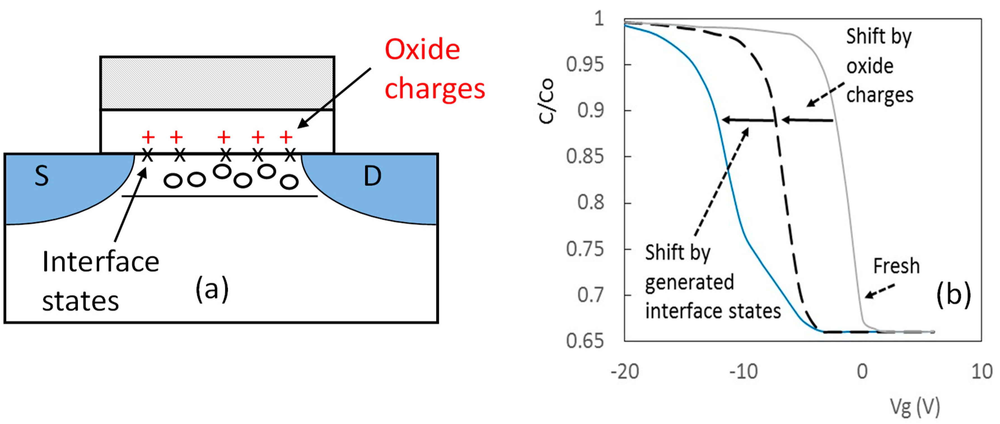

# Device reliability: Bias temperature instability

Bias temperature instability (BTI)는 metal-oxide-semiconductor field-effect transistor (MOSFET)에 게이트 바이어스와 온도를 장시간 인가할 때 문턱전압 $V_T$와 구동 특성이 변하는 현상이다. Negative BTI (NBTI)는 주로 음의 게이트 바이어스를 받는 pMOS에서, positive BTI (PBTI)는 주로 양의 게이트 바이어스를 받는 nMOS에서 관측된다. NBTI와 PBTI는 단순히 게이트 바이어스의 부호만 반대인 현상이 아니다. 채널에서 주입되는 운반자의 종류와 게이트 절연막 결함의 에너지 준위가 다르므로, 열화의 크기와 스트레스를 제거한 후의 회복 특성도 서로 다를 수 있다.[1–4]

## 1. NBTI와 PBTI의 구분

### (1) 바이어스 극성과 문턱전압 이동

아래 표는 source와 body를 기준 전위에 두고 반전층이 형성될 만큼 충분한 게이트 전압을 인가하는 대표적인 스트레스 조건과 부호를 비교한다. $V_T$는 부호를 포함한 문턱전압이고, $\Delta V_T=V_T-V_{T0}$에서 $V_{T0}$는 스트레스 전의 값이다.[1,2,5]

| 구분 | 대표 스트레스 | 채널 운반자 | 대표적인 결함 전하 변화 | 일반적인 문턱전압 이동 | 특히 중요한 구조 |
| --- | --- | --- | --- | --- | --- |
| NBTI | pMOS, 충분한 음의 $V_G$ | 정공 | 절연막의 양전하 증가와 계면 상태 생성·점유 변화 | $\Delta V_T<0$, 문턱전압의 크기 증가 | SiO₂·SiON·high-k pMOS |
| PBTI | nMOS, 충분한 양의 $V_G$ | 전자 | 절연막 전자 포획에 따른 음전하 증가 | $\Delta V_T>0$ | HfO₂ 계열 high-k nMOS |

충분한 음의 게이트 스트레스에서 pMOS 표면에는 정공 반전층이 형성된다. 정공이 절연막 결함의 포획 가능한 상태인 trap에 포획되면 절연막의 유효 전하가 더 양으로 변할 수 있다. 또한 Si/SiO₂ 계면에 새로운 interface state가 생기고 그 상태의 전자 점유가 달라지면 계면 전하도 변한다. 이처럼 절연막과 계면의 전하 변화가 함께 NBTI의 $V_T$ 이동에 기여한다.[1,2,5]

충분한 양의 게이트 스트레스에서 nMOS에는 전자 반전층이 형성된다. 특히 high-k gate stack에서는 채널 전자가 절연막 trap에 포획되어 유효 전하가 더 음으로 변하는 과정이 PBTI의 중요한 성분이다. 절연막과 계면의 전하는 자체 전기장을 만들어 반도체 표면의 전위를 바꾸므로, 같은 반전 조건에 도달하려면 게이트 전압으로 그 효과를 보상해야 한다. 양의 유효 전하가 늘면 같은 표면 조건에 필요한 게이트 전압은 더 음으로, 음의 유효 전하가 늘면 더 양으로 바뀐다. 따라서 전하와 문턱전압의 이동은 다음 절의 근사식처럼 반대 부호이다. 실제 결함의 기여는 재료와 바이어스, 측정 시점에 따라 달라진다.[1,5]

예를 들어 pMOS의 $V_T$가 $-0.4$ V에서 $-0.5$ V로 바뀌면 $\Delta V_T=-0.1$ V이지만 문턱전압의 크기 변화 $\Delta|V_T|$는 $+0.1$ V이다. 반면 nMOS의 $V_T$가 $+0.4$ V에서 $+0.5$ V로 바뀌면 $\Delta V_T=+0.1$ V이다. 이 값들은 부호 규약을 설명하기 위한 예시이다. 문헌을 비교할 때에는 부호를 갖는 변화량인지 열화의 크기인지 확인해야 하며, 본 문서는 열화량의 크기를 비교할 때 $|\Delta V_T|$를 사용한다.

### (2) 산화막 전하와 계면 상태

BTI의 $\Delta V_T$에는 게이트 절연막 내부 트랩의 전하 상태 변화와 반도체–절연막 계면 상태의 생성·점유가 함께 기여한다. Trap은 운반자를 포획하거나 방출할 수 있는 결함의 상태이며, oxide charge는 절연막 쪽에 존재하는 유효 전하를 뜻한다. Interface state는 반도체와 절연막의 경계에 있는 전자 상태로, 그 전하 상태는 전자 점유에 따라 달라진다.[1,2,5] Oxide charge는 이상적인 capacitance–voltage (C–V) 곡선을 주로 평행 이동시키는 반면, interface state는 표면 전위에 따라 점유가 달라져 C–V 곡선의 형태, subthreshold swing (SS)과 transconductance에도 영향을 줄 수 있다.[1–4]

<figure markdown="span">
  
  <figcaption markdown="1">
    그림 1. MOS 구조의 oxide charge와 interface state, 그리고 두 결함군이 C–V 곡선에 주는 대표적인 차이. 그림의 전압 값은 개념을 보이는 예시이며 현대 소자의 정량 기준으로 사용하지 않는다.
    출처: J. F. Zhang et al., “Bias Temperature Instability of MOSFETs: Physical Processes, Models, and Prediction,” Figure 3 (2022),
    <a href="https://doi.org/10.3390/electronics11091420">DOI</a>,
    <a href="https://creativecommons.org/licenses/by/4.0/">CC BY 4.0</a>, 수정 없음.[1]
  </figcaption>
</figure>

단위면적당 유효 산화막 전하 변화 $\Delta Q_\mathrm{ot}$와 계면 상태의 유효 전하 변화 $\Delta Q_\mathrm{it,eff}$를 전하 시트로 근사하면

$$
\Delta V_T\approx-
\frac{\Delta Q_\mathrm{ot}+\Delta Q_\mathrm{it,eff}}
{C_\mathrm{ox}}
$$

로 쓸 수 있다. $C_\mathrm{ox}$는 단위면적당 유효 게이트 절연막 capacitance이다. 이 식은 전하 부호와 전기적 효과를 연결하지만, 트랩의 에너지·깊이와 점유율을 하나의 $\Delta V_T$로부터 유일하게 역산하지는 못한다.[1–4]

## 2. Si/SiO₂ NBTI의 물리적 기원

### (1) Si–H 결합 파괴와 계면 상태 생성

열산화 SiO₂와 Si의 계면에는 배위 결함을 수소로 종결한 Si–H 결합이 존재할 수 있다. 고전적인 설명에서는 음의 게이트 바이어스가 계면에 정공을 모으고, 높은 온도가 결합 반응을 촉진하여 Si–H 전구체가 깨진다. 남은 Si dangling bond는 $P_b$ center로 불리는 계면 상태를 형성하고, 방출된 수소 종은 계면에서 절연막 쪽으로 이동하거나 다른 반응에 참여한다. 이 과정은 계면 상태 증가와 양의 유효 전하를 통해 pMOS의 $|V_T|$를 증가시킨다.[1–3]

초기 reaction–diffusion 모형은 계면 반응과 수소 종의 확산을 결합하여 장시간의 거듭제곱 시간 의존성을 설명했다. 그러나 이 모형 하나만으로 스트레스 제거 직후의 빠른 회복, 넓은 시간 범위의 로그형 회복, 나노 소자에서 보이는 개별적인 문턱전압 계단을 모두 설명하기는 어렵다.[1,3,4]

### (2) 산화막 트랩의 정공 포획과 회복

현대의 얇은 SiO₂·SiON 구조에서는 기존 oxide trap의 정공 포획이 NBTI의 큰 회복 가능 성분을 만들 수 있다. 스트레스 중 정공을 포획한 트랩은 판독 바이어스로 전환한 뒤 정공을 방출하며, 이 때문에 측정 지연이 길수록 관측되는 $|\Delta V_T|$가 작아진다. 반면 스트레스 중 새로 생성되거나 구조가 바뀐 결함은 더 오래 남을 수 있다.[1,3,4]

따라서 Si/SiO₂ NBTI를 다음 두 성분 중 하나로만 정의하는 것은 적절하지 않다.

| 결함 성분 | 대표적인 물리 과정 | 전기적 관측 | 시간 특성 |
| --- | --- | --- | --- |
| 기존 oxide trap | 정공 포획과 방출, 결함 구조 전환 | 주로 $V_T$ 이동 | 매우 빠른 회복부터 장시간 잔류까지 분포 |
| Interface state | Si–H 전구체의 활성화와 $P_b$ center 생성·점유 | $V_T$, SS, $g_m$ 변화 | 생성과 회복이 공정·온도·시간 창에 의존 |

개별 트랩의 점유 확률을 $f$라 하고 포획률을 $c$, 방출률을 $e$라 하면 두 비율의 단위는 s⁻¹이다. 고정된 바이어스와 온도에서 $c$와 $e$가 일정한 가장 단순한 일차 동역학은

$$
\frac{df}{dt}=c(1-f)-ef,
\qquad
\tau=\frac{1}{c+e}
$$

로 쓸 수 있다. 실제 절연막에는 에너지, 채널과의 거리와 구조 이완이 서로 다른 트랩이 존재하므로 $\tau$가 넓게 분포한다. 많은 트랩의 응답을 합하면 단일 지수함수가 아닌 거듭제곱 또는 로그형 stress–recovery 곡선이 나타날 수 있다.[1,3,4]

## 3. 게이트 적층에 따른 PBTI

### (1) 열산화 SiO₂의 전자 포획

초기의 poly-Si/열산화 SiO₂ nMOS에서 관측된 PBTI는 같은 세대의 pMOS NBTI에 비해 작았다. 관측된 순 이동만으로 트랩 밀도나 유일한 원인을 결정할 수는 없다.[1,6]

이 설명은 “SiO₂에서는 PBTI가 존재하지 않는다”는 뜻이 아니다. 나노 면적 SiON nMOS에서는 전자 포획과 poly-Si gate에 결합된 정공 트랩 응답이 분리되어 관측되며, 큰 면적의 평균 응답에서는 서로 상쇄될 수 있다. PBTI의 관측 크기는 적층 구조와 판독 시간에도 의존한다.[1,6]

### (2) HfO₂의 전자 트랩

Equivalent oxide thickness (EOT)를 줄이면서 누설 전류를 억제하기 위해 SiO₂ interfacial layer 위에 HfO₂ 계열 high-k 절연막을 쌓으면, SiO₂ 단일막에는 적었던 접근 가능한 전자 트랩이 high-k 내부에 추가된다. 양의 게이트 스트레스에서 nMOS 채널의 전자가 이 트랩에 포획되면 절연막에 음의 전하가 남고 $V_T$가 양의 방향으로 이동한다. 전자 포획과 방출이 high-k PBTI의 큰 회복 가능 성분을 만들며, 더 깊거나 구조 이완이 큰 트랩은 장시간 잔류 성분을 만든다.[1,6–8]

HfO₂의 산소 공공과 관련된 결함은 계산된 전자 포획 준위와 전기적 분광 결과가 가까워 PBTI 전자 트랩의 유력한 후보로 제시되어 왔다. 산소 공공을 줄이는 공정과 PBTI 감소 사이의 상관관계도 보고되었다. 다만 전기적 측정만으로 원자 구조를 직접 식별할 수 없고 HfO₂에는 불순물·계면·다른 구조 결함도 존재하므로, 모든 high-k PBTI를 하나의 산소 공공 전하 상태로 단정할 수는 없다.[1,7,8]

| Gate stack | 상대적으로 두드러지는 BTI | 주요 물리적 이유 | 해석할 때 주의할 점 |
| --- | --- | --- | --- |
| 열산화 SiO₂ pMOS | NBTI | 정공 포획, Si/SiO₂ 계면 전구체와 interface state | 정공 포획과 결함 생성을 측정 지연 없이 분리하기 어려움 |
| 열산화 SiO₂ nMOS | PBTI가 대체로 작음 | 관측된 순 이동이 작은 사례 | 순 이동만으로 결함 밀도를 결정할 수 없음 |
| SiON | NBTI와 PBTI 모두 공정 의존 | 질소 도입이 트랩 에너지와 밀도를 변화 | 소자 극성만으로 포획 운반자를 단정하지 않음 |
| SiO₂/HfO₂ nMOS | PBTI가 중요한 수명 제한 | high-k 내부의 접근 가능한 전자 트랩 | 산소 공공은 유력 후보이나 유일한 원인으로 확정되지 않음 |

## 4. 게이트 전압·온도·시간 의존성

BTI는 일반적으로 게이트 overdrive와 온도가 커질수록 빨라지지만, 정확한 전압·온도 함수는 결함군과 측정 시간 창에 의존한다. 제한된 범위의 경험식은

$$
|\Delta V_T(t)|
=A|V_\mathrm{ov}|^m t^n
\exp\left(-\frac{E_a}{kT}\right)
$$

처럼 쓸 수 있다. $V_\mathrm{ov}=V_G-V_T$의 크기는 게이트 overdrive, $m$과 $n$은 적합 지수, $E_a$는 유효 활성화 에너지, $k$는 Boltzmann 상수, $T$는 절대 온도이다. $A$는 단위 선택에 의존하는 적합 계수로, 전압을 V, 시간을 s로 입력하면 $\mathrm{V}^{1-m}\mathrm{s}^{-n}$의 단위를 갖는다. 고정된 스트레스 바이어스와 온도에서 시간 의존성을 적합하고 각 조건을 비교하는 제한된 경험식이다. 이 매개변수는 스트레스·판독 절차와 적합 구간에 종속되며 보편적인 재료 상수가 아니다. 열화 중 $V_T$가 변하므로 초기 $V_{T0}$와 순간 $V_T(t)$ 가운데 어느 값을 overdrive 계산에 사용했는지도 명시해야 한다.[1–4,9]

직류 스트레스와 실제 회로의 교류 동작도 구분해야 한다. 교류 파형의 비스트레스 구간에는 일부 트랩이 방출되어 회복하지만, 시정수가 주기보다 긴 트랩과 비가역에 가까운 성분은 누적된다. 따라서 duty cycle만으로 직류 자료를 선형 축소하지 말고, 진폭·주파수·상승 및 하강 시간·온도를 포함한 파형으로 검증한다.[1,3,4]

## 5. 전기적 열화 지표와 결함 분리

$V_T$ 이동은 고정된 게이트 전압에서 overdrive를 바꾸므로 선형·포화 드레인 전류와 transconductance를 변화시킨다. Interface state가 증가하면 SS도 악화될 수 있다. 긴 채널 소자의 subthreshold 영역에서 전류가 열적 확산으로 지배되고 이동도가 게이트 전압에 따라 완만하게 변하며 interface state가 표면 전위 변화에 준정적으로 응답하는 근사에서는

$$
SS=\ln(10)\frac{kT}{q}
\left(1+\frac{C_d+C_\mathrm{it}}{C_\mathrm{ox}}\right)
$$

로 나타낼 수 있다. $k$는 Boltzmann 상수, $T$는 절대 온도, $q$는 양의 기본 전하량이며 $C_d$, $C_\mathrm{it}$, $C_\mathrm{ox}$는 각각 단위면적당 공핍, 응답 가능한 interface state, 게이트 절연막 capacitance이다.[10,11] $\Delta V_T$는 크지만 $\Delta SS$가 작다면 oxide charge 성분이 우세할 가능성이 있고, $\Delta SS$와 $\Delta g_m$이 함께 커지면 interface state와 산란 변화를 의심할 수 있다. 다만 이러한 전기적 특성의 변화는 가능한 결함 유형을 구분하는 정성적 단서일 뿐이며, 특정 결함의 화학적 구조를 단독으로 확정하는 증거는 아니다.[1–4]

| 관측량 | 주된 민감도 | 해석할 때 함께 볼 양 |
| --- | --- | --- |
| $\Delta V_T$ | 유효 절연막 전하와 계면 상태 | 추출법, 판독 지연, body bias |
| $\Delta I_{D,\mathrm{lin}}$ | 저전계 채널 전도 | $\Delta V_T$, mobility, 직렬저항 |
| $\Delta g_m$ | mobility와 계면 산란 | $V_G$ 추출점, $\Delta V_T$ 보정 |
| $\Delta SS$ | 계면 상태와 전기정적 결합 | 누설 바닥, 온도, sweep 방향 |

회로에서는 pMOS와 nMOS의 비대칭 열화가 inverter의 상승·하강 지연, 잡음 여유와 static random-access memory (SRAM) 안정성을 바꿀 수 있다. 같은 $|\Delta V_T|$라도 열화된 소자의 위치와 동작 상태에 따라 회로 영향은 달라진다.[1,2]

## 6. 실험 측정과 결함 분석

### (1) 측정 장비와 단자 바이어스

BTI 시험 구성의 예로 온도 조절 chuck 또는 oven, gate와 source·drain·body 전압을 인가할 source measure unit (SMU), 스트레스와 판독 사이를 빠르게 전환할 pulse generator 또는 switching matrix를 사용할 수 있다. 장비 구성은 필요한 바이어스와 시간 분해능에 따라 선택한다. 나노초급 장비가 항상 필요한 것은 아니지만, 장비의 최소 전환 시간이 관측 가능한 가장 빠른 회복 성분을 결정하므로 시간 분해능을 시험 결과와 함께 기록해야 한다.[1,3,4]

가장 단순한 gate-only BTI 스트레스에서는 source, drain과 body를 같은 기준 전위에 두고 gate에만 스트레스 전압을 인가한다. pMOS NBTI에는 $V_{G,\mathrm{str}}<0$, nMOS PBTI에는 $V_{G,\mathrm{str}}>0$를 사용한다. $|V_D|$를 작게 두는 이유는 채널을 따라 큰 횡전계를 만들지 않아 [HCD](hot-carrier-degradation.md)의 기여를 줄이기 위해서이다. 실제 회로 파형을 모사할 때에는 drain과 body bias도 인가할 수 있지만, 이 경우 순수한 gate-bias BTI 시험과 구분해 기록한다.[1,2,12]

시험 전에 목표 온도에서 소자와 chuck가 열평형에 도달하도록 기다리고, 스트레스를 받지 않은 대조 소자의 $I_D$ 변동과 장비 drift를 확인한다. 온도를 바꿀 때에는 동일 소자에 누적 스트레스를 반복하기보다 별도의 소자 또는 누적 이력을 포함한 시험 순서를 사용한다. 그렇지 않으면 온도 효과와 앞선 스트레스 이력이 섞인다.[1–4]

### (2) 스트레스–판독–회복 절차

!!! info "[Measurement]"
    1. 낮은 drain bias에서 초기 $I_D$–$V_G$ transfer 곡선을 측정하고 constant-current 또는 linear-extrapolation 방법으로 $V_{T0}$를 구한다. 이 곡선으로 빠른 판독점을 선정하고 기준 전류와 국소 기울기를 보정한다. 이후에는 같은 drain bias와 보정된 동일 추출 절차를 사용한다.
    2. 정해진 $(V_{G,\mathrm{str}},V_{D,\mathrm{str}},V_{B,\mathrm{str}},T)$를 시간 $t_s$ 동안 인가한다. 보통 $t_s$를 로그 간격으로 늘려 짧은 시간과 긴 시간을 모두 표본화한다.
    3. 스트레스 전압을 끈 뒤 가능한 한 빠르게 낮은 교란의 판독 바이어스로 전환하여 $V_T(t_s,t_r)$를 측정한다. 넓은 $V_G$ sweep은 측정 시간이 길고 트랩 점유를 바꿀 수 있으므로, 빠른 소수점 판독이나 좁은 전압 범위를 우선한다. 소수점 판독은 보정된 국소 기울기로 $V_T$ 변화를 근사하며 전체 transfer 곡선에서 직접 추출한 값과 동일하지 않으므로 적용 범위를 검증한다.
    4. 마지막 스트레스 뒤에는 판독 바이어스 또는 무바이어스 상태에서 $t_r$를 로그 간격으로 늘리며 recovery를 측정한다. 스트레스와 recovery 전 구간에서 실제 gate 파형을 함께 저장한다.

    각 판독점에서

    $$
    \Delta V_T(t_s,t_r)
    =V_T(t_s,t_r)-V_{T0}
    $$

    를 계산한다. NBTI와 PBTI를 비교할 때에는 유사한 유효 산화막 전계와 채널 운반자 조건을 사용하고, 단순히 $|V_G|$만 맞추지 않는다.[1–4]

On-the-fly 측정은 스트레스를 유지한 채 제한된 바이어스 구간을 판독하여 빠른 회복 손실을 줄일 수 있지만, 판독 전압 자체가 트랩 점유를 바꾸고 완전한 transfer 곡선을 얻기 어렵다. Measure–stress–measure 방식은 여러 전기량을 추출할 수 있지만 전환 지연 동안의 회복을 포함한다. Charge pumping이나 C–V 측정을 함께 사용하면 interface state 변화에 대한 추가 단서를 얻을 수 있으나, 측정 주파수와 에너지 창이 달라 결과를 단순히 동일시해서는 안 된다.[1–4]

### (3) 결함 성분의 실험적 구분

빠른 $I_D$ 판독은 실제 동작과 가까운 $\Delta V_T$를 얻는 데 적합하지만 oxide trap과 interface state를 직접 분리하지 못한다. 따라서 원인 분석에서는 서로 다른 민감도를 가진 측정을 조합한다.[1–4,6]

| 실험 방법 | 직접 얻는 자료 | 주로 제공하는 정보 | 주요 한계 |
| --- | --- | --- | --- |
| 빠른 $I_D$–$V_G$ 또는 소수점 판독 | $\Delta V_T$, $\Delta I_D$; 충분한 전압 범위와 표본점이 있으면 $\Delta g_m$, $\Delta SS$ | 전체 전기적 열화와 빠른 회복 | 첫 판독 전 회복, 추출법과 전압 표본화 의존성 |
| On-the-fly 판독 | 스트레스 중 $I_D$ 또는 $V_T$ 근사 | 빠른 recovery 손실이 작은 열화량 | 판독 바이어스가 트랩 점유에 영향 |
| Charge pumping | 펄스 주파수에 따른 기판 전류 | 특정 에너지 창의 interface state 변화 | 산화막 트랩과의 결합, 파형·면적 보정 |
| C–V·conductance | 평행·비평행 이동과 주파수 분산 | oxide charge와 interface state의 정성적 분리 | 실제 짧은 채널 소자 적용과 시간 분해능 제한 |
| Time-dependent defect spectroscopy (TDDS) | recovery 중 개별 $\Delta V_T$ 계단 | 단일 트랩의 방출 시간과 step 높이 분포 | 작은 면적 소자와 낮은 잡음이 필요 |

TDDS에서는 충분히 작은 소자를 스트레스한 뒤 recovery 중 $V_T$를 연속 판독한다. 한 개의 트랩이 운반자를 방출하면 전류 또는 $V_T$에 계단이 나타나며, 여러 회 반복하여 방출 시간과 step 높이의 분포를 구한다. 이 방법은 넓은 시정수 분포가 서로 다른 개별 결함에서 기원할 수 있음을 보여주지만, 계단 하나만으로 결함의 원자 구조를 확정하지는 못한다.[3,4,6]

!!! note "[Metric]"
    수명 기준을 $|\Delta V_T|=\Delta V_{T,\mathrm{crit}}$로 정했다면 임계값과 함께 판독 지연, $\Delta I_D/I_{D0}$와 스트레스 파형을 보고한다. 회복 비율은

    $$
    R(t_r)=1-
    \frac{|\Delta V_T(t_s,t_r)|}
    {|\Delta V_T(t_s,t_{r,0})|}
    $$

    로 정의할 수 있다. 여기서 $t_{r,0}$는 장비가 허용하는 가장 이른 판독 시점이며 분모가 0이 아닐 때만 이 비율을 정의한다. 회복이 단조롭지 않거나 이동의 크기가 증가하면 $R$은 0과 1 사이에 제한되지 않는다. 서로 다른 장비의 $R$을 비교할 때에는 $t_{r,0}$와 $t_r$가 같아야 한다.[1,3,4]

## 7. 수명 모형과 외삽 한계

Reaction–diffusion 모형은 Si–H 결합 파괴와 수소 이동을 연결하는 역사적으로 중요한 NBTI 모형이다. Switching oxide trap 모형은 기존 결함의 전하 교환과 구조 이완, 개별 트랩의 넓은 시정수 분포를 강조한다. 두 모형의 일부 시간 구간은 모두 $t^n$ 형태로 보일 수 있으므로 거듭제곱 적합만으로 미시 메커니즘을 선택할 수 없다.[1,3,4]

!!! warning "[Interpretation Caveat]"
    가속 시험의 $m$, $n$, $E_a$를 사용 조건까지 외삽하기 전에 같은 결함군이 지배적인지 확인해야 한다. 높은 전계에서만 새 결함이 생성되거나, 온도에 따라 포획과 방출의 상대 비중이 바뀌거나, 첫 판독 전에 빠른 회복이 사라지면 적합 매개변수의 물리적 의미가 달라진다. 적어도 여러 전압·온도·시간 창과 판독 지연에서 일관성을 검증한다.[1–4]

BTI와 hot-carrier degradation (HCD)는 실제 동작 바이어스에서 동시에 나타날 수 있다. 높은 $|V_G|$의 열화를 모두 BTI로, 높은 $V_D$의 열화를 모두 HCD로 배정하지 말고 [hot-carrier degradation](hot-carrier-degradation.md)의 바이어스 지도와 판독량을 함께 사용한다.[1,12]

## 8. 요약

- Si/SiO₂ pMOS의 NBTI에는 정공을 포획하는 oxide trap과 Si–H 전구체에서 유래하는 interface state가 함께 기여할 수 있다.
- 초기의 SiO₂ nMOS에서는 관측된 PBTI가 상대적으로 작았지만, HfO₂ 계열 high-k가 도입되면서 전자 포획에 의한 PBTI가 주요 수명 제한으로 부상했다.
- HfO₂의 산소 공공 관련 결함은 PBTI 전자 트랩의 유력한 후보이지만, 모든 공정과 결함을 대표하는 유일한 원인으로 확정된 것은 아니다.
- $\Delta V_T$의 크기만으로 oxide trap과 interface state를 분리할 수 없으므로 $\Delta SS$, $\Delta g_m$, 회복 시간과 보조 측정을 함께 해석해야 한다.
- 판독 지연과 회복을 포함하지 않은 경험식의 적합 지수는 재료 고유 상수가 아니며, 측정 범위 밖 수명 외삽에는 추가 검증이 필요하다.

## 9. 참고문헌

1. J. F. Zhang, R. Gao, M. Duan, Z. Ji, W. Zhang, and J. Marsland, “Bias Temperature Instability of MOSFETs: Physical Processes, Models, and Prediction,” *Electronics* **11**, 1420 (2022). [DOI](https://doi.org/10.3390/electronics11091420)
2. J. H. Stathis and S. Zafar, “The Negative Bias Temperature Instability in MOS Devices: A Review,” *Microelectronics Reliability* **46**, 270–286 (2006). [DOI](https://doi.org/10.1016/j.microrel.2005.08.001)
3. T. Grasser et al., “The Paradigm Shift in Understanding the Bias Temperature Instability: From Reaction–Diffusion to Switching Oxide Traps,” *IEEE Transactions on Electron Devices* **58**, 3652–3666 (2011). [DOI](https://doi.org/10.1109/TED.2011.2164543)
4. T. Grasser et al., “NBTI in Nanoscale MOSFETs—The Ultimate Modeling Benchmark,” *IEEE Transactions on Electron Devices* **61**, 3586–3593 (2014). [DOI](https://doi.org/10.1109/TED.2014.2353578)
5. A. Campos-Cruz, G. Espinosa-Flores-Verdad, A. Torres-Jacome, and E. Tlelo-Cuautle, “On the Prediction of the Threshold Voltage Degradation in CMOS Technology Due to Bias-Temperature Instability,” *Electronics* **7**, 427 (2018). [DOI](https://doi.org/10.3390/electronics7120427)
6. M. Waltl, B. Stampfer, G. Rzepa, B. Kaczer, and T. Grasser, “Separation of Electron and Hole Trapping Components of PBTI in SiON nMOS Transistors,” *Microelectronics Reliability* **114**, 113746 (2020). [DOI](https://doi.org/10.1016/j.microrel.2020.113746)
7. E. Cartier, B. P. Linder, V. Narayanan, and V. K. Paruchuri, “Fundamental Understanding and Optimization of PBTI in nFETs with SiO₂/HfO₂ Gate Stack,” *2006 International Electron Devices Meeting*, 1–4 (2006). [DOI](https://doi.org/10.1109/IEDM.2006.346773)
8. J. L. Gavartin, D. Muñoz Ramo, A. L. Shluger, G. Bersuker, and B. H. Lee, “Negative Oxygen Vacancies in HfO₂ as Charge Traps in High-k Stacks,” *Applied Physics Letters* **89**, 082908 (2006). [DOI](https://doi.org/10.1063/1.2236466)
9. M. Waltl, *Experimental Characterization of Bias Temperature Instabilities in Modern Transistor Technologies*, Ph.D. dissertation, Technische Universität Wien (2016), §7.1.1. [Full text](https://www.iue.tuwien.ac.at/phd/waltl/Modeling-Bias-Temperature-Instabilities.html)
10. S. Cristoloveanu and G. Ghibaudo, “Breaking the Subthreshold Slope Limit in MOSFETs,” *Solid-State Electronics* **198**, 108465 (2022). [DOI](https://doi.org/10.1016/j.sse.2022.108465)
11. L. Chen, *Radiation Tolerant Design with 0.18-micron CMOS Technology*, Ph.D. dissertation, University of Alberta (2004), §2.3.1. [Full text](https://sites.ualberta.ca/~gingrich/students/thesis_phd_chen_v3.pdf)
12. H. Zhou, “An Overview of Hot Carrier Degradation on Gate-All-Around Nanosheet Transistors,” *Micromachines* **16**, 311 (2025). [DOI](https://doi.org/10.3390/mi16030311)
