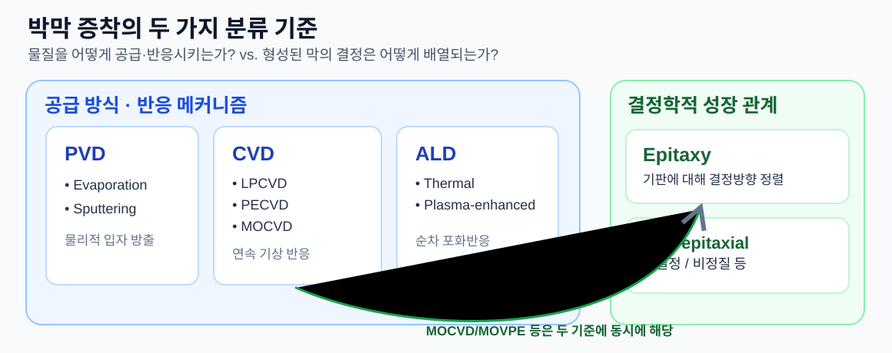
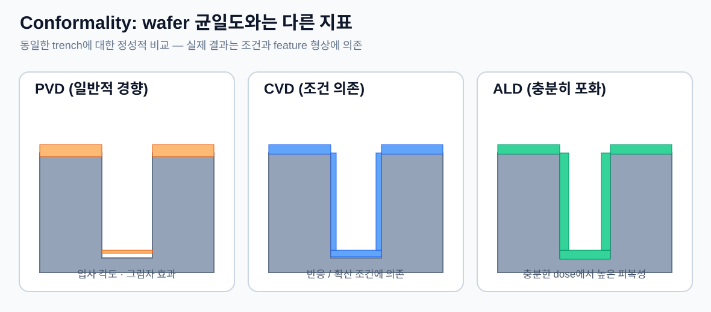
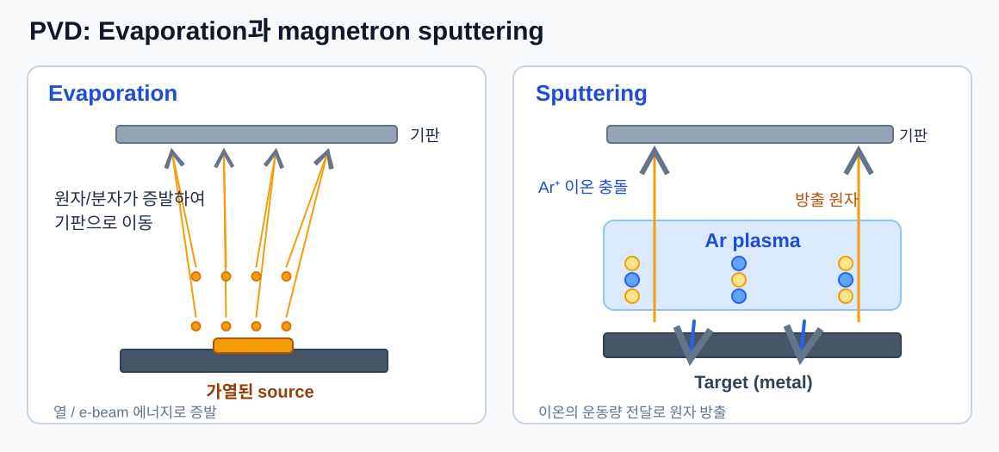
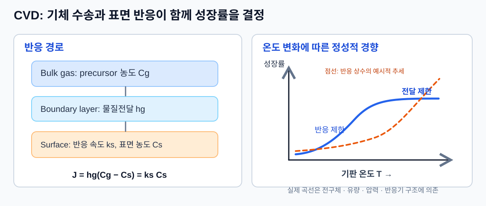
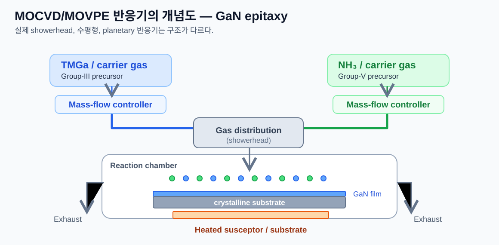
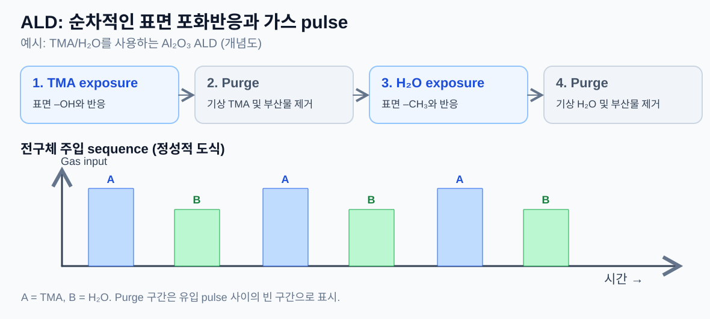
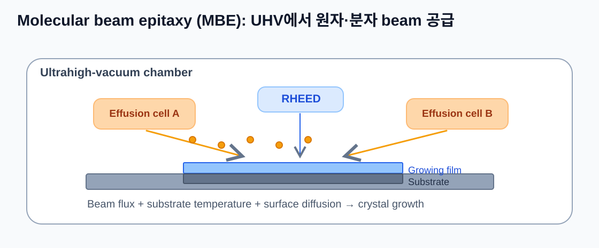
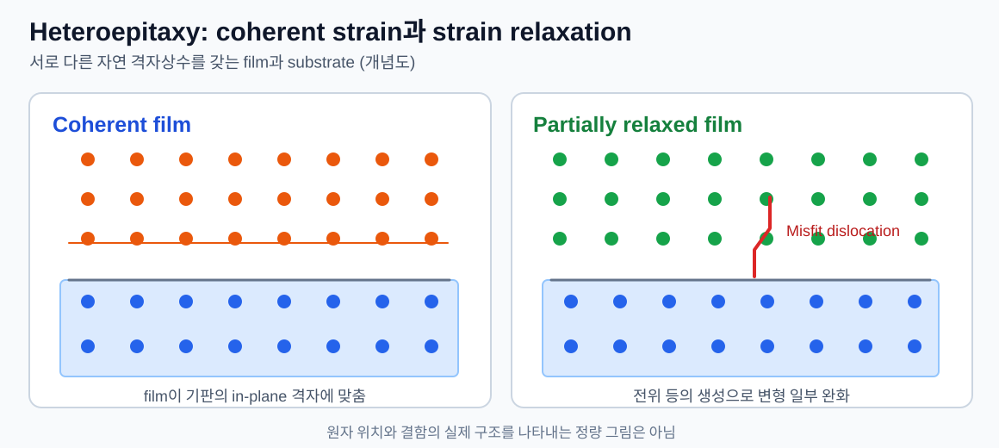

# 박막 증착 (Thin-film deposition)

반도체 소자를 제작할 때는 웨이퍼 위에 수 nm에서 수 µm 두께의 박막을 반복해서 형성한다. 박막의 역할은 재료에 따라 다르다. 예를 들어 게이트 절연막은 누설전류를 억제해야 하고, 금속 배선은 낮은 저항을 유지해야 하며, 트랜지스터의 채널이나 발광소자의 활성층은 필요한 결정성과 전자구조를 갖추어야 한다. 따라서 **증착 공정의 목적은 단순히 재료를 쌓는 것이 아니라, 원하는 두께·조성·미세구조·계면 특성을 재현성 있게 구현하는 것**이다. [1,2]

박막을 형성하는 방법으로는 physical vapor deposition(PVD), chemical vapor deposition(CVD), atomic layer deposition(ALD) 등이 널리 사용된다. 반면 **epitaxy(에피택시)는 공급 방식이 아니라, 성장한 결정이 기판과 특정한 결정학적 방향 관계를 갖는다는 뜻**이다. 따라서 MOCVD로 GaN 단결정을 성장시키는 공정은 동시에 CVD이면서 epitaxial growth이다. 이러한 구분을 이해해야 증착법들의 관계를 정확히 파악할 수 있다. [1,4,5]

<figure markdown="span">
  
  <figcaption>그림 1. 박막 증착을 설명하는 두 가지 기준. PVD·CVD·ALD는 물질 공급과 반응 방식에 따른 분류이며, epitaxy는 성장한 박막과 기판 사이의 결정학적 관계를 나타낸다. 설명을 위해 제작한 개념도.</figcaption>
</figure>

| 구분 | 박막이 형성되는 주요 원리 | 대표 기술 | 주요 적용 재료·소자 |
| --- | --- | --- | --- |
| **PVD** | 고체 source에서 방출한 원자·분자를 기판에 응축 | Thermal/e-beam evaporation, sputtering | 금속 전극·배선, 금속/합금, 일부 산화물·질화물 |
| **CVD** | 기상 전구체의 수송과 표면 화학반응 | APCVD, LPCVD, PECVD, MOCVD | Si, SiO₂, SiNₓ, W, 화합물 반도체 |
| **ALD** | 전구체를 시간적으로 분리해 공급하고 표면 포화반응을 반복 | Thermal ALD, plasma-enhanced ALD | HfO₂, Al₂O₃, 일부 금속·질화물, 3차원 구조의 피복막 |
| **Epitaxy** | 박막 결정과 기판 결정의 방향 관계를 유지하며 성장 | MBE, MOVPE/MOCVD, HVPE, CVD epitaxy | Si/SiGe, GaAs, GaN, InGaN, AlGaN |

!!! note "용어와 분류"
    ALD는 넓은 의미에서 기상 전구체와 표면 반응을 이용한다는 점에서 CVD와 관련되지만, 반응물을 **순차 공급**하여 포화된 반응 단계를 이용한다는 점이 일반적인 연속 공급 CVD와 다르다. Epitaxy는 PVD·CVD·ALD와 같은 층위의 독립적인 공급 기술이 아니다. 또한 열산화(thermal oxidation)는 기판 자체를 소비하면서 산화막을 성장시키는 공정으로, 외부 물질을 공급해 쌓는 증착과 구분한다.

## 1. 박막은 어떻게 성장하는가?

### 1.1 공급, 흡착, 확산, 핵생성

서로 다른 증착법이라도 박막 성장은 몇 가지 공통 과정으로 이해할 수 있다. (1) 공급원에서 원자·분자 또는 반응성 입자를 생성하고, (2) 기판 표면까지 이동시킨 다음, (3) 표면에 흡착시켜 화학반응이나 확산을 거치게 하며, (4) 안정적인 핵(nucleus)을 형성하고 성장시킨다. 성장한 핵들이 서로 연결되면 연속 박막이 형성된다. [1,6]

기판에 도달한 입자가 모두 박막에 포함되지는 않는다. 일부는 표면에서 반사되거나 다시 탈착(desorption)된다. 입자가 표면에 머물 가능성은 입사 조건, 표면의 화학적 상태, 온도, 흡착 에너지에 따라 달라진다. 이 차이는 흔히 **sticking coefficient**로 표현한다. 표면에 흡착한 입자도 제자리에서 즉시 고정되는 것은 아니다. 표면 확산(surface diffusion)을 통해 더 안정한 결합 위치로 이동하거나, 기존의 원자층 또는 핵과 결합할 수 있다.

핵생성과 성장의 경쟁은 최종 막의 형태를 결정한다. 고전적인 분류에는 다음 세 가지가 있다. [6]

- **Frank–van der Merwe (layer-by-layer)**: 원자층이 순차적으로 완성되는 성장.
- **Volmer–Weber (island growth)**: 기판을 완전히 덮기 전에 3차원 섬이 형성되는 성장.
- **Stranski–Krastanov (layer-plus-island)**: 초기 습윤층(wetting layer)이 생긴 뒤 3차원 섬이 형성되는 성장.

이러한 분류는 박막·기판의 표면 및 계면 에너지와 변형 에너지의 경쟁을 이해하는 데 유용하다. 다만 실제 증착은 비평형 과정이므로 성장률, 온도, 확산 속도, 결정 결함에 따라서도 형태가 달라진다. 매끄러운 박막이 형성되었다는 이유만으로 반드시 layer-by-layer growth가 일어났다고 판단할 수는 없다.

### 1.2 증착률, 웨이퍼 균일도, 단차 피복성

가장 기본적인 증착률(deposition rate)은 시간에 따른 막 두께 변화로 정의한다.

$$
R_\mathrm{dep}=\frac{\Delta t_\mathrm{film}}{\Delta \tau}.
$$

여기서 $t_\mathrm{film}$은 박막 두께이고 $\tau$는 공정 시간이다. 단위는 흔히 nm/min 또는 nm/s를 사용한다. 단, 초기 핵생성 지연이나 성장률 변화가 있으면 전체 공정의 평균 증착률과 순간 증착률이 다를 수 있다.

**웨이퍼 내 균일도(uniformity)**는 웨이퍼의 서로 다른 위치에서 두께가 얼마나 일정한지를 나타낸다. 자주 사용되는 peak-to-peak 비균일도 표현 가운데 하나는

$$
U_\mathrm{p-p}=\frac{t_\mathrm{max}-t_\mathrm{min}}{2t_\mathrm{avg}}\times100\%
$$

이다. 이 식이 유일한 산업 표준은 아니다. 어떤 자료는 분모에 $t_\mathrm{avg}$를 사용하고, 다른 자료는 두께 분포의 표준편차를 보고한다. 비교할 때는 반드시 정의와 측정 위치, 웨이퍼 가장자리 제외 범위(edge exclusion)를 확인해야 한다.

**단차 피복성(step coverage)과 conformality**는 웨이퍼 전체의 균일도와 다르다. 트렌치(trench)나 홀(hole)의 윗면, 측벽, 바닥에 박막이 얼마나 고르게 쌓이는지를 나타내는 지표다. 위치에 따른 피복 비율은 예를 들어

$$
SC_\mathrm{side}=\frac{t_\mathrm{side}}{t_\mathrm{top}},\qquad
SC_\mathrm{bottom}=\frac{t_\mathrm{bottom}}{t_\mathrm{top}}
$$

으로 정의할 수 있다. 구조의 깊이 $h$와 폭 $w$의 비인 aspect ratio($AR=h/w$)가 커질수록 반응종을 바닥까지 전달하기 어려워지는 경우가 많다. 이는 3D NAND, DRAM capacitor, 고종횡비 contact 및 via 공정에서 특히 중요하다. [3]

<figure markdown="span">
  
  <figcaption>그림 2. 공정별 단차 피복성의 정성적 비교. 전형적인 방향성 PVD, 조건에 의존하는 CVD, 충분한 반응종 노출을 확보한 ALD를 예시한 것으로, 각 방법의 보편적 결과를 뜻하지 않는다. 설명용 개념도.</figcaption>
</figure>

!!! warning "Uniformity와 conformality는 별개의 특성"
    평탄한 웨이퍼에서 두께가 균일하더라도 깊은 트렌치의 바닥에서는 막이 얇게 형성될 수 있다. 반대로 개별 구조의 피복성이 좋아도 웨이퍼 전체에서 두께 편차가 클 수 있다. 따라서 둘은 서로 다른 길이 척도의 품질 지표다.

## 2. Physical vapor deposition (PVD)

PVD는 고체 공급원에서 원자나 분자를 **물리적으로 방출**한 뒤 기판에 도달시켜 박막을 형성하는 기술이다. 대표적인 방법은 evaporation과 sputtering이다. 두 기술 모두 고체 target/source를 사용하지만 물질을 방출하는 원리가 다르다. [1]

<figure markdown="span">
  
  <figcaption>그림 3. Evaporation은 열에너지로 공급원을 기화하고, sputtering은 플라즈마 이온 충돌로 target 원자를 방출한다. 실제 장비에서는 source geometry, magnetic field, bias 등이 달라질 수 있다. 설명용 개념도.</figcaption>
</figure>

### 2.1 Evaporation: 열을 이용한 기화

**Thermal evaporation**에서는 금속이나 다른 공급원을 가열하여 증기압을 높이고, 기화된 원자가 기판에 도달하도록 한다. **Electron-beam evaporation(e-beam evaporation)**은 전자빔으로 공급원의 일부를 국소적으로 가열하므로 저항 가열이 어려운 고융점 재료에도 사용할 수 있다.

증발률은 공급원의 증기압과 온도에 크게 좌우된다. 이상적인 조건에서 순증발 플럭스는 Hertz–Knudsen 관계를 참고해 이해할 수 있지만, 실제 박막 두께는 공급원과 웨이퍼의 상대 위치, 방출 각도, 기판 회전, sticking probability 등에 따라 달라진다. [1]

증발은 금속 전극 형성에 자주 사용된다. 그러나 증발 원자가 거의 직선으로 이동하면 트렌치 측벽이나 바닥에는 도달하기 어렵다. 서로 다른 원소의 증기압이 다르기 때문에 합금이나 복잡한 화합물의 조성을 유지하기 어려울 수 있다는 점도 고려해야 한다.

### 2.2 Sputtering: 이온 충돌에 의한 원자 방출

Sputtering에서는 주로 Ar 등의 기체로 플라즈마를 형성하고, 양이온을 target 쪽으로 가속한다. 이온이 target에 운동량을 전달하면 표면 원자가 방출되어 기판에 도달한다. 입사 이온 한 개당 방출된 원자의 평균 수를 **sputtering yield**라고 한다. Yield는 이온 에너지, 질량, 입사각, target 재료 등에 의존한다. [1]

Magnetron sputtering은 target 부근에서 전자를 자기장으로 구속하여 플라즈마 밀도를 높인다. 전도성 target에는 흔히 DC sputtering을 사용하고, 절연성 target에는 표면 전하 축적을 완화하기 위해 RF sputtering을 사용한다. **Reactive sputtering**은 Ar 외에 O₂나 N₂ 등의 반응성 기체를 공급하여 산화물·질화물 박막을 형성한다.

Sputtering은 Ti, Ta, Al, Cu 등의 금속막 및 TiN, TaN과 같은 막의 형성에 활용된다. 다만 박막의 조성 및 비저항, 결정성, 응력은 공정 압력, target power, substrate bias와 반응성 가스 공급 조건에 따라 달라진다. 반응성 sputtering에서는 target 표면이 화합물로 덮이는 **target poisoning**도 공정 안정성에 영향을 줄 수 있다.

### 2.3 Line-of-sight와 shadowing

증착 입자의 평균 자유 행로(mean free path)가 챔버의 대표 길이보다 충분히 길면, 입자는 기체와 거의 충돌하지 않고 이동한다. 이때 입사 방향이 기판 형상에 가려져 트렌치 내부에 도달하지 못하는 **shadowing** 문제가 발생할 수 있다.

입사각 분포를 바꾸는 방법으로 기판 회전, 가스 압력 조절, collimation, ionized PVD 등이 있다. 따라서 모든 PVD를 무조건 비등각(nonconformal)이라고 설명하는 것은 부정확하다. 다만 고종횡비 구조의 완전한 피복에는 일반적으로 불리한 조건이 많고, 막 두께·입자 에너지·기판 손상 사이의 절충이 필요하다.

## 3. Chemical vapor deposition (CVD)

CVD에서는 기체 상태의 **precursor(전구체)**를 공급한 뒤, 기판 표면에서 화학반응을 일으켜 고체 박막을 형성한다. 증발이나 sputtering이 고체에서 원자를 물리적으로 꺼내는 방법이라면, CVD는 전구체의 화학적 반응성을 이용한다는 점이 핵심이다. [2]

대표적인 과정은 다음과 같다.

1. 전구체를 반응기로 공급하고 기체 흐름을 따라 수송한다.
2. 기판 근처의 경계층(boundary layer)을 거쳐 전구체가 표면에 도달한다.
3. 전구체가 흡착하고 분해·환원·산화 등 표면 반응을 거쳐 고체 성분을 남긴다.
4. 반응 부산물이 탈착되어 배기 흐름을 통해 제거된다.

과도한 기상 반응(homogeneous gas-phase reaction)은 particle 형성이나 유효 전구체 농도 감소를 일으킬 수 있다. 반면 표면에서 일어나는 반응(heterogeneous surface reaction)은 의도한 박막 성장에 직접 기여한다.

### 3.1 물질 전달과 표면 반응: 무엇이 성장률을 결정하는가?

CVD에서는 기판으로의 **물질 전달(mass transport)**과 **표면 반응(surface reaction)**이 서로 경쟁한다. 간단한 정상상태·일차 반응 모델을 사용하면 이 차이를 정량적으로 설명할 수 있다. [2]

기체 본류의 농도를 $C_g$, 표면 부근 농도를 $C_s$, 물질 전달 계수를 $h_g$, 표면 반응 속도 상수를 $k_s$라고 하자. 그러면 표면으로 유입되는 플럭스와 표면에서 소비되는 플럭스는 각각

$$
J_\mathrm{transport}=h_g(C_g-C_s),\qquad
J_\mathrm{reaction}=k_s C_s
$$

로 근사할 수 있다. 정상상태에서 두 플럭스가 같으므로,

$$
J=\frac{h_gk_s}{h_g+k_s}C_g
=k_\mathrm{eff}C_g,
\qquad
\frac{1}{k_\mathrm{eff}}=\frac{1}{h_g}+\frac{1}{k_s}.
$$

따라서 두 과정은 **직렬로 연결된 전달 저항**처럼 해석할 수 있다. 이 식의 $J$는 전구체 소모 플럭스이며, 이를 박막 두께 성장률로 변환하려면 반응 화학양론과 박막의 원자 밀도(또는 몰 부피)가 추가로 필요하다. 다성분·다단계 표면 반응이나 강한 기상 반응이 있는 실제 공정에서는 이 간단한 모델만으로 성장률을 예측할 수 없다.

<figure markdown="span">
  
  <figcaption>그림 4. CVD의 물질 전달과 표면 반응 모델 및 온도에 따른 제한 과정 변화의 개념도. 성장률 곡선은 정성적 경향이며 특정 전구체의 실측 자료가 아니다.</figcaption>
</figure>

- **표면 반응 제한(surface-reaction-limited), $k_s\ll h_g$**: 전구체가 표면까지 비교적 충분히 공급되지만 반응이 느리다. $k_s$가 Arrhenius 관계를 따른다면 성장률의 온도 의존성이 크게 나타날 수 있다. 표면 반응이 느리다는 점은 특정 조건에서 위치별 전구체 고갈을 줄이는 데 유리하지만, 높은 conformality를 자동으로 보장하지는 않는다.
- **물질 전달 제한(mass-transfer-limited), $h_g\ll k_s$**: 전구체가 표면에 도달하면 빠르게 소비되어 공급 속도가 성장률을 좌우한다. 가스 유량, 반응기 형상, 경계층 두께 및 전구체 고갈(depletion)의 영향이 커진다.

이 구분은 실제 CVD 공정을 이해하는 출발점이다. 반응기 전체에서 나타나는 전달 제한과 **깊은 feature 내부의 확산·반응 경쟁**은 서로 다른 공간 척도의 문제이므로 구별해야 한다.

### 3.2 주요 CVD 공정

| 공정 | 작동 특성 | 대표 장점 | 주요 제약·검토 항목 |
| --- | --- | --- | --- |
| **APCVD** (atmospheric-pressure CVD) | 대기압 부근에서 전구체 반응 | 진공 시스템 요구가 상대적으로 작음 | 기상 반응, 입자 형성, 기체 수송 조건 |
| **LPCVD** (low-pressure CVD) | 낮은 압력에서 열적 표면 반응 | 배치 공정, 높은 온도 공정의 막 품질·재현성 확보에 활용 | 비교적 높은 열 예산(thermal budget), 반응·수송 균일도 |
| **PECVD** (plasma-enhanced CVD) | 플라즈마로 반응성 radical·ion을 생성 | 낮은 기판 온도에서도 반응 촉진 가능 | 이온 손상, 수소 함량, 막 밀도·응력, plasma uniformity |
| **MOCVD** (metal-organic CVD) | 유기금속 전구체 등으로 박막 형성 | 조성·도핑 제어를 이용한 화합물 반도체 성장 | 전구체 반응, 기상 부반응, 조성·결정 결함 관리 |

대표적인 응용에는 SiH₄ 기반 polysilicon 증착, SiO₂ 및 SiNₓ 절연막 형성, W 금속 증착 등이 있다. 구체적인 반응 경로와 공정 온도는 전구체·반응기·목표 박막에 따라 달라진다.

!!! note "PECVD가 저온 증착에 유리한 이유"
    열적 CVD에서는 일부 표면 반응을 활성화하기 위해 높은 기판 온도가 필요하다. PECVD에서는 전자 충돌로 기체를 분해하여 반응성 종을 만들기 때문에 더 낮은 기판 온도에서 증착을 진행할 수 있다. 그러나 **낮은 온도에서 증착할 수 있다는 사실이 자동으로 높은 막 품질을 의미하지는 않는다.** 결합 상태, 수소 포함량, 밀도, 응력, 누설전류와 후속 열처리 안정성을 따로 평가해야 한다.

## 4. MOCVD/MOVPE: 화합물 반도체의 핵심 성장 기술

**Metal-organic chemical vapor deposition(MOCVD)**은 유기금속(metal-organic) 전구체를 사용하는 CVD 기술이다. 이 방법으로 단결정 화합물 반도체를 에피택셜 성장시키는 맥락에서는 **metal-organic vapor-phase epitaxy(MOVPE)** 또는 **organometallic vapor-phase epitaxy(OMVPE)**라는 명칭도 사용한다. 실무 및 문헌에서는 MOCVD와 MOVPE가 상당 부분 혼용되지만, 전자는 전구체·증착 방식, 후자는 에피택셜 성장에 초점을 둔 표현이다. [4]

MOCVD/MOVPE는 GaAs 계열뿐 아니라 GaN, AlGaN, InGaN 등의 III–V 화합물 반도체를 성장시키는 데 중요한 기술이다. 특히 LED, laser diode, 고전자이동도 트랜지스터(HEMT) 등에서는 여러 층의 조성과 두께, 도핑 및 계면을 정밀하게 제어해야 한다.

### 4.1 GaN 성장의 예: 전구체 공급에서 결정 성장까지

GaN 성장을 예로 들면 Ga 공급원으로 **trimethylgallium(TMGa, Ga(CH₃)₃)** 같은 유기금속 전구체를, N 공급원으로 **NH₃(ammonia)**를 사용할 수 있다. 운반 기체(carrier gas)는 반응기에 따라 H₂ 또는 N₂ 등을 사용한다. NH₃ 자체는 유기금속 화합물이 아니지만, MOCVD 공정의 V족 반응물로 함께 사용된다. [4]

<figure markdown="span">
  
  <figcaption>그림 5. GaN 성장에 사용되는 MOCVD 반응기의 기본 구성 예시. 실제 장비의 가스 주입부 및 수평형·수직형 반응기 구조는 서로 다를 수 있다. 설명용 개념도.</figcaption>
</figure>

전구체는 유량 제어기(mass-flow controller) 등을 통해 반응기로 공급되고, 기판 근처로 수송된다. 기상 또는 표면에서 분해·반응한 Ga 포함 종과 N 포함 종이 결정 표면에 결합하면서 GaN이 성장한다. 이때 전구체 간 기상 부반응, 표면의 화학적 종단 상태(termination), 흡착·탈착, 표면 확산이 함께 작용한다.

단순화한 전체 반응식은 TMGa와 NH₃가 GaN과 탄화수소 부산물을 만든다는 형태로 나타낼 수 있지만, **실제 성장 메커니즘은 단일한 전체 반응식만으로 설명되지 않는다.** 중간 생성물과 기상 부반응의 종류는 반응 조건에 따라 달라진다. [4]

### 4.2 성장 조건이 결정 품질을 좌우하는 이유

- **기판 온도**: 전구체 분해, 흡착·탈착 평형, 표면 확산, 원자의 격자 위치 선택에 영향을 미친다.
- **V/III ratio**: 기상 공급 조건에서 V족과 III족 전구체의 몰 유량 비(또는 연구별로 명시한 해당 정의)를 나타낸다. 이 비는 표면 화학과 성장 조건에 영향을 주지만, 공급비가 곧바로 고체의 원자 조성비를 뜻하지는 않는다.
- **압력·유량·반응기 구조**: 경계층, 전구체 체류 시간, 반응 부산물 제거, 균일도와 기상 부반응에 영향을 준다.
- **기판 및 표면 상태**: lattice mismatch, polarity, miscut, 표면 청정도와 초기 핵생성 조건이 결정 결함에 영향을 준다.
- **조성·도핑**: AlGaN·InGaN 합금 조성 및 Si·Mg 등 도핑 원소의 도입과 활성화는 서로 다른 반응·열역학적 제약을 받는다.

예를 들어 GaN/AlGaN heterostructure에서는 barrier 두께나 조성뿐 아니라 분극(polarization)과 strain이 계면 전하 및 2DEG 형성에 영향을 준다. 따라서 MOCVD로 성장시킨 박막은 두께와 조성만이 아니라 결정 결함, strain, 계면 및 전기적 특성을 함께 평가해야 한다.

### 4.3 MOCVD와 일반적인 CVD의 차이

MOCVD도 기본적으로는 CVD이므로 앞 절의 물질 전달·표면 반응 개념을 그대로 적용할 수 있다. 다만 화합물 반도체의 에피택셜 성장이 목표라면 **전구체가 분해되어 막이 생기는 것만으로 충분하지 않다.** 공급된 원자가 기판의 결정학적 질서를 따라 배열되고, 여러 원소의 화학량론과 이종접합 계면이 제어되어야 한다.

즉, MOCVD의 핵심은 단순한 증착률 최대화가 아니라 **표면 반응과 결정 성장의 동시 제어**다. 이 부분은 일반적인 PECVD 절연막 증착과 목적이 다르다. [4,5]

## 5. Atomic layer deposition (ALD)

ALD는 두 종류 이상의 반응물을 **시간적으로 분리해 공급**하고, 표면에서 일어나는 포화 반응(self-limiting reaction)을 반복하여 박막을 형성한다. 연속적으로 전구체를 공급하는 일반적인 CVD와 구별되는 핵심 원리다. [3,8]

### 5.1 ALD 한 사이클은 무엇으로 구성되는가?

가장 단순한 binary ALD 공정에서는 다음 네 단계가 반복된다.

1. **Precursor A pulse**: 첫 번째 전구체를 주입하여 표면의 반응 가능한 site와 반응시킨다.
2. **Purge**: 반응하지 않은 A와 기상 부산물을 제거한다.
3. **Reactant B pulse**: 두 번째 반응물을 주입하여 표면의 화학적 상태를 변화시키고 필요한 원소를 공급한다.
4. **Purge**: 남아 있는 B와 부산물을 제거한다.

<figure markdown="span">
  
  <figcaption>그림 6. 일반적인 thermal ALD의 시간적 주입 순서. 색은 각 전구체의 pulse를 구분하며 실제 분압의 시간 변화를 정량적으로 나타내지 않는다. 설명용 개념도.</figcaption>
</figure>

대표적인 예는 **trimethylaluminum(TMA)과 H₂O를 이용한 Al₂O₃ ALD**다. 수산기(–OH)로 종단된 표면에 TMA가 반응하면 Al을 포함한 표면 종이 형성되고 CH₄ 등의 부산물이 생성된다. 이어 H₂O가 표면의 잔여 리간드와 반응하여 다음 TMA pulse에 필요한 반응 site를 다시 형성한다. [8]

여기서 self-limiting이란 전구체를 충분히 공급하면 반응 가능한 표면 site가 소모되어 **같은 half-cycle 내의 추가 공급이 성장량을 거의 늘리지 않는 현상**이다. 이는 한 사이클마다 정확히 한 원자층(monolayer)이 성장한다는 뜻이 아니다.

### 5.2 Growth per cycle과 ALD window

사이클 수 $N$에 따른 두께 증가량 $\Delta t_\mathrm{film}$에서 **growth per cycle(GPC)**을 정의한다.

$$
\mathrm{GPC}=\frac{\Delta t_\mathrm{film}}{N}.
$$

steady-state ALD에서는 GPC가 비교적 일정할 수 있지만, 초기에는 기판 재료와 표면 종단 상태에 따라 핵생성 지연(nucleation delay)이나 island 형성이 나타날 수 있다. 전구체 분해나 기상 반응이 동반되면 이상적인 ALD에서 벗어나기도 한다.

**ALD window**는 주어진 공정에서 포화된 표면 반응이 유지되며 GPC가 온도에 비교적 둔감한 범위를 설명할 때 쓰는 개념이다. 너무 낮은 온도에서는 반응 불완전성이나 전구체 응축이, 너무 높은 온도에서는 탈착이나 열분해가 문제가 될 수 있다. 그러나 모든 ALD에 선명한 평탄 구간이 나타나는 것은 아니므로 **GPC–온도 곡선만으로 ALD 메커니즘을 판정하면 안 된다.** 전구체 dose에 따른 saturation과 부산물·불순물 특성도 확인해야 한다. [3,8]

### 5.3 왜 3차원 구조에서 ALD가 중요한가?

ALD의 장점은 공급종이 구조의 안쪽까지 도달할 수 있고 반응 site가 충분히 포화될 경우, 복잡한 표면에도 비교적 일정한 두께의 막을 형성할 수 있다는 점이다. 예를 들어 HfO₂ 기반 high-k 절연막, Al₂O₃ 계면막, 고종횡비 구조의 기능성 막에 활용된다.

하지만 **self-limiting chemistry가 곧바로 높은 conformality를 보장하지는 않는다.** 깊고 좁은 구조 내부에서는 확산과 표면 반응 때문에 전구체가 입구에서 먼저 소모된다. 바닥까지 포화시키려면 충분한 dose와 exposure 시간이 필요하다. Purge가 불충분하면 A와 B가 기상에서 동시에 존재하여 CVD-like reaction이나 불순물 문제가 발생할 수 있다. [3]

Plasma-enhanced ALD(PEALD)는 플라즈마로 반응성 종을 만들어 낮은 온도에서 반응을 촉진할 수 있지만, radical의 재결합·수송과 ion damage 때문에 구조 내부에서 thermal ALD와 다른 피복 특성을 보일 수 있다.

!!! tip "ALD의 포화 반응을 어떻게 검증할까?"
    A pulse만 늘려 GPC가 포화되는지, B pulse만 늘려도 포화되는지 각각 확인한다. 다음으로 purge 시간을 늘렸을 때 GPC·막 조성·불순물 함량이 안정되는지 살펴본다. 고종횡비 구조에 적용한다면 평탄한 기판의 GPC만 측정하지 말고 top·middle·bottom 두께를 단면 TEM/SEM 등으로 비교한다. [3]

## 6. Epitaxy: 결정의 방향을 맞추어 성장시키는 과정

에피택시(epitaxy)는 **성장한 박막의 결정 방향이 단결정 기판의 결정 방향과 일정한 관계를 갖는 성장**을 말한다. 기판과 박막의 물질이 같으면 **homoepitaxy**, 서로 다르면 **heteroepitaxy**라고 한다. 예를 들어 Si 위에 Si를 성장시키는 경우는 homoepitaxy, Si 위에 SiGe를 성장시키거나 적절한 기판 위에 III–V 화합물을 성장시키는 경우는 heteroepitaxy에 해당한다. [5]

에피택시는 MOCVD/MOVPE뿐 아니라 molecular beam epitaxy(MBE), hydride vapor-phase epitaxy(HVPE), 일부 CVD 공정 등 여러 방법으로 구현할 수 있다. 따라서 **MBE와 MOCVD는 공급 기술의 비교 대상이지만 epitaxy와 MOCVD를 대등한 증착 방식으로 비교하는 것은 부정확하다.**

### 6.1 Molecular beam epitaxy (MBE)

MBE에서는 일반적으로 **ultrahigh vacuum(UHV)** 조건에서 effusion cell 등으로 원자·분자 beam을 형성해 결정 기판에 공급한다. 각 beam의 flux를 조절하고 shutter를 열거나 닫아 원소 공급과 박막 조성을 제어한다. 성장 중 표면 구조를 관찰하기 위해 **reflection high-energy electron diffraction(RHEED)**을 사용하는 경우가 많다. [5]

<figure markdown="span">
  
  <figcaption>그림 7. MBE의 대표적인 구성 요소. 실제 장비의 source cell, substrate holder 및 RHEED 입사·검출 기하 구조는 이 단순 개념도와 다를 수 있다.</figcaption>
</figure>

MBE는 빔 공급을 신속하게 전환하고 성장 표면을 정밀하게 연구하는 데 강점이 있다. 다만 높은 진공 요구, 상대적으로 제한된 처리량, 장비 운용의 복잡성 등을 고려해야 한다. MOCVD와 MBE 모두 원자층 수준의 계면과 조성 제어를 목표로 할 수 있으므로, 특정 방법이 항상 더 높은 결정 품질을 제공한다고 일반화하기는 어렵다.

### 6.2 HVPE와 기타 epitaxial growth

**HVPE(hydride vapor-phase epitaxy)**는 할라이드 등의 기상 종을 이용하여 III–V 반도체를 성장시키는 기술이다. GaN의 비교적 두꺼운 층을 성장시키거나 bulk-like 기판을 형성하는 데 활용되어 왔다. 이 외에도 기판·재료에 따라 CVD-based Si epitaxy나 liquid-phase epitaxy(LPE) 등을 사용한다. 성장 방법을 선택할 때는 목표 막 두께, 조성 제어, 성장 속도, 계면 선명도, 결정 결함 밀도와 비용을 함께 고려한다. [4,5]

### 6.3 Lattice mismatch, coherent strain, relaxation

Heteroepitaxy에서는 박막과 기판의 **격자상수 차이(lattice mismatch)**가 중요한 변수다. 자연 상태의 박막과 기판의 격자상수를 각각 $a_f$와 $a_s$라고 할 때, 하나의 부호 규약으로

$$
f=\frac{a_f-a_s}{a_s}
$$

를 정의할 수 있다. 이 식은 비교할 면내 결정 방향과 격자 대응 관계가 정해져 있을 때 사용한다. 다른 문헌에서는 분모나 부호를 다르게 정의하기도 하므로 규약을 확인해야 한다.

얇은 박막은 기판과 면내 격자 주기를 맞추면서 **coherent strain**을 유지할 수 있다. 이 경우 실제 박막의 면내 변형률은

$$
\varepsilon_{\parallel}=\frac{a_{\parallel}-a_f}{a_f}
$$

로 나타낼 수 있다. 여기서 $a_{\parallel}$은 성장한 박막의 실제 면내 격자상수다. 박막이 완전히 coherent하다면 $a_{\parallel}\simeq a_s$가 된다.

두께가 증가하면 탄성 변형 에너지가 누적되고, 일정 조건에서 **misfit dislocation** 등으로 strain이 완화(relaxation)될 수 있다. 다만 전위가 생성되기 시작하는 critical thickness는 mismatch만으로 정해지는 하나의 보편적인 값이 아니다. 탄성 상수, 전위 형성 에너지, 성장 온도·속도, 기존 결함과 성장 동역학에 의존한다. [5,7]

<figure markdown="span">
  
  <figcaption>그림 8. Coherent heteroepitaxy와 strain relaxation의 개념적 비교. 원자 배열과 전위는 물리적 현상을 설명하기 위한 단순화된 그림이며 실제 특정 결정의 전위 core를 재현하지 않는다.</figcaption>
</figure>

격자 정합만으로 박막 품질을 판단할 수는 없다. 예를 들어 III–V/Si 계에서는 결정 구조·극성·열팽창계수 차이 때문에 threading dislocation, anti-phase boundary, 열응력에 따른 crack 등이 문제가 될 수 있다. XRD 및 reciprocal-space mapping으로 평균적인 strain과 결정성을 살펴보고, 단면 TEM 등으로 국소 결함을 확인하는 것이 유용하다. [7]

## 7. 주요 증착 기술의 비교

아래 표는 각 증착 기술의 **대표적인 사용 경향**을 비교한 것이다. 동일한 공정 이름이라도 장비 설계, 전구체, 온도, 압력 및 feature 형상에 따라 실제 특성은 크게 달라질 수 있다.

| 기술 | 성장 제어의 핵심 | 상대적으로 유리한 목적 | 주의할 점 |
| --- | --- | --- | --- |
| Evaporation | 공급원의 증기압 및 기하학적 입사 | 금속 전극·단순 박막 | 합금 조성, 방향성, shadowing |
| Sputtering | 이온 충돌, target yield, plasma | 금속·질화물·산화물, 산업적 막 증착 | energetic particle 손상, stress, reactive-gas 안정성 |
| LPCVD | 열적 표면 반응 및 기체 수송 | Si·절연막의 배치 증착 | thermal budget, 반응·수송 제한 |
| PECVD | plasma radical 및 표면 반응 | 상대적 저온 절연막·passivation | 수소·불순물, 밀도, ion damage |
| MOCVD/MOVPE | 전구체 화학 + 결정 표면 성장 | III–V epitaxial heterostructure | V/III ratio, 기상 부반응, 결함, strain |
| Thermal/PEALD | 분리된 표면 포화반응 | 정밀 두께 제어, 복잡한 구조의 피복 | 낮은 처리 속도, nucleation, 충분한 dose·purge |
| MBE | UHV beam flux, shutter, 표면 확산 | 조성·계면·성장 연구, 고품질 epitaxy | 진공 시스템, throughput, 성장 조건 민감성 |
| HVPE | 할라이드 기반 기상 성장 | 일부 III–V 재료의 두꺼운 epitaxial layer | 정밀한 초박막·복잡한 다층 구조 제어의 제약 |

공정 선택의 기준은 특정 방법의 장점 하나가 아니다. 예를 들어 금속 접촉막에서는 저항과 계면 반응이 중요하고, 게이트 절연막에서는 누설전류·계면 trap·열적 안정성이 중요하다. 3D NAND나 DRAM의 고종횡비 구조에서는 특히 bottom coverage와 조성 균일도가 중요할 수 있다. III–V epitaxial layer에서는 결함 밀도, strain, 조성 및 도핑까지 평가해야 한다.

### 7.1 박막 품질은 무엇으로 측정하는가?

| 평가 항목 | 대표 지표 | 주요 계측 방법 | 해석할 때 주의할 점 |
| --- | --- | --- | --- |
| 두께·균일도 | 평균 두께, wafer map, 편차 | Ellipsometry, reflectometry, XRR | Optical model, edge exclusion, 측정 위치 |
| 단차 피복성 | Top/side/bottom thickness ratio | 단면 SEM·TEM | Aspect ratio, 측정 위치, 국부 두께 |
| 조성·불순물 | 원자 조성비, depth profile | XPS, RBS, SIMS, EDS/EELS | 분석 깊이, 정량 보정, 감도·matrix effect |
| 결정 구조·strain | Phase, orientation, lattice parameter | XRD, reciprocal-space mapping, TEM | 평균 strain과 국부 결함의 차이 |
| 표면·계면 | RMS roughness, interface width | AFM, XRR, TEM | 공간 척도, fitting model |
| 응력·전기 특성 | Wafer curvature, sheet resistance, leakage | Curvature, four-point probe, 전기적 측정 | 다층 효과, 두께 의존성, 계면 상태 |

박막 형성 이후의 [식각 공정](etching.md), 열처리 및 chemical mechanical polishing(CMP)도 막의 형상·조성·응력과 전기적 특성을 바꿀 수 있다. 따라서 초기 증착 결과뿐 아니라 **후속 공정을 거친 최종 소자 구조**에서 성능을 확인해야 한다.

## 8. 핵심 정리

1. **PVD·CVD·ALD는 물질 공급 및 표면 반응 방식의 구분이고, epitaxy는 성장한 박막의 결정학적 관계다.**
2. PVD는 물리적 입자 방출을 이용한다. Evaporation은 기화, sputtering은 이온의 운동량 전달을 이용하며, 입사각 분포와 shadowing이 단차 피복성을 좌우한다.
3. CVD는 기체 수송과 표면 반응의 경쟁으로 이해할 수 있다. 단순 일차 반응 모델에서는 느린 단계가 성장 플럭스를 제한한다.
4. MOCVD/MOVPE는 유기금속 전구체 등의 화학반응을 이용하여 특히 III–V 화합물 반도체의 조성, 결정성, 계면 및 도핑을 제어하는 핵심 기술이다.
5. ALD는 순차적인 포화 표면 반응으로 두께를 제어한다. 높은 conformality를 얻으려면 고종횡비 구조 안쪽까지 충분한 전구체 dose와 purge를 확보해야 한다.
6. Epitaxy에서는 단순한 증착률뿐 아니라 lattice mismatch, coherent strain, relaxation, dislocation 및 계면 구조가 결정 품질을 좌우한다.
7. 실제 공정은 두께만이 아니라 균일도, 피복성, 조성, 결정성, 결함, 응력과 최종 전기적 특성을 종합하여 평가한다.

## 9. 참고문헌

1. A. G. Andreou, “Film Deposition,” Johns Hopkins University 520/580.495 lecture notes, adapted from R. B. Darling (2000). [강의 자료](https://pages.jh.edu/aandreo1/495/Archives/2002/LectureNotes/FilmDeposition.pdf).
2. J. Hoyt, “Chemical Vapor Deposition,” MIT OpenCourseWare 6.774, *Physics of Microfabrication: Front-End Processing* (2004). [강의 자료](https://ocw.mit.edu/courses/6-774-physics-of-microfabrication-front-end-processing-fall-2004/1sSADV3Iiuifbp51EEBEB0v15lnIZkjBA_transcript.pdf).
3. V. Cremers, R. L. Puurunen, and J. Dendooven, “Conformality in Atomic Layer Deposition: Current Status Overview of Analysis and Modelling,” *Applied Physics Reviews* **6**, 021302 (2019). [DOI: 10.1063/1.5060967](https://doi.org/10.1063/1.5060967).
4. G. B. Stringfellow, *Organometallic Vapor-Phase Epitaxy: Theory and Practice*, 2nd ed. (Academic Press, 1999). [출판사 정보](https://www.sciencedirect.com/book/monograph/9780126738421/organometallic-vapor-phase-epitaxy).
5. C. G. Fonstad, “Epitaxial Growth,” MIT OpenCourseWare 6.772, *Compound Semiconductor Devices* (2003). [강의 자료](https://ocw.mit.edu/courses/6-772-compound-semiconductor-devices-spring-2003/48fbc45331e7a934ba2f804423d990fc_lect8_part1.pdf).
6. R. W. Vook, “Thin Film Growth,” *Materials Research Society Symposium Proceedings* **103**, 3–14 (1987). [DOI: 10.1557/PROC-103-3](https://doi.org/10.1557/PROC-103-3).
7. Y. Du *et al.*, “Review of Highly Mismatched III–V Heteroepitaxy Growth on (001) Silicon,” *Nanomaterials* **12**, 741 (2022). [DOI: 10.3390/nano12050741](https://doi.org/10.3390/nano12050741).
8. S. M. George, “Atomic Layer Deposition: An Overview,” *Chemical Reviews* **110**, 111–131 (2010). [DOI: 10.1021/cr900056b](https://doi.org/10.1021/cr900056b).
9. J. Li, G. Chai, and X. Wang, “Atomic Layer Deposition of Thin Films: From a Chemistry Perspective,” *International Journal of Extreme Manufacturing* **5**, 032003 (2023). [DOI: 10.1088/2631-7990/acd88e](https://doi.org/10.1088/2631-7990/acd88e).
10. D. Windover *et al.*, “Thickness and Composition Reference Standards for Semiconductor Metrology,” SEMATECH Technology Transfer 11035149A-TR (2011). [NIST](https://www.nist.gov/publications/thickness-and-composition-reference-standards-semiconductor-metrology).
11. International Organization for Standardization, *ISO 16413:2020 — Evaluation of Thickness, Density and Interface Width of Thin Films by X-Ray Reflectometry* (2020). [공식 표준](https://www.iso.org/standard/76403.html).

*그림 1–8은 공정의 원리를 설명하기 위해 새로 작성한 도식으로, 특정 장비의 설계도나 실험 결과가 아니다.*
